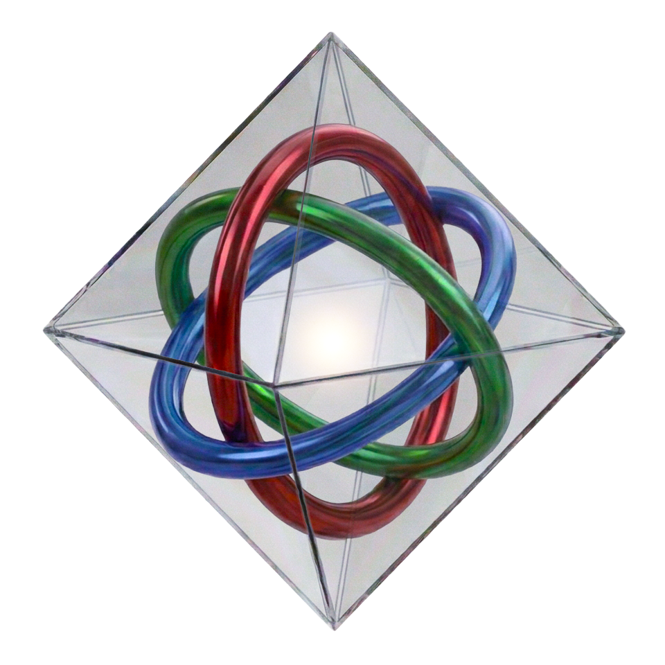

<p align="center">
  
</p>

# The Riemann Hypothesis in Lean 4

[](https://github.com/Nondual-Observer/riemann-lean4-blueprint/actions/workflows/verify.yml)
[](https://doi.org/10.5281/zenodo.24459321)
[-blue.svg)](lean/HypercubeAndLPTheorems.lean)
[-9558B2.svg)](verification/verify_blueprint.jl)
[](LICENSE)
[](LICENSE-DOCS.md)

**[Read in Russian](README_RU.md)** · [One-page PDF (`ONE_PAGE_PROOF_EN.pdf`)](blueprint/ONE_PAGE_PROOF_EN.pdf) · [Outline (`ONE_PAGE_PROOF_EN.md`)](blueprint/ONE_PAGE_PROOF_EN.md) · [Article (`BLUEPRINT_EN.md`)](blueprint/BLUEPRINT_EN.md) · [Article PDF (`BLUEPRINT_EN.pdf`)](blueprint/BLUEPRINT_EN.pdf) · [Kernel index (`KERNEL_INDEX_EN.md`)](blueprint/KERNEL_INDEX_EN.md) · [`Lean 4` module (`44` theorems)](lean/HypercubeAndLPTheorems.lean) · [`Julia` verifier](verification/verify_blueprint.jl) · [Eight expositions](verification/COMPARISON_8_REPOS_EN.md) · [Audit history](verification/AUDIT_HISTORY_EN.md) · [Referee instructions](prompts/AI_REFEREE_PROMPT_EN.md)

---

## Overview and Scope Attribution

On 20 November 2026 Levent Alpöge released a formal proof, written with Claude, of the Riemann hypothesis and its analogue for all Dirichlet $L$-functions. The `Lean 4` archive contains `175,187` files and `17,374,215` lines. The author reports that a generated rendering exceeded `250,000` pages. [Author’s note](https://alpo.ge/remark.pdf) · [Lean and Mathlib statement](https://leanprover-community.github.io/blog/posts/riemann-hypothesis/)

Andrew Sutherland records checks on the compiled `.olean` modules with `leanchecker` and `lean4lean`. The `61.57 GB` export (`solution.ndjson`) was accepted by `nanoda` and `con-leche`. The `--compare` checks match the five statements of `Main.lean` to the challenge. Their axiom lists contain only `propext`, `Classical.choice` and `Quot.sound`. [Verification at MIT](https://math.mit.edu/~drew/grh/)

This edition follows the argument from a bound on prime powers to a statement about zeros. Each part identifies the archive declarations used in that passage.

1. **Formal proof.** Levent Alpöge and Claude (2026) supplied the original `175,187`-file archive.
2. **Exposition and companion results.** Igor M. Zhuk, edition 9.0.
   - Read the five steps on [one page (`blueprint/ONE_PAGE_PROOF_EN.md`)](blueprint/ONE_PAGE_PROOF_EN.md) or in the [print version (`blueprint/ONE_PAGE_PROOF_EN.pdf`)](blueprint/ONE_PAGE_PROOF_EN.pdf). Parts I–V of the [article (`blueprint/BLUEPRINT_EN.md`)](blueprint/BLUEPRINT_EN.md) give the estimates and the order of quantifiers. Source references identify the corresponding `Lean 4` declarations. [Article PDF, `11` pages (`blueprint/BLUEPRINT_EN.pdf`)](blueprint/BLUEPRINT_EN.pdf)
   - The [kernel index (`blueprint/KERNEL_INDEX_EN.md`)](blueprint/KERNEL_INDEX_EN.md) has `240` entries: `233` public declarations in `104` modules and `7` fields or Mathlib entries. Each entry gives `export_id` and a five-bit mask in the `Expr.const` graph of `1,484,733` declarations. The index distinguishes homonyms by namespace.
   - The [`Lean 4.33.1` companion module (`lean/HypercubeAndLPTheorems.lean`)](lean/HypercubeAndLPTheorems.lean) has `0` imports and `0 sorry`. Its `44` public theorems concern matrices, the exponent inequalities, Lubin–Tate rates, the common-weight slope estimate, the map `partner` and integral lattices. Seven families of concrete examples use `Rat` and `Int`.
   - **Zero-dependency standard-library `Julia` verifier ([`verification/verify_blueprint.jl`](verification/verify_blueprint.jl)) and reachability builder ([`verification/build_kernel_reachability_tsv.jl`](verification/build_kernel_reachability_tsv.jl)):** `31` adversarial preflight traps (`--self-gate`), standalone bilingual and `Lean 4.33.1` verification (`--portable`), and full scanning of all `175,187` modules and `1,484,733` kernel rows when the source archive is present (`--full`).

---

## Compression Scale and Reference Metrics

| Representation Layer | Scale | Verification Scope |
|---|---|---|
| Uncompressed kernel export `solution.ndjson` (MIT protocol) | `61.57 GB` (`1,065,214,335` expressions, `1,484,733` declarations) | `1,478,222` reachable declarations from `5` roots in `Main.lean`, `3` standard axioms |
| Five-root reachability table [`kernel_reachability_5roots.tsv.zst`](verification/kernel_reachability_5roots.tsv.zst) | `15.17 MiB` (`1,484,733` rows `mask · id · name`) | Bundled in repository (`SHA-256: 76b00059...`); reproducible via [`build_kernel_reachability_tsv.jl`](verification/build_kernel_reachability_tsv.jl) |
| Raw `Lean 4` source archive (`original.part01..14`) | `239.28 MB` (`175,187` files, `17,374,215` lines) | Scanned end-to-end in `--full` mode (`SHA-256: 9631b4f0...`) |
| Proof spine in [`KERNEL_INDEX_EN.md`](blueprint/KERNEL_INDEX_EN.md) | `104` modules (`233` public declarations + `7` fields/Mathlib = **`240`** entries) | Exact path, line, kind, `export_id`, 5-bit root mask, EN/RU citation and line-range parity |
| One-page proof [`ONE_PAGE_PROOF_EN.md`](blueprint/ONE_PAGE_PROOF_EN.md) | `1` printed page (`ONE_PAGE_PROOF_EN.pdf`) | All five stages, Lubin–Tate height-2 rate, 4-clause Bost–Arakelov squeeze, Four-Wall LP law |
| Mathematical blueprint [`BLUEPRINT_EN.md`](blueprint/BLUEPRINT_EN.md) | `11` printed pages (`BLUEPRINT_EN.pdf`) | Overview, Main Theorem, Parts I–VI, Appendices A.1–A.3, overload glossary B, two vector figures |
| Standalone module [`HypercubeAndLPTheorems.lean`](lean/HypercubeAndLPTheorems.lean) | `0` imports, `0` external libraries, `0 sorry` | `44/44` public theorems + `#print axioms` audit and `7` witness families over `Rat` / `Int` |

---

## Five-Stage Classical Proof Architecture (Parts I–V)

The core analytic obstacle is how to extract a **one-sided upper bound** on the smoothed prime-power sum $G_{\mathcal F}(x) \le x^{1/2 + O(\varepsilon)}$ across arbitrarily distant multiplicative windows $[Z, Z^{3/2}]$ without global sign definiteness:


**Note on Figure 1.** In $(\mathrm{Div})$, the first term on the right is $S_{\rm div}$. The quantity $\mathrm{Data.Main}$ enters after the counting and height terms are combined in Part IV. The ladder has $m$ signatures and $m-1$ lifts.


**Figure 2(a).** The red line gives the exponent $2a$ of $\sum_{j=1}^{m}j=m(m+1)/2\sim m^2/2$.

1. **Sign-free Landau window criterion (Part I):** the normalized Gamma kernel $\frac{\sigma^{k+1}}{k!} u^k e^{-\sigma u}$ concentrates high Mellin derivatives $\Phi^{(k)}$ inside a narrow logarithmic window; an upper bound $G_{\mathcal F}(y) \le C y^\theta$ on arbitrarily far windows $[Y, Y^{1+\delta}]$ rules out zeros of every character in an admissible positive-weight family across $\Re s > \theta$.
2. **CM tower and complex Fourier balance (Part II):** over a biquadratic base of Galois group $E_0 = (\mathbb Z/2\mathbb Z)^2$ and an abelian floor $H$, the bijection $\mathrm{partner}(t, g) = \mathrm{cconj} + g + \mathrm{topPl}(t)$ (with inverse $\mathrm{partner}(-t, \cdot)$, not an involution when $2t \ne 0$) yields the exact complex identity `ch_balance` ($\mathrm{ASK} - \mathrm{MAIN} = \mathrm{De}$), subgroup-averaging projection `sum_Th`, and complement bound `sigA_le` ($K_p \subsetneq \Psi_A$).
3. **Height-2 Lubin–Tate jets and the signature ladder (Part III):** at inert primes $\ell \ge 5$, supersingular CM reduction has a height-2 formal group whose exponential denominators grow at rate $1/(\ell^2 - 1)$ against Legendre's factorial rate $1/(\ell - 1)$, giving net rate $\ell/(\ell^2 - 1) = \sum_{e\,\mathrm{odd}} \ell^{-e}$ (`LemmaSt`, `SmithExists.lean`). Climbing $m \asymp x^{1/2-\varepsilon/16}$ unitary theta lifts reaches positive-definite signature $(r, 0)$ with block-local indexing that avoids the $x^{2/3}$ prefix-compounding barrier.
4. **Four-clause Bost–Arakelov squeeze and Four-Wall LP balance (Part IV):** four coupled inequalities `(Loss)`, `(Gain)`, `(Slope)`, and `(Div)` telescope across Hermitian lattice layers, while `Data.key_identity` cancels $\log(\pi/v)$ and $m\cdot\mathrm{sumA}\cdot\mathrm{lg}$ via Chowla–Selberg CM periods. Subtracting $\mathrm{Data.Main}(u) = \sum_{t \in TT}\sum_{j \in \mathrm{Fin}(m)} \Re\,\mathrm{MAIN}$ from both sides and optimizing at the unique LP vertex $(a, \kappa) = (1/2, 9/2)$ for $(p, q, \nu) = (5, 4, 2)$ brings the window exponent to $1/2 + (e_D + e_L + 7)\varepsilon$.
5. **Descent to the five theorems of `Main.lean` (Part V):** letting $\theta \downarrow 1/2$, stripping imprimitive Euler factors, and reflecting via the functional equation eliminate zeros in $\Re s > 1/2$ and $0 < \Re s < 1/2$, leaving $\Re s = 1/2$ throughout $0 < \Re s < 1$.

### Raw-Archive Pitfalls Resolved in the Index
- **Short-name and filename collisions:** `26` distinct live `adm2` declarations across namespaces, two distinct `ltLog` series (height 2 in `CMGoodModels/Statement.lean:35` vs. height 1 elsewhere), two `SizeData₂` structures, three `MAIN` / `Data.Main` declarations, `BNBounds` (arbitrary finite abelian $H$) vs. `BNBoundsU`, proposition `PairEx` vs. proof `QH.pairEx`, `86` files named `Statement.lean`, `15` named `StatementG.lean`, four named `RamificationTwoAndConjugationAtQAndD.lean`, two named `ChCore.lean`, and source-only `sg` absent from the compiled kernel export.
- **Local symbol overloading:** in `PowFourLeRpowNineHalves.lean:134`, `m := 2 * P.r + 2` denotes the local Bessel grid dimension inside `wBp_of`, not the theta-lift step count `R.m` of `Params.lean`.
- **Bit transposition across carriers:** the additive carrier `E0 × H` (`PartnersToFactorsAt.lean`) and multiplicative carrier `Frame.GG` (`DataHost.lean`) are linked by the group isomorphism `toE` (`RecH.lean:10`, `ToEBij.lean:37`), which swaps the first two bits (`(a₁, a₂) ↦ ((-1)^{a₂}, (-1)^{a₁})`).

---

## Secondary Research Arcs (Part VI and Appendix A.3)

The classical exposition is completely self-contained in **Parts I–V**. Two independent companion arcs are strictly separated and carry explicit epistemic tags:

1. **Structural Comparisons via Distinction Observable Theory (`DOT`, Part VI) and the $[0, 1]^4$ Hypercube Rigidity Theorem:**
   - Functional-equation reflection $s \leftrightarrow 1 - s$ is blind to symmetric off-line zero quartets $\frac{1}{2} \pm \sigma \pm i\gamma$ in the exact same structural sense in which Boolean complementation $q \mapsto 1 - q$ on $[0, 1]^4$ is blind to weight pairs $(1, 3)$; isolating the midline requires an independent **positivity cone**.
   - Section VI.1 proves analytically and formally in [`lean/HypercubeAndLPTheorems.lean`](lean/HypercubeAndLPTheorems.lean) the **continuous hypercube $[0, 1]^4$ projector theorem**: by the Walsh–Bloch trace identity
     $$\operatorname{tr}\bigl(E(q) - E(q)^2\bigr) = 4\bigl(t - t^2 - \|\mathbf e\|_2^2\bigr) = \sum_{i=1}^4 q_i(1 - q_i),$$
     the image of the entire continuous hypercube $[0, 1]^4$ contains **no additional orthogonal projectors**. There are strictly **`8`** in total ($0$, $I_4$, and strictly **`6`** projectors of real rank $2$, forming the vertices of the regular $\ell_1$-octahedron $O_6$ inscribed inside the Bloch sphere $\|\mathbf e\|_2 = 1/2$), whereas a continuous $S^2$ of projectors appears only across the full Clifford interval $0 \le E \le I_4$ outside $[0, 1]^4$.
   - Canonical open repository of Distinction Observable Theory (`DOT`): [`Nondual-Observer/DOTheory`](https://github.com/Nondual-Observer/DOTheory).
2. **Open Rank-$2$ Determinant Target over $\mathbb Q(\sqrt{-7})$ (Appendix A.3):**
   - The simultaneous critical-line statements for $\zeta(s)$ and $L(s, \chi_{-7})$ are equivalent to a window estimate for the integer $2 \times 2$ ideal-norm determinant $N I_{M_j}(j)$. The computation in `Julia` covers determinants of up to `7,079` bits. A direct proof of the rank-$2$ estimate without the rank-$\asymp x^{9/2}$ theta tower remains open.

---

## Quick Start and Reproducible Verification

Requirements: `Lean 4.33.1` (via `elan`, pinned by [`lean-toolchain`](lean-toolchain)) and standard `Julia 1.12+` (**zero external packages**). For `--full` mode, standard system utilities `cat`, `gzip`, and `zstd` are required together with a directory `RH_ARCHIVE_DIR` holding the 14 archive volumes named `original.part01` … `original.part14` (or a single `original.tar.gz` matching `SHA-256 = 9631b4f0...`; the five-root reachability table [`verification/kernel_reachability_5roots.tsv.zst`](verification/kernel_reachability_5roots.tsv.zst) is bundled in the repository and can be rebuilt from scratch from `solution.ndjson` via [`verification/build_kernel_reachability_tsv.jl`](verification/build_kernel_reachability_tsv.jl)).

```bash
# 1. Verify SHA-256 cryptographic checksums of all repository files:
shasum -a 256 -c SHA256SUMS.txt

# 2. Compile the standalone Lean 4.33.1 module directly (0 imports, 0 sorry, 44/44 #print axioms):
lean lean/HypercubeAndLPTheorems.lean

# 3. Run the 31-trap adversarial preflight self-gate (including live Lean 4.33.1):
OPENBLAS_NUM_THREADS=1 JULIA_NUM_THREADS=1 JULIA_LOAD_PATH=@stdlib \
  julia --startup-file=no -t1 verification/verify_blueprint.jl --self-gate

# 4. Run portable verification of finite mathematics, bilingual coverage, and Lean 4 axioms (no archive needed):
OPENBLAS_NUM_THREADS=1 JULIA_NUM_THREADS=1 JULIA_LOAD_PATH=@stdlib \
  julia --startup-file=no -t1 verification/verify_blueprint.jl --portable

# 5. Full scan of all 175,187 Lean 4 modules and 1,484,733 kernel declarations (with original.part01..14):
OPENBLAS_NUM_THREADS=1 JULIA_NUM_THREADS=1 JULIA_LOAD_PATH=@stdlib \
  RH_ARCHIVE_DIR=/path/to/archive julia --startup-file=no -t1 verification/verify_blueprint.jl --full
```

---

## Repository Structure

```text
├── .github/workflows/verify.yml                 # Automated CI (Lean 4.33.1 + Julia stdlib + SHA-256)
├── README.md                                    # Primary overview, proof architecture, and quick start (EN)
├── README_RU.md                                 # Russian overview (RU)
├── CITATION.cff                                 # Citation metadata (CFF 1.2.0)
├── LICENSE                                      # Apache License 2.0 (for Lean 4 and Julia code)
├── LICENSE-DOCS.md                              # CC BY 4.0 (for blueprint text and index tables)
├── lean-toolchain                               # Pins compiler leanprover/lean4:v4.33.1
├── assets/
│   ├── octahedron_borromean_emblem.png          # Transparent emblem (octahedron & RGB Borromean rings)
│   ├── social_preview_1280x640.png              # 2:1 Open Graph / X social preview card
│   ├── fig1_architecture_{en,ru}.{svg,pdf}      # Vector proof-architecture flowchart
│   └── fig2_balance_lp_{en,ru}.{svg,pdf}        # Vector 2/3-vs-1/2 & Four-Wall LP phase diagram
├── blueprint/
│   ├── ONE_PAGE_PROOF_EN.md                     # Standalone 1-page classical proof account (EN)
│   ├── ONE_PAGE_PROOF_EN.pdf                    # Strictly 1-page printable PDF (EN)
│   ├── ONE_PAGE_PROOF_RU.md                     # Standalone 1-page classical proof account (RU)
│   ├── ONE_PAGE_PROOF_RU.pdf                    # Strictly 1-page printable PDF (RU)
│   ├── BLUEPRINT_EN.md                          # Full mathematical blueprint (Parts I–VI, Appendices A–B, EN)
│   ├── BLUEPRINT_EN.pdf                         # Printable typeset PDF generated from BLUEPRINT_EN.md (11 pp.)
│   ├── BLUEPRINT_RU.md                          # Full mathematical blueprint (Parts I–VI, Appendices A–B, RU)
│   ├── BLUEPRINT_RU.pdf                         # Printable typeset PDF generated from BLUEPRINT_RU.md (12 pp.)
│   ├── KERNEL_INDEX_EN.md                       # 240-entry Lean 4 kernel index and collision ledger (EN)
│   └── KERNEL_INDEX_RU.md                       # 240-entry Lean 4 kernel index and collision ledger (RU)
├── lean/
│   └── HypercubeAndLPTheorems.lean              # Standalone Lean 4.33.1 module (0 imports, 0 sorry, 44 theorems)
├── scripts/
│   ├── build_figures.py                         # Deterministic SVG/PDF vector figure generator
│   ├── build_pdfs.py                            # PDF builder (Pandoc, Tectonic and pdfinfo or pypdf)
│   ├── blueprint_pdf.lua                        # Pandoc Lua filter for Lean 4 line breaks and theorem boxes
│   └── blueprint_header.tex                     # Academic XeLaTeX/Tectonic preamble (CMU Serif + DejaVu Mono)
├── verification/
│   ├── verify_blueprint.jl                      # Unified zero-dependency stdlib Julia verification suite
│   ├── build_kernel_reachability_tsv.jl         # Standalone builder of the 5-root TSV from solution.ndjson
│   ├── kernel_reachability_5roots.tsv.zst       # 1,484,733-row 5-root kernel reachability table (SHA-256: 76b00059...)
│   ├── COMPARISON_8_REPOS_EN.md                 # Comparative audit of 8 public exposition repositories (EN)
│   ├── COMPARISON_8_REPOS_RU.md                 # Comparative audit of 8 public exposition repositories (RU)
│   ├── AUDIT_HISTORY_EN.md                      # Full verification log and 44-theorem Lean 4 ledger (EN)
│   └── AUDIT_HISTORY_RU.md                      # Full verification log and 44-theorem Lean 4 ledger (RU)
├── prompts/
│   ├── AI_REFEREE_PROMPT_EN.md                  # Ready-to-copy adversarial AI referee prompt (EN)
│   └── AI_REFEREE_PROMPT_RU.md                  # Ready-to-copy adversarial AI referee prompt (RU)
└── SHA256SUMS.txt                               # Cryptographic manifest of all repository files
```

---

## Primary Sources and References

1. **L. Alpöge** (with Claude), Author’s note accompanying the source archive, Nov 20, 2026: https://alpo.ge/remark.pdf (source archive `SHA-256`: `9631b4f020199e580ba86178cb56c6e9b09f690c2369a80dc4334aa93f49c7fc`).
2. **A. V. Sutherland** (MIT), *Verification files for the Lean proof of the Riemann Hypothesis*, Nov 2026: https://math.mit.edu/~drew/grh/ (uncompressed `solution.ndjson` `SHA-256`: `5ea74b912147c5c93cc2b6d70cc727cf908df2f62ac6a20480a3fa02f6be244e`).
3. **Lean and Mathlib Community**, *Lean verification of the Riemann Hypothesis*, Nov 2026: https://leanprover-community.github.io/blog/posts/riemann-hypothesis/.
4. **E. Landau**, *Über einen Satz von Tschebyschef*, Math. Ann. **61** (1905), 527–550.
5. **S. Chowla, A. Selberg**, *On Epstein's zeta-function*, J. Reine Angew. Math. **227** (1967), 86–110.
6. **S. S. Kudla, J. J. Millson**, *Intersection numbers of cycles on locally symmetric spaces and Fourier coefficients of holomorphic modular forms in several complex variables*, Publ. Math. IHÉS **71** (1990), 121–172; **R. E. Borcherds**, *Automorphic forms with singularities on Grassmannians*, Invent. Math. **132** (1998), 491–562.
7. **L. Grenié, G. Molteni**, *Explicit versions of the prime ideal theorem for Dedekind zeta functions under GRH*, Math. Comp. **85** (2016), 889–906 (`arXiv:1312.4463`); **L. Faber, H. Kadiri**, *New bounds for $\psi(x)$*, Math. Comp. **84** (2015), 1339–1357 ([arXiv:1310.6374](https://arxiv.org/abs/1310.6374), with the 2018 corrigendum).
8. **P. Massot**, *leanblueprint*; **A. Kontorovich, T. Tao et al.**, *PrimeNumberTheoremAnd* (`Lean 4` blueprint project).
9. **Igor M. Zhuk**, *DOT: Distinction Observable Theory*: https://github.com/Nondual-Observer/DOTheory.

---

## Citation and Authorship

- **Author of the mathematical blueprint, kernel index, and verification suite:** Igor M. Zhuk · [ORCID `0009-0003-1670-8388`](https://orcid.org/0009-0003-1670-8388) · [GitHub `@Nondual-Observer`](https://github.com/Nondual-Observer).
- **Zenodo Preprint (Blueprint Edition `9.0`, 4 PDFs):** [DOI `10.5281/zenodo.24459321`](https://doi.org/10.5281/zenodo.24459321) (Concept DOI: [`10.5281/zenodo.24459320`](https://doi.org/10.5281/zenodo.24459320)).
- The software release is `1.0.0`. The blueprint edition is `9.0`. Citation metadata is provided in [`CITATION.cff`](CITATION.cff). Code is licensed under [`Apache-2.0`](LICENSE); documentation and blueprint tables are licensed under [`CC BY 4.0`](LICENSE-DOCS.md).
