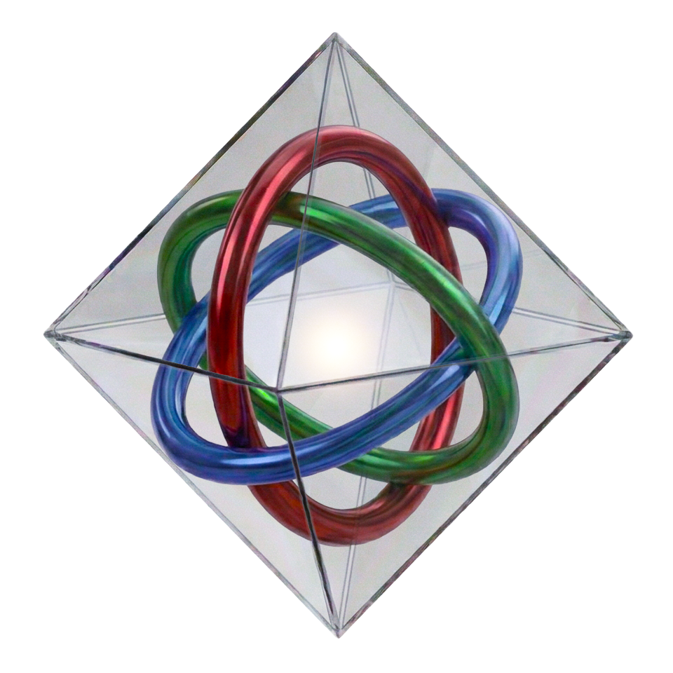
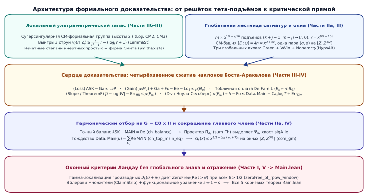
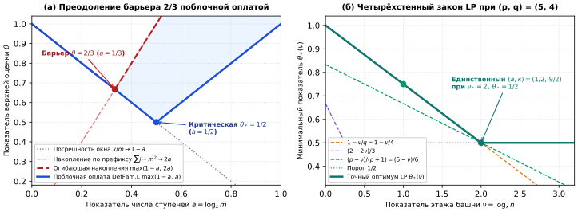

<p align="center">
  
</p>

# Гипотеза Римана в Lean 4

[](https://github.com/Nondual-Observer/riemann-lean4-blueprint/actions/workflows/verify.yml)
[](https://doi.org/10.5281/zenodo.24459321)
[-blue.svg)](lean/HypercubeAndLPTheorems.lean)
[-9558B2.svg)](verification/verify_blueprint.jl)
[](LICENSE)
[](LICENSE-DOCS.md)

**[English version (README.md)](README.md)** · **[Доказательство на 1 странице PDF (`ONE_PAGE_PROOF_RU.pdf`)](blueprint/ONE_PAGE_PROOF_RU.pdf)** · **[На 1 странице (`ONE_PAGE_PROOF_RU.md`)](blueprint/ONE_PAGE_PROOF_RU.md)** · **[Полный чертёж (`BLUEPRINT_RU.md`)](blueprint/BLUEPRINT_RU.md)** · **[Полный PDF (`BLUEPRINT_RU.pdf`)](blueprint/BLUEPRINT_RU.pdf)** · **[Указатель 240 записей ядра (`KERNEL_INDEX_RU.md`)](blueprint/KERNEL_INDEX_RU.md)** · **[Модуль `Lean 4` (`44` теоремы)](lean/HypercubeAndLPTheorems.lean)** · **[Стенд `Julia`](verification/verify_blueprint.jl)** · **[Сравнение 8 репозиториев](verification/COMPARISON_8_REPOS_RU.md)** · **[Журнал верификации](verification/AUDIT_HISTORY_RU.md)** · **[Промпт ИИ-ревизора](prompts/AI_REFEREE_PROMPT_RU.md)**

---

## О проекте и разграничении ролей

20 ноября 2026 года Левент Альпёге опубликовал доказательство гипотезы Римана и её аналога для всех $L$-функций Дирихле, записанное совместно с Claude. Архив `Lean 4` содержит `175 187` файлов и `17 374 215` строк. По сообщению автора, автоматически развёрнутая запись заняла более `250 000` страниц. [Заметка автора](https://alpo.ge/remark.pdf) · [Сообщение Lean и Mathlib](https://leanprover-community.github.io/blog/posts/riemann-hypothesis/)

Эндрю Сазерленд приводит результаты проверки скомпилированных модулей с помощью `leanchecker` и `lean4lean`. Полный экспорт `solution.ndjson` (`61.57 ГБ`) приняли `nanoda` и `con-leche`. Режим `--compare` сопоставляет пять утверждений `Main.lean` с исходными формулировками. В их списках аксиом встречаются только `propext`, `Classical.choice` и `Quot.sound`. [Протокол проверки в MIT](https://math.mit.edu/~drew/grh/)

Это издание прослеживает путь от оценки суммы по степеням простых до утверждения о нулях. Каждая часть указывает объявления архива, на которые опирается переход.

1. **Формальное доказательство.** Левент Альпёге и Claude (2026) подготовили исходный архив из `175 187` модулей.
2. **Изложение и сопроводительные теоремы.** И. М. Жук, редакция 9.0.
   - Пять шагов уместились [на одном листе (`blueprint/ONE_PAGE_PROOF_RU.md`)](blueprint/ONE_PAGE_PROOF_RU.md). Доступна [версия для печати (`blueprint/ONE_PAGE_PROOF_RU.pdf`)](blueprint/ONE_PAGE_PROOF_RU.pdf). В частях I–V [статьи (`blueprint/BLUEPRINT_RU.md`)](blueprint/BLUEPRINT_RU.md) приведены оценки и порядок кванторов. Ссылки указывают соответствующие объявления `Lean 4`. [Статья в печати, `12` стр. (`blueprint/BLUEPRINT_RU.pdf`)](blueprint/BLUEPRINT_RU.pdf)
   - В [указателе (`blueprint/KERNEL_INDEX_RU.md`)](blueprint/KERNEL_INDEX_RU.md) `240` записей. Из них `233` объявления в `104` модулях и ещё `7` полей структур или записей Mathlib. Для каждой даны `export_id` и пятибитная маска в графе `Expr.const` из `1 484 733` объявлений. Одноимённые термы различаются по пространству имён.
   - [Сопроводительный модуль `Lean 4.33.1` (`lean/HypercubeAndLPTheorems.lean`)](lean/HypercubeAndLPTheorems.lean) содержит `0` импортов и `0 sorry`. Его `44` теоремы описывают матрицы, ограничения на показатели, скорости Любина–Тейта, среднее наклонов с общими весами, отображение `partner` и целые решётки. Семь семейств примеров заданы над `Rat` и `Int`.
   - **Единый zero-dependency стенд проверки на стандартной библиотеке `Julia` ([`verification/verify_blueprint.jl`](verification/verify_blueprint.jl)) и построитель таблицы достижимости ([`verification/build_kernel_reachability_tsv.jl`](verification/build_kernel_reachability_tsv.jl)):** предпусковой контроль из `31` враждебной ловушки (`--self-gate`), автономная проверка обеих языковых версий и компиляции `Lean 4.33.1` (`--portable`) и полное сканирование всех `175 187` модулей и `1 484 733` строк ядра при наличии локального архива (`--full`).

---

## Масштаб сжатия и опорные числа

| Уровень представления | Объём | Что проверяется |
|---|---|---|
| Распакованный ядерный экспорт `solution.ndjson` (протокол MIT) | `61.57 ГБ` (`1 065 214 335` выражений, `1 484 733` объявлений) | `1 478 222` достижимых объявления от `5` теорем `Main.lean`, `3` стандартные аксиомы |
| Таблица достижимости [`kernel_reachability_5roots.tsv.zst`](verification/kernel_reachability_5roots.tsv.zst) | `15.17 МиБ` (`1 484 733` строк `маска · id · имя`) | Включена в репозиторий (`SHA-256: 76b00059...`); пересобирается скриптом [`build_kernel_reachability_tsv.jl`](verification/build_kernel_reachability_tsv.jl) |
| Первичный архив исходников `Lean 4` (`original.part01..14`) | `239.28 МБ` (`175 187` файлов, `17 374 215` строк) | Полностью сканируется в режиме `--full` (`SHA-256: 9631b4f0...`) |
| Опорный позвоночник доказательства в [`KERNEL_INDEX_RU.md`](blueprint/KERNEL_INDEX_RU.md) | `104` модуля (`233` публичных объявления + `7` полей/Mathlib = **`240`** записей) | Точный путь, строка, категория, `export_id`, 5-битная маска корней, двуязычный паритет ссылок и диапазонов |
| Одностраничное доказательство [`ONE_PAGE_PROOF_RU.md`](blueprint/ONE_PAGE_PROOF_RU.md) | `1` печатная страница (`ONE_PAGE_PROOF_RU.pdf`) | Все пять этапов, скорость Любина–Тейта высоты 2, 4-звенное сжатие Боста–Аракелова, закон LP |
| Математический чертёж [`BLUEPRINT_RU.md`](blueprint/BLUEPRINT_RU.md) | `12` печатных страниц (`BLUEPRINT_RU.pdf`) | Панорама, Основная теорема, Части I–VI, Приложения А.1–А.3, словарь перегрузок Б, две векторные схемы |
| Автономный модуль [`HypercubeAndLPTheorems.lean`](lean/HypercubeAndLPTheorems.lean) | `0` импортов, `0` внешних библиотек, `0 sorry` | `44/44` публичных теорем + проверка `#print axioms` и семи семейств свидетелей над `Rat` и `Int` |

---

## Архитектура классического доказательства (Части I–V)

Центральная аналитическая трудность задачи состоит в том, как получить **одностороннюю верхнюю оценку** сглаженной суммы по простым степеням $G_{\mathcal F}(x) \le x^{1/2 + O(\varepsilon)}$ сразу на сколь угодно далёких мультипликативных окнах $[Z, Z^{3/2}]$, не располагая глобальной знаковой определённостью остатка. Доказательство решает эту задачу за пять шагов:



**Примечание к рисунку 1.** В $(\mathrm{Div})$ первый член справа равен $S_{\rm div}$. Величина $\mathrm{Data.Main}$ появляется после объединения оценки числа слов с оценкой высоты в части IV. Лестница содержит $m$ сигнатур и $m-1$ подъёмов.



**Рисунок 2(а).** Красная пунктирная прямая показывает показатель $2a$ суммы $\sum_{j=1}^{m}j=m(m+1)/2\sim m^2/2$.

1. **Оконный критерий Ландау без глобального знака (Часть I):** нормированное гамма-ядро $\frac{\sigma^{k+1}}{k!} u^k e^{-\sigma u}$ концентрирует высокие производные преобразования Меллина $\Phi^{(k)}$ в узком логарифмическом окне; верхняя оценка $G_{\mathcal F}(y) \le C y^\theta$ на сколь угодно далёких окнах $[Y, Y^{1+\delta}]$ исключает нули всех характеров допустимого семейства в полуплоскости $\Re s > \theta$.
2. **Башня CM-полей и комплексный баланс Фурье (Часть II):** над биквадратичной базой с группой Галуа $E_0 = (\mathbb Z/2\mathbb Z)^2$ и абелевым этажом $H$ биекция $\mathrm{partner}(t, g) = \mathrm{cconj} + g + \mathrm{topPl}(t)$ (с обратной $\mathrm{partner}(-t, \cdot)$, не инволюция при $2t \ne 0$) даёт точное тождество `ch_balance` ($\mathrm{ASK} - \mathrm{MAIN} = \mathrm{De}$), проектор усреднения по подгруппе `sum_Th` и оценку дополнения `sigA_le` ($K_p \subsetneq \Psi_A$).
3. **Струи Любина–Тейта высоты 2 и лестница сигнатур (Часть III):** в инертных простых $\ell \ge 5$ суперсингулярная редукция CM-кривой имеет формальную группу высоты 2, чья экспонента накапливает знаменатели со скоростью $1/(\ell^2 - 1)$ против скорости Лежандра $1/(\ell - 1)$, давая чистую скорость $\ell/(\ell^2 - 1) = \sum_{e\,\text{нечётно}} \ell^{-e}$ (`LemmaSt`, `SmithExists.lean`). Подъём вдоль $m \asymp x^{1/2-\varepsilon/16}$ ступеней унитарных тета-подъёмов приводит к положительно определённой сигнатуре $(r, 0)$ с поблочной индексацией, устраняющей барьер $x^{2/3}$.
4. **Четырёхзвенное сжатие Боста–Аракелова и четырёхстенный баланс (Часть IV):** четыре неравенства `(Loss)`, `(Gain)`, `(Slope)` и `(Div)` телескопически складываются вдоль слоёв эрмитовых решёток, а в тождестве `Data.key_identity` сокращаются логарифмические периоды $\log(\pi/v)$ и член с $\mathrm{lg}$ по формуле Чоулы–Сельберга. Вычитание двойной вещественной суммы $\mathrm{Data.Main}(u) = \sum_{t \in TT}\sum_{j \in \mathrm{Fin}(m)} \Re\,\mathrm{MAIN}$ из обеих частей и единственная вершина $(a, \kappa) = (1/2, 9/2)$ задачи LP при $(p, q, \nu) = (5, 4, 2)$ доводят показатель окна до $1/2 + (e_D + e_L + 7)\varepsilon$.
5. **Спуск к пяти теоремам `Main.lean` (Часть V):** переход к произвольному $\theta > 1/2$, снятие эйлеровых множителей непримитивных характеров и отражение по функциональному уравнению исключают нули при $\Re s > 1/2$ и $0 < \Re s < 1/2$, оставляя внутри открытой критической полосы прямую $\Re s = 1/2$.

### Критические ловушки сырого архива, снятые в указателе
- **Коллизии коротких имён и файлов:** `26` различных живых объявлений `adm2` в разных пространствах имён, два разных ряда `ltLog` (высоты 2 в `CMGoodModels/Statement.lean:35` против высоты 1 в другом модуле), два разных `SizeData₂`, три разных `MAIN` / `Data.Main`, различие `BNBounds` (произвольная конечная абелева $H$) и `BNBoundsU`, различие предиката `PairEx` и теоремы `QH.pairEx`, `86` файлов `Statement.lean`, `15` файлов `StatementG.lean`, четыре файла `RamificationTwoAndConjugationAtQAndD.lean`, два `ChCore.lean`, а также определение `sg`, отсутствующее в скомпилированном экспорте ядра.
- **Локальная перегрузка букв:** в `PowFourLeRpowNineHalves.lean:134` переменная `m := 2 * P.r + 2` обозначает размерность бесселевой сетки внутри `wBp_of`, а не число ступеней тета-подъёмов `R.m` из `Params.lean`.
- **Перестановка битов между носителями:** переход между аддитивным носителем `E0 × H` (`PartnersToFactorsAt.lean`) и мультипликативным `Frame.GG` (`DataHost.lean`) задаётся групповым изоморфизмом `toE` (`RecH.lean:10`, `ToEBij.lean:37`), переставляющим первые два бита (`(a₁, a₂) ↦ ((-1)^{a₂}, (-1)^{a₁})`).

---

## Второстепенные исследовательские арки (Часть VI и Приложение А.3)

Классическое изложение доказательства полностью сосредоточено и замкнуто в **Частях I–V**. Две дополнительные исследовательские линии строго отделены от основного маршрута и снабжены явной маркировкой статуса утверждений:

1. **Структурные сопоставления с Теорией Наблюдаемого Различения (ТНР, Часть VI) и теорема о жёсткости гиперкуба $[0, 1]^4$:**
   - Инволюция функционального уравнения $s \leftrightarrow 1 - s$ на критической прямой слепа к симметричным четвёркам нулей $\frac{1}{2} \pm \sigma \pm i\gamma$ точно так же, как булево дополнение $q \mapsto 1 - q$ на четырёхмерном кубе $[0, 1]^4$ слепо к парам весов $(1, 3)$; выделение середины в обеих задачах требует отдельного **конуса положительности**.
   - В § VI.1 аналитически и формально в [`lean/HypercubeAndLPTheorems.lean`](lean/HypercubeAndLPTheorems.lean) доказана **теорема о проекторах непрерывного гиперкуба $[0, 1]^4$**: в силу тождества Уолша–Блоха
     $$\operatorname{tr}\bigl(E(q) - E(q)^2\bigr) = 4\bigl(t - t^2 - \|\mathbf e\|_2^2\bigr) = \sum_{i=1}^4 q_i(1 - q_i)$$
     в образе всего непрерывного гиперкуба $[0, 1]^4$ нет ни одного дополнительного ортогонального проектора. Их ровно **`8`** ($0$, $I_4$ и строго **`6`** проекторов вещественного ранга $2$, образующих вершины правильного $\ell_1$-октаэдра $O_6$, вписанного в сферу Блоха $\|\mathbf e\|_2 = 1/2$), тогда как непрерывная сфера проекторов возникает лишь во всём операторном интервале Клиффорда $0 \le E \le I_4$ за пределами $[0, 1]^4$.
   - Основной открытый репозиторий Теории Наблюдаемого Различения: https://github.com/Nondual-Observer/DOTheory.
2. **Открытая задача ранга $2$ над $\mathbb Q(\sqrt{-7})$ (Приложение А.3):**
   - Гипотезы о критической прямой для $\zeta(s)$ и $L(s, \chi_{-7})$ вместе равносильны оконной оценке одного целого определителя нормы идеала $N I_{M_j}(j)$ размера $2 \times 2$. В `Julia` проверены определители до `7 079` бит. Прямой вывод этой оценки без башни тета-подъёмов ранга $\asymp x^{9/2}$ остаётся открытой задачей.

---

## Быстрый старт и воспроизведение проверок

Требования: `Lean 4.33.1` (через `elan`, автоматически читает [`lean-toolchain`](lean-toolchain)) и стандартный `Julia 1.12+` (**ноль внешних пакетов**). Для полного режима `--full` дополнительно требуются стандартные системные утилиты `cat`, `gzip` и `zstd`, а также локальная папка `RH_ARCHIVE_DIR`, содержащая 14 частей авторского архива под именами `original.part01` … `original.part14` (либо слитный `original.tar.gz` с суммой `SHA-256 = 9631b4f0...`; таблица достижимости [`verification/kernel_reachability_5roots.tsv.zst`](verification/kernel_reachability_5roots.tsv.zst) уже включена в репозиторий и при желании пересобирается из `solution.ndjson` скриптом [`verification/build_kernel_reachability_tsv.jl`](verification/build_kernel_reachability_tsv.jl)).

```bash
# 1. Проверка криптографической целостности всех файлов репозитория:
shasum -a 256 -c SHA256SUMS.txt

# 2. Прямая компиляция автономного модуля Lean 4.33.1 (0 импортов, 0 sorry, 44/44 #print axioms):
lean lean/HypercubeAndLPTheorems.lean

# 3. Предпусковой контроль 31 враждебной ловушки (включая живой Lean 4.33.1):
OPENBLAS_NUM_THREADS=1 JULIA_NUM_THREADS=1 JULIA_LOAD_PATH=@stdlib \
  julia --startup-file=no -t1 verification/verify_blueprint.jl --self-gate

# 4. Переносная проверка конечной математики, двуязычного покрытия и аксиом Lean 4 (без архива Альпёге):
OPENBLAS_NUM_THREADS=1 JULIA_NUM_THREADS=1 JULIA_LOAD_PATH=@stdlib \
  julia --startup-file=no -t1 verification/verify_blueprint.jl --portable

# 5. Полное сканирование 175 187 модулей и 1 484 733 объявлений ядра (при наличии original.part01..14):
OPENBLAS_NUM_THREADS=1 JULIA_NUM_THREADS=1 JULIA_LOAD_PATH=@stdlib \
  RH_ARCHIVE_DIR=/путь/к/архиву julia --startup-file=no -t1 verification/verify_blueprint.jl --full
```

---

## Структура репозитория

```text
├── .github/workflows/verify.yml                 # Автоматический CI (Lean 4.33.1 + Julia stdlib + SHA-256)
├── README.md                                    # Англоязычный обзор (EN)
├── README_RU.md                                 # Русскоязычный обзор, архитектура и быстрый старт (RU)
├── CITATION.cff                                 # Метаданные цитирования (CFF 1.2.0)
├── LICENSE                                      # Apache License 2.0 (для кода на Lean 4, Julia и скриптов)
├── LICENSE-DOCS.md                              # CC BY 4.0 (для текста чертежей, таблиц и схем)
├── lean-toolchain                               # Фиксация компилятора leanprover/lean4:v4.33.1
├── assets/
│   ├── octahedron_borromean_emblem.png          # Эмблема (октаэдр и борромеевы кольца)
│   ├── social_preview_1280x640.png              # Карточка предпросмотра 2:1 (Open Graph / X)
│   ├── fig1_architecture_{en,ru}.{svg,pdf}      # Векторная схема архитектуры доказательства
│   └── fig2_balance_lp_{en,ru}.{svg,pdf}        # Векторная диаграмма преодоления барьера 2/3 и закона LP
├── blueprint/
│   ├── ONE_PAGE_PROOF_EN.md                     # Автономное доказательство на 1 странице (EN)
│   ├── ONE_PAGE_PROOF_EN.pdf                    # Печатный лист строго на 1 страницу (EN)
│   ├── ONE_PAGE_PROOF_RU.md                     # Автономное доказательство на 1 странице (RU)
│   ├── ONE_PAGE_PROOF_RU.pdf                    # Печатный лист строго на 1 страницу (RU)
│   ├── BLUEPRINT_EN.md                          # Полный математический чертёж (Части I–VI, Приложения A–B, EN)
│   ├── BLUEPRINT_EN.pdf                         # Печатный PDF из BLUEPRINT_EN.md (11 стр.)
│   ├── BLUEPRINT_RU.md                          # Полный математический чертёж (Части I–VI, Приложения А–Б, RU)
│   ├── BLUEPRINT_RU.pdf                         # Печатный PDF из BLUEPRINT_RU.md (12 стр.)
│   ├── KERNEL_INDEX_EN.md                       # Указатель 240 записей ядра Lean 4 и реестр коллизий (EN)
│   └── KERNEL_INDEX_RU.md                       # Указатель 240 записей ядра Lean 4 и реестр коллизий (RU)
├── lean/
│   └── HypercubeAndLPTheorems.lean              # Автономный модуль Lean 4.33.1 (0 импортов, 0 sorry, 44 теоремы)
├── scripts/
│   ├── build_figures.py                         # Генератор векторных фигур SVG/PDF
│   ├── build_pdfs.py                            # Сборка PDF (Pandoc, Tectonic и pdfinfo или pypdf)
│   ├── blueprint_pdf.lua                        # Lua-фильтр Pandoc для переносов имён Lean 4 и рамок теорем
│   └── blueprint_header.tex                     # Академическая преамбула XeLaTeX/Tectonic (CMU Serif + DejaVu Mono)
├── verification/
│   ├── verify_blueprint.jl                      # Единый stdlib-верификатор на чистом Julia
│   ├── build_kernel_reachability_tsv.jl         # Построитель таблицы достижимости 5 корней из solution.ndjson
│   ├── kernel_reachability_5roots.tsv.zst       # Таблица достижимости 1 484 733 строк (SHA-256: 76b00059...)
│   ├── COMPARISON_8_REPOS_EN.md                 # Сравнительный разбор 8 открытых репозиториев (EN)
│   ├── COMPARISON_8_REPOS_RU.md                 # Сравнительный разбор 8 открытых репозиториев (RU)
│   ├── AUDIT_HISTORY_EN.md                      # Журнал верификации и реестр 44 теорем Lean 4 (EN)
│   └── AUDIT_HISTORY_RU.md                      # Журнал верификации и реестр 44 теорем Lean 4 (RU)
├── prompts/
│   ├── AI_REFEREE_PROMPT_EN.md                  # Промпт для независимого ИИ-ревизора (EN)
│   └── AI_REFEREE_PROMPT_RU.md                  # Промпт для независимого ИИ-ревизора (RU)
└── SHA256SUMS.txt                               # Криптографический манифест всех файлов репозитория
```

---

## Первоисточники и литература

1. **L. Alpöge** (with Claude), Авторское сообщение, приложенное к архиву доказательства, Nov 20, 2026: https://alpo.ge/remark.pdf (`SHA-256` архива исходников: `9631b4f020199e580ba86178cb56c6e9b09f690c2369a80dc4334aa93f49c7fc`).
2. **A. V. Sutherland** (MIT), *Verification files for the Lean proof of the Riemann Hypothesis*, Nov 2026: https://math.mit.edu/~drew/grh/ (`SHA-256` распакованного экспорта `solution.ndjson`: `5ea74b912147c5c93cc2b6d70cc727cf908df2f62ac6a20480a3fa02f6be244e`).
3. **Сообщества Lean и Mathlib**, *Lean verification of the Riemann Hypothesis*, ноябрь 2026: https://leanprover-community.github.io/blog/posts/riemann-hypothesis/.
4. **E. Landau**, *Über einen Satz von Tschebyschef*, Math. Ann. **61** (1905), 527–550.
5. **S. Chowla, A. Selberg**, *On Epstein's zeta-function*, J. Reine Angew. Math. **227** (1967), 86–110.
6. **S. S. Kudla, J. J. Millson**, *Intersection numbers of cycles on locally symmetric spaces and Fourier coefficients of holomorphic modular forms in several complex variables*, Publ. Math. IHÉS **71** (1990), 121–172; **R. E. Borcherds**, *Automorphic forms with singularities on Grassmannians*, Invent. Math. **132** (1998), 491–562.
7. **L. Grenié, G. Molteni**, *Explicit versions of the prime ideal theorem for Dedekind zeta functions under GRH*, Math. Comp. **85** (2016), 889–906 (`arXiv:1312.4463`); **L. Faber, H. Kadiri**, *New bounds for $\psi(x)$*, Math. Comp. **84** (2015), 1339–1357 ([arXiv:1310.6374](https://arxiv.org/abs/1310.6374), с поправкой 2018 года).
8. **P. Massot**, *leanblueprint*; **A. Kontorovich, T. Tao et al.**, *PrimeNumberTheoremAnd* (`Lean 4` blueprint project).
9. **И. М. Жук**, *Теория Наблюдаемого Различения (ТНР)*: [канонический открытый репозиторий](https://github.com/Nondual-Observer/DOTheory).

---

## Цитирование и авторство

- **Автор математического чертежа, указателя ядра и верификационного кода:** Игорь Михайлович Жук · [ORCID `0009-0003-1670-8388`](https://orcid.org/0009-0003-1670-8388) · [GitHub `@Nondual-Observer`](https://github.com/Nondual-Observer).
- **Препринт на Zenodo (редакция чертежа `9.0`, 4 PDF):** [DOI `10.5281/zenodo.24459321`](https://doi.org/10.5281/zenodo.24459321) (общий DOI всех редакций: [`10.5281/zenodo.24459320`](https://doi.org/10.5281/zenodo.24459320)).
- Программный выпуск `1.0.0` сопровождает редакцию статьи `9.0`. Реквизиты для библиографических менеджеров приведены в файле [`CITATION.cff`](CITATION.cff). Код распространяется по лицензии [`Apache-2.0`](LICENSE), документация по лицензии [`CC BY 4.0`](LICENSE-DOCS.md).
