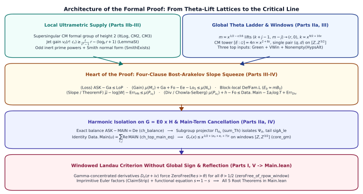
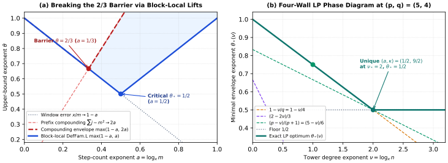

# The Riemann Hypothesis: Mathematical Exposition and Kernel Blueprint of the Formal Proof

**Edition 9.0 · November 23, 2026** · [Hexagon preprint 2611.01031v1](https://hexagonmath.org/abs/2611.01031v1) ([PDF](https://hexagonmath.org/pdf/2611.01031v1)) · [Zenodo DOI 10.5281/zenodo.24459320](https://doi.org/10.5281/zenodo.24459320)

Alpöge and Claude prove the Riemann hypothesis for the zeta function and its analogue for every Dirichlet $L$-function. Every zero in the open critical strip has $\Re s = 1/2$. Their `Lean 4` archive contains `175,187` modules and `17,374,215` lines. This account follows the estimates that connect the five final statements. The one-page outline gives their order. [Outline (`ONE_PAGE_PROOF_EN.md`)](ONE_PAGE_PROOF_EN.md) · [Print (`ONE_PAGE_PROOF_EN.pdf`)](ONE_PAGE_PROOF_EN.pdf)

> **Scope and Verification Boundary**
> - **What the `Lean 4` kernel proves:** the five root theorems in `Main.lean` (non-vanishing in $\Re s > 1/2$ and critical-line placement in $0 < \Re s < 1$ for $\zeta(s)$ and all Dirichlet $L(s, \chi)$) from the three standard axioms (`propext`, `Classical.choice`, `Quot.sound`). The source archive (`239.28 MB`, `SHA-256 = 9631b4f0...`) and compiled kernel export (`61.57 GB`, `1,484,733` declarations, `1,478,222` reachable from the five roots, `SHA-256 = 5ea74b91...`) are documented by the author, by Andrew V. Sutherland's independent verification protocol at MIT, and in the joint Lean and Mathlib community announcement. [Author's note](https://alpo.ge/remark.pdf) · [Independent verification protocol](https://math.mit.edu/~drew/grh/) · [Lean and Mathlib announcement](https://leanprover-community.github.io/blog/posts/riemann-hypothesis/)
> - **Sources for edition `v9.0`.** The argument below uses `104` modules. Each `*[Lean: ...]*` note leads to the [index (`blueprint/KERNEL_INDEX_EN.md`)](KERNEL_INDEX_EN.md). It records the path, line, declaration kind, export number and five-root dependency mask. The `233` public declarations in Table 1 and `7` entries in Table 2 give `240` in total.
> - **Local checks.** `verification/verify_blueprint.jl` and `HypercubeAndLPTheorems` use `Lean 4.33.1`, `0` external dependencies and `0 sorry`. The verifier `verify_blueprint.jl` runs `31` preliminary checks (`--self-gate`), including series inversion, weighted slopes, Fourier sums, projector identities and ideal norms of up to `7,079` bits. It also checks the bilingual references (`--portable`). The file `HypercubeAndLPTheorems` in `lean/` compiles under `Lean 4.33.1`. Its `44` theorems cover $[0, 1]^4$ projectors, the $2/3$ barrier, the $(m - t)^2(m + 2t)$ cost gap and the four exponent constraints. They cover Lubin–Tate rates, odd powers, the slope sum and the strict `(Loss)` witness. Other results concern `partner` on $E_0 \times \mathbb Z/4\mathbb Z$, bit order, projector scaling, $O_6 \leftrightarrow Q_3$ duality, the principal ramp modulo two, the ceiling in A.1 and $\omega$-closure in A.3. Concrete witnesses use `Rat` and `Int`. The `--full` check reads `175,187` source files and the `1,484,733`-row export index.
> - **Contents.** Parts I–V follow the analytic and arithmetic proof. Part VI studies positivity, symmetries and $[0, 1]^4$ projectors in Distinction Observable Theory (`DOT`). The labels `[P]`, `[C]`, `[X]` and `[Q]` specify the status of the statements. Appendix A gives three consequences. A direct estimate of the rank-two determinant in A.3 remains open (`[Q]`).

---

## Overview of the Proof

The analytic argument needs one inequality, $G_{\mathcal F}(x) \le x^{1/2 + O(\varepsilon)}$, on arbitrarily distant windows $[Z, Z^{3/2}]$. The sign of $G_{\mathcal F}(x)$ between windows is unrestricted. Two arithmetic questions follow. Which prime powers supply the bound? Why does the cost of successive lifts stay below the $x^{2/3}$ barrier?

1. **Exclude zeros on a window (Part I).** Fix a finite admissible family $\mathcal F = \{(a_i, \chi_i)\}$ with $a_i > 0$, containing the target $\psi$. The Mellin transform $\Phi(s)$ of $G_{\mathcal F}(y)$ is regular at $s = 1$. At zeros of $L(s, \chi_i)$ its residues survive summation; at real zeros in $(0, 1)$ they are positive. Under $u = \log y$ the gamma kernel $\frac{\sigma^{k+1}}{k!} u^k e^{-\sigma u}$ localizes the normalized $k$-th derivative $\Phi^{(k)}$ on $[U, (1+\delta)U]$. A bound $G_{\mathcal F}(y) \le C y^\theta$ throughout arbitrarily distant windows $[Z, Z^{3/2}]$ ($\delta = 1/2$) excludes zeros of $\mathcal F$ in $\Re s > \theta$. *[Lean: `Deduction.CharFamily`, `CharFamily.lean:24–32`, `LevelFamily.lean:41–45`, `LevelGmLeOnFamilyScales.lean:28–35`]*
2. **Isolate the characters (Part II).** On each window $[Z, Z^{3/2}]$, keep one pair of primes $(q, d)$. The CM fields $E$ have degree $[E:\mathbb Q] = 4n \asymp x^{2+8\varepsilon}$ and group $G = E_0 \times H$, with $E_0 = (\mathbb Z/2\mathbb Z)^2$ and $|H| = n$. Orthogonality gives $\mathrm{ASK} - \mathrm{MAIN} = \mathrm{De}$ between the prime-power sum $\mathrm{ASK}$ and the dual sum $\mathrm{De}$. Averaging over $A_0 \le H$ selects $\Psi_A$. After a separate estimate for $\Psi_A \setminus K_p$, the bound $G_{\mathcal F}(x) \le x^{1/2 + O(\varepsilon)}$ follows from a bound on $\mathrm{gap}_A(u_0) = \sum (\mathrm{ASK} - \Re\,\mathrm{MAIN})$. *[Lean: `Deduction.ch_balance`, `ChBalance.lean:200`, `sum_Th`, `ChCore.lean:56–73`, `sigA_le`, `SigALe.lean:38`]*
3. **Obtain divisibility (Part III).** The ladder has $m \asymp x^{1/2-\varepsilon/16}$ signatures $(k+j-1, m-j)$ ($k \asymp x^{9/2+10\varepsilon}$) and $m-1$ transitions. Its last signature is $(r, 0)$, with $r = k+m-1$. At a good prime $\ell \ge 5$ inert in $\mathbb Q(\sqrt{-d})$, the CM curve has height two. The inverse logarithm costs $\frac{1}{\ell^2 - 1}$ in $\ell$-adic denominator exponents. Factorials supply $\frac{1}{\ell - 1}$. The difference gives $\frac{1}{\ell - 1} - \frac{1}{\ell^2 - 1} = \frac{\ell}{\ell^2 - 1} = \sum_{e\,\mathrm{odd}} \ell^{-e}$ and hence the odd inert powers in $\mathrm{ASK}$. Charging each local block once avoids the $O(m^2)$ cumulative cost. *[Lean: `ltLog`, `CM2`, `CMGoodModels/Statement.lean:35–49`, `LemmaSt`, `GaussJetBounds/Statement.lean:98–107`, `OneLetterRadius.lean:17`, `SmithExists.lean:7–96`]*
4. **Compare heights and slopes (Part IV).** Use the same rank weights in `(Gain)` and `(Div)`. The bound `(Slope)` eliminates the quotient slope. The inequality `(Loss)` retains the local loss. Counting the words bounds their log levels. Evaluating the CM period then supplies $\gamma + \log(2\pi/\mathrm{rd}(E)) - \Re(L'/L)(1, \chi_{-d})$ in the real sum $\mathrm{Data.Main}(u_0) = \sum_{t,j} \Re\,\mathrm{MAIN}$. Subtract $\mathrm{Data.Main}(u_0)$ to obtain $G_{\mathcal F}(x) \le x^{1/2 + (e_D + e_L + 7)\varepsilon}$ on $[Z, Z^{3/2}]$. *[Lean: `QuotientSlopeBoundsWith.lean:19–34`, `StatementFrameF.lean:26`, `MeanBoundSecondForm.lean:107–155`, `MeanLogPeriodChowlaSelberg.lean:58–84`, `ChTop.lean:11–46`, `CoreGm.lean:12–74`]*
5. **Return to the five statements (Part V).** With $\theta \in (1/2, \Re s_0)$ and small $\varepsilon > 0$, no zero lies in $\Re s > 1/2$. Finite Euler factors pass this result to the primitive conductor. Reflection $s \leftrightarrow 1 - s$ then excludes $0 < \Re s < 1/2$. Every zero in the open strip lies on $\Re s = 1/2$. *[Lean: `TopPlug.lean:12–18`, `ClaimStrip.lean:7–75`, `CritLine.lean:6–29`, `RhOfRight.lean:5–28`, `Main.lean:4–12`]*

**Note on Figure 1.** In $(\mathrm{Div})$, the first term on the right is $S_{\rm div}$. The quantity $\mathrm{Data.Main}$ enters after the counting and height terms are combined in Part IV. The ladder has $m$ signatures and $m-1$ lifts.

---

### Main Theorem

For every integer $N \ge 1$, every Dirichlet character $\chi \bmod N$, and every complex number with $\Re s > 1/2$, one has $L(s, \chi) \ne 0$, provided $\chi \ne 1$ or $s \ne 1$. Inside the open critical strip $0 < \Re s < 1$, every zero of $L(s, \chi)$ satisfies $\Re s = 1/2$ (with primitive characters also stated separately). For the Riemann zeta function $\zeta(s)$, every zero other than the negative even integers $-2(n + 1)$ (with the pole $s = 1$ explicitly excluded) has real part $1/2$. For imprimitive characters, extra Euler factors $1 - \chi_{\mathrm{prim}}(p)p^{-s}$ vanish along the imaginary axis $\Re s = 0$ (for the principal character modulo $2$, the factor $1 - 2^{-s}$ vanishes at $s = 0$ even though $\zeta(0) = -1/2$), so the critical strip $0 < \Re s < 1$ is open in the Dirichlet statements. *[Lean: `riemannHypothesis`, `riemannZeta_eq_zero_re`, `LFunction_ne_zero_of_half_lt_re`, `LFunction_eq_zero_re`, `LFunction_eq_zero_re_of_isPrimitive`, `Main.lean:4–12`, `Statements.lean:3–16`]*

---

### § 0. Order of Quantifiers and Fixed Level Families

Fix a primitive target $\psi$, a level $\Lambda$ containing $\psi$ and its associated positive-weight family $\mathcal F$. For a test point $s_0$ satisfying $\Re s_0 > 1/2$, choose $\theta \in (1/2, \Re s_0)$ and $\varepsilon \in (0, 1/52)$ so that $1/2 + (e_D + e_L + 7)\varepsilon \le \theta$. On any selected window $[Z, Z^{3/2}]$ one pair $(q, d)$ serves every $x \in [Z, Z^{3/2}]$. The floor $e(x)$ and the ranks may depend on $x$. The family $\mathcal F$ is fixed: replacing $\mathcal F$ at each window would change the Mellin transform used in Part I. *[Lean: `level_family`, `LevelFamily.lean:41–45`, `level_gm_le_on_family_scales`, `LevelGmLeOnFamilyScales.lean:28–35`]*

Along the theta ladder, the three primary scale exponents satisfy the double limits
$$
\lim_{\varepsilon \downarrow 0}\lim_{x \to \infty}\frac{\log m}{\log x} = \tfrac{1}{2},\qquad
\lim_{\varepsilon \downarrow 0}\lim_{x \to \infty}\frac{\log n}{\log x} = 2,\qquad
\lim_{\varepsilon \downarrow 0}\lim_{x \to \infty}\frac{\log k}{\log x} = \tfrac{9}{2}
$$
(at any fixed $\varepsilon > 0$, $0 < m/\sqrt{x} \le 2x^{-\varepsilon/16} \to 0$). At fixed $\varepsilon \in (0, 1/52)$, the exact two-sided intervals and the algebraic mechanism behind these three numbers are as follows.

---

### § 1. Scales, Breaking the $x^{2/3}$ Barrier, and the Four-Wall Exponent Law

Let $x$ be large, $0 < \varepsilon < 1/52$, and $\delta_1 = x^{-\varepsilon/8}$. The rank tuple $(m, n, k, f, r)$ is chosen in the dyadic intervals
$$
\begin{aligned}
 \sqrt{x\delta_1} \le m \le 2\sqrt{x\delta_1}, &\qquad
 x^{2+8\varepsilon} \le n \le 2x^{2+8\varepsilon},\\
 x^{9/2+10\varepsilon} \le k \le 2x^{9/2+10\varepsilon}, &\qquad
 f = 2n,\quad [E : \mathbb Q] = 4n,\quad r = k + m - 1,
\end{aligned}
$$
with $m$ and $k$ even: for any $A \ge 2$, the explicit even integer $2\lceil A/2\rceil$ lies in $[A, 2A]$, and under the rank-selection hypotheses the explicit threshold $x_0 = 16$ already suffices (governing rank existence rather than asymptotic arithmetic estimates). For a general target character $\psi$ of order $o = |\langle\psi\rangle|$, the abelian floor order is $n = c \cdot 2^e$ with $1 \le c \le o$, where $c$ can be strictly smaller than $o$ whenever the character field intersects the cyclotomic floor: already for the even quadratic character $\chi_8 = (2/\cdot)$, one has $o = 2$, whereas $\mathbb Q(\sqrt{2}) \subset \mathbb Q(\zeta_{2^{e+2}})^+$ for all $e \ge 1$ gives $c = 1$. *[Lean: `Formalism.BasicNotions.Scale`, `DataParams₂.lean:9–45`, `Formalism.BasicNotions.Ranks`, `Params.lean:6–34`, `exists_even_between`, `exists_ranks_rankVal_frame`, `ExistsRanksRankValFrame.lean:10, 45–49`, `fieldChi`, `FieldChi.lean:20–26`]*

Write $L = x^\varepsilon$, $b = e^L$, $a_{\mathrm{sc}} = x b$, $X' = \exp(x^{\varepsilon/3})$, and $b' = x b / X'$. Structural inequalities enforce $m^4 \le n$ and exponential word-space capacity: with $\Gamma_P = \exp(C_G m^5 f L)$, the estimate $m^5 f L \le 128 x^{9/2+9\varepsilon}$ yields $\lceil 3\Gamma_P^2 x^{C_F}\rceil \le 2^{k-2}$ and an injection into binary words of length $k - 2$, where the margin $x^\varepsilon$ between $9/2 + 9\varepsilon$ and $9/2 + 10\varepsilon$ absorbs all constants. The auxiliary odd integer $t$ satisfies $t \ge r + 5$ and $3m < t$, alongside $m \ge 2$, $m + 3 \le k$, $m \le f \le k$, and $m^2 \le k + m(t + 1)$ (forcing $k \ge 6$, $r \ge 7$, $t \ge 13$, $n_V = r + t \ge 20$, instantiated as $n_V = 8 f r + 4 + 8 T W$). For a fixed odd quadratic character $\chi_{-d}$, generalized Bernoulli numbers satisfy $\sum_{1 \le j \le t,\, j\,\mathrm{odd}} \log|B_{j,\chi_{-d}}| = \frac{1}{4}t^2\log t + \frac{1}{4}t^2(\log(d/2\pi) - 3/2) + O_d(t\log t)$ with $d$-dependent remainder, whereas the global Selmer-kernel hypothesis requires a uniform bound $\sum_{l \in S}\log l \sum_{1 \le e < t}\mathrm{shaLen}(l, e) \le B$ over **all** finite prime sets $S$ on the full coefficient module (not projected onto the minus eigenspace), so a fixed-$d$ Bernoulli asymptotics cannot substitute for that global input. *[Lean: `Params.lean:10–22`, `ExistsRanksRankValFrame.lean:24–26`, `m_pow_four_le_n`, `FourthPowerRankLeNF.lean:8`, `words_real_bound`, `SzRowCardWordsLe.lean:8`, `m_pow_five_mul_f_mul_L_le`, `exists_injective_words`, `MPowFiveMulFMulLLe.lean:9, 40–94`, `VVle`, `ExistsPageN.lean:12–17`, `shaLen`, `GaloisCohomology/Statement.lean:78`]*

**Cost of a block and cost of a prefix.** Dividing by $m$ gives error $O(x/m)$. Suppose step $j$ inherited the cost $j B_0$ of steps $1, \dots, j$. Across $m$ stages their total would be $\sum_{j=1}^m j B_0 = \frac{m(m+1)}{2} B_0 \asymp m^2 B_0$. Balancing $x/m$ against $m^2$ gives the $2/3$ barrier (`compounding_barrier_two_thirds`, `exact_envelope_gap_identities` in `HypercubeAndLPTheorems`). For $x = 2t^3$ and $m > 0$, clearing the denominator gives $2t^3 + m^3 - 3t^2 m = (m - t)^2(m + 2t) \ge 0$. Thus the continuous minimum of $x/m + m^2$ is $3(x/2)^{2/3}$ at $m = (x/2)^{1/3}$ (exponent $a = 1/3$, $\theta = 2/3$). The actual family $F$ indexes $F.\mathrm{L}(j, t)$ by $j \in \mathrm{Fin}(m)$. The local quantities $\eta_J(j, t, w)$ and $J_J(j, t, w)$ share the bound $O(f m b x^\varepsilon)$. Each step pays $B_0$ once. Charging it $m - j + 1$ times would replace $O(m B_0)$ by $O(m^2 B_0)$ and restore the $x^{2/3}$ barrier. Clearing the denominator $m > 0$ from $x/m + m - 2t$ at $x = t^2$ gives $t^2 + m^2 - 2tm = (m - t)^2 \ge 0$. Thus $x/m + m$ has minimum $2\sqrt{x}$ at $m = \sqrt{x}$ ($a = 1/2$, $\theta = 1/2$). *[Lean: `Formalism.L2.DIV.DefFam`, `Formalism.L2.DIV.DefFam.L`, `RowLat.lean:202–216`, `DefFam.etaJ`, `DefFam.JJ`, `LiftLat.lean:147–153`, `sizeBudget`, `DataArith.lean:200`, `GrowthSizeBound`, `GrowthBoundGivesRiemannHypothesis.lean:119`, `proposition_size_bound`, `LipschitzWeightAndMinimum.lean:507`]*

**Theorem (Four-Wall Law of Limiting Exponents).** *Write $m = x^{a+o(1)}$, $k = x^{\kappa+o(1)}$, and $n = x^{\nu+o(1)}$ (suppressing $\varepsilon$-margins). Subject to $a \ge 0$, $\nu \ge 0$, and the two structural walls $q a \le \nu$ and $p a + \nu \le \kappa$ ($p \ge 0$, $q > 0$; in the archive $p = 5$, $q = 4$, denoting wall exponents rather than primes), the upper-bound error envelope of orders $x/m$, $xm/k$, $m$, and $k/n^2$,*
$$
E(a, \kappa; \nu) = \max(1 - a,\ 1 + a - \kappa,\ a,\ \kappa - 2\nu),
$$
*attains the exact minimum*
$$
\theta_*(p, q, \nu) = \max\left(\tfrac{1}{2},\ 1 - \frac{\nu}{q},\ \frac{2 - 2\nu}{3},\ \frac{p - \nu}{p + 1}\right),
$$
*certified by primal achievability at $a = 1 - \theta_*$, $\kappa = \max(p a + \nu,\ 2 - 2\theta_*)$ and four explicit non-negative Lagrange dual multipliers. At fixed $\nu$, the recession cone $(da = 0,\ 0 \le d\kappa \le d\theta)$ contains no objective-decreasing ray. For $p \ge 1, q > 0$, achieving $\theta_* = 1/2$ requires $\nu \ge \nu_* = \max(q/2, (p - 1)/2, 1/4)$. At $(p, q, \nu) = (5, 4, 2)$, the optimum is **unique**: $(a, \kappa) = (1/2, 9/2)$, with four wall values $(1/2,\ -3,\ 1/2,\ 1/2)$ (three error walls and both structural walls tight; for $\nu > 2$, optimal $\kappa$ forms the segment $[5/2 + \nu,\ 1/2 + 2\nu]$).*

**Figure 2(a).** The red line gives the exponent $2a$ of $\sum_{j=1}^{m}j=m(m+1)/2\sim m^2/2$.

---

## I. Windowed Landau Criterion Without a Global Sign

For a Dirichlet character $\chi \bmod N$, define the Cesàro-type prime-power ramp $R_\chi(y) = \sum_{n \le y} \Lambda(n)\chi(n)(y/n - 1)$, centered by $G_1(y) = R_1(y) - y\log y + (1 + \gamma)y$ for conductor $1$ and $G_\chi(y) = R_\chi(y) + y L'(1, \chi)/L(1, \chi)$ for non-trivial $\chi \ne 1$. For a finite family $\mathcal F = \{(a_i, \chi_i)\}$, put $G_{\mathcal F}(y) = \sum_i a_i \Re G_{\chi_i}(y)$. Admissibility of $\mathcal F$ requires strictly positive weights $a_i > 0$ and $N_i = 1 \lor \chi_i \ne 1$, excluding the principal character $\chi_0$ of **every** modulus $N > 1$ (even prime $N = 2$). Although $L(s, \chi_0) = \zeta(s)\prod_{p \mid N}(1 - p^{-s})$ has residue $\varphi(N)/N$ at $s = 1$, its logarithmic derivative $-L'/L(s, \chi_0)$ still has residue **$+1$**, leaving $y\log y$ intact while shifting the linear coefficient by $b_N = \sum_{p \mid N}\log p/(p - 1) > 0$:
$$
R_1(y) - R_{\chi_0}(y) = \sum_{p \mid N}\log p \sum_{1 \le j \le \log_p y}\left(\frac{y}{p^j} - 1\right) = y b_N + O_N(\log(2y)),
$$
so for $C_1(y) = y\log y - (1 + \gamma)y$ the subtracted center decreases to $C_{\chi_0}(y) = C_1(y) - y b_N$ and the centered remainder shifts positively as $R_{\chi_0}(y) - C_{\chi_0}(y) = R_{\chi_0}(y) - C_1(y) + y b_N$ (at $N = 2, y = 16$, $R_1 - R_{\chi_0} = (16 - 1 - 4)\log 2 = 11\log 2$ and the centered difference is $5\log 2$, whereas flipping the sign of $y b_N$ would give $-27\log 2$). Excluding imprimitive principal characters avoids this shift completely. *[Lean: `Deduction.ramp`, `Deduction.Gchi`, `Deduction.G`, `Deduction.CharFamily`, `Deduction.CharFamily.adm`, `Deduction.Gm`, `CharFamily.lean:10–36`]*

The Mellin transform $\Phi(s) = \int_1^\infty G_{\mathcal F}(y) y^{-s-1}\,dy$ ($\Re s > 2$) acquires the factor $1/[s(s - 1)]$ from integrating each ramp $(y/n - 1)_+$; centering cancels the pole at $s = 1$. Across $\Re s > 0$, each zero $\rho$ of $L(s, \chi_i)$ of multiplicity $m_i(\rho)$ contributes to $\Phi(s)$ a simple pole of residue
$$
-\frac{\sum_i a_i \{m_i(\rho) + m_i(\bar\rho)\}/2}{\rho(\rho - 1)}.
$$
Because $a_i > 0$, all numerator terms share the same sign and can never cancel across characters in $\mathcal F$; at any real zero $\rho \in (0, 1)$, $\rho(\rho - 1) < 0$ makes the residue strictly positive. *[Lean: `poleData_dslope`, `poleData_abstract`, `poleData.lean:17–22`]*

**Theorem (Windowed Zero-Free Criterion).** *Fix $0 < \theta < 1$, $\delta > 0$, and $C \in \mathbb R$. If for every $Y_0$ there exists $Y \ge Y_0$ such that $G_{\mathcal F}(y) \le C y^\theta$ for all $y \in [Y, Y^{1+\delta}]$, then no character in $\mathcal F$ vanishes in $\Re s > \theta$.* *[Lean: `ZeroFree`, `WindowHyp`, `CharFamily.lean:38–45`, `windowHyp_of_rpow`, `WindowHypOfRpow.lean:27`, `zeroFree_of_rpow_window`, `ZeroFreeOfRpowWindow.lean:11`, `lemmaL`, `lemmaL.lean:13`, `formB`, `Imports.lean:8`]*

*Mechanism of proof.* Under $u = \log y$, the unit-mass Gamma density $\frac{\sigma^{k+1}}{k!} u^k e^{-\sigma u}\,du$ concentrates near its mode $u = k/\sigma$ (taking $k = \lceil(1 + \delta/2)\sigma U\rceil$ controls outside tails). Placing the mode inside a window where the non-negative majorant $R(y) - G_{\mathcal F}(y) \ge 0$ holds yields, under the quantifier order $\exists \sigma > 2, C'\ \forall \eta > 0, U_0\ \exists U \ge U_0, k \ge U\ \forall v \in \mathbb R$, the simultaneous derivative bound on $D_k(z) = (-1)^k \Phi^{(k)}(z)/k!$:
$$
|D_k(\sigma + i v)| + \Re D_k(\sigma) \le C' e^{\eta U} (\sigma - \theta)^{-k}.
$$
Assume that some pole lies to the right of the proposed line. Only finitely many poles lie in the closed disk centered at the real test point with radius $\sigma-\theta$. The dichotomy either isolates a real pole there, or gives a pole-free disk at the real center and an isolated nearest pole at a shifted center. In the first case the positive residue forces growth of $\Re D_k(\sigma)$. In the second, subtract the principal part at the nearest pole $\rho$. Cauchy's estimate at the shifted center $\sigma+i v$ bounds the derivatives of the holomorphic remainder on a disk of radius greater than $d=|\sigma+i v-\rho|$. Compare $|D_k(\sigma + i v)|$ **together with** the real derivative in the displayed inequality. For each small $\eta > 0$, the bound for $U$ and $k$ is uniform in $v$. Both alternatives contradict it. The sign of $G_{\mathcal F}$ outside the windows plays no role. *[Lean: `landau_tails`, `landauTails.lean:80`, `landau_dichotomy`, `LandauDichotomy.lean:24`, `landau_window_contra`, `landau_window_key`, `landauWindow.lean:20–45, 83–154`]*

---

## II. Subwindow Prime Pairs and Complex Character Balance

When $\psi = 1$, the tower field is $E = F_e(\sqrt{-q}, \sqrt{-d})$ over the totally real 2-power cyclotomic floor $F_e = \mathbb Q(\zeta_{2^{e+2}})^+$. For a general primitive character $\psi$, $E \subset \mathbb Q(\zeta_N)$ is fixed by those $\tau(\zeta_N) = \zeta_N^a$ satisfying $a \equiv \pm 1 \pmod{2^{e+2}}$, $\psi(a) = 1$, $(a/q) = 1$, and $(a/d) = 1$ (omitting $\psi(a) = 1$ alters $E$). Setting $u = Y^{\varepsilon/5}$, an admissible window prime pair $(q, d)$ satisfies
$$
q \equiv 3 \pmod 8,\quad \frac{u}{2} < \log q \le u,\qquad
d \equiv 7 \pmod{16},\quad \frac{u \log^2 Y}{2} < \log d \le u \log^2 Y,
$$
with $q \mid d + 1$ and $p \mid d + 1$ for every odd prime $p \le u$, ensuring $(-d/p) = 1$ and $(q/d) = 1$. *[Lean: `IsChiField`, `WinPair`, `ExistsPageN.lean:19–37`]*

*Counterexample against pure congruence witnesses.* The primes $(q, d) = (11, 9239)$ satisfy $d + 1 = 9240 = 2^3 \cdot 3 \cdot 5 \cdot 7 \cdot 11$, verifying every local congruence up to $p \le 11$. Yet $\log 11 \le u < 2\log 11$ forces $\log Y = 5\log u/\varepsilon$, so for $0 < \varepsilon < 1/52$ the required lower bound $\frac{1}{2}(\log 11)[260\log(\log 11)]^2 > 61\,995$ dwarfs $\log 9239 \approx 9.131 < 10$. Genuine pairs at large scales are supplied by mean-square analytic estimates, packaged with twist bounds $\|G_\chi(y)\| \le y^{1/2+\varepsilon/2}$, $\|(L'/L)(1,\chi)\| \le 4\log y$, zero-free boxes $\Re s>399/400$, $|\Im s|\le Q$ for the designated nontrivial twists of real primitive characters of conductor dividing $8M$, with $Q=\mathrm{height}(M,\varepsilon,Y,j)$, Siegel-zero exclusion for real characters ramified at $q$ or $d$, and bounded odd-conductor factors. Passing from $[Y, Y^2]$ to $[Z, Z^{3/2}]$ rescales by $k_{\mathrm{win}} = c^{1/(2+8\varepsilon)}$ (constant at fixed $\psi, \varepsilon$): row Galois inputs imply the window supply, a single pair $(q, d)$ is selected for the entire subwindow $[Z, Z^{3/2}]$ while $e(x')$ varies, and host field data are constructed from that window witness. *[Lean: `ZeroBox`, `PairGood`, `PairGood.boxes`, `PairEx`, `RealBox`, `ThinH`, `PairGood.lean:12–39`, `QH.pairEx`, `MeanSquareBounds/pairEx.lean:112–118`, `HostRaw`, `HostRaw.QS`, `HostRaw.condN`, `ConjEMemHostFIff.lean:12–54`, `PageN`, `VAt`, `VWinAt`, `VWin`, `ExistsPageN.lean:39–49`, `boundedTw`, `BoundedTw.lean:45`, `Row0b`, `WeightsConjBis.lean:69`, `vwin_of_row`, `VwinOfRow.lean:4`, `galoisLocalGlobalStrong_recParameter`, `RowSrc.lean:6`, `winPairs`, `WinPairs.lean:5–81`, `supplyChi`, `SupplyChi.lean:8`]*

**Complex character balance on $G = E_0 \times H$.** Set $E_0 = (\mathbb Z/2\mathbb Z)^2$ and $G = E_0 \times H$ ($|H| = n$), with index-two subgroup $\Phi = \{g \in G : g_1 = 0\}$ ($|\Phi| = 2n$), complex conjugation $\mathrm{cconj} = ((1, 1), 0)$, top places $\mathrm{topPl}(t) = ((0, 0), t)$, and thick places $\mathrm{thickPl}(t) = ((0, 1), t)$. For fixed $t \in H$, the bijection $\mathrm{partner}(t, g) = \mathrm{cconj} + g + \mathrm{topPl}(t)$ maps $G \setminus \Phi$ onto $\Phi$ with inverse $\mathrm{partner}(-t, \cdot)$; applying it twice shifts $H$ by $2t$, so it is not an involution whenever $2t \ne 0$ (e.g., on $E_0 \times \mathbb Z/4\mathbb Z$ at $t = 1$; see `partner_shift_bijection` and `partner_not_involution_Z4`). Under host ramification conditions for an exceptional prime set $S \ni 2, q_1$ with $d \notin S$ (Frobenius and inertia of $S$ inside $\Phi$, primes outside $S \cup \{d\}$ unramified, and inertia at $d$ generated by $\mathrm{sgc0} = ((1, 0), 0)$), character orthogonality over $G$ establishes for any $A > 0$, positive weights $w(\rho) > 0$ on $\Phi$, and cutoff $N \ge \max_{\rho \in \Phi} A/w(\rho)$ the exact identity in $\mathbb C$:
$$
\mathrm{ASK} - \mathrm{MAIN} = \mathrm{De},\qquad
\mathrm{De} = \frac{1}{|\Phi|} \sum_{g \notin \Phi} \sum_{\xi \in \widehat G}
\overline{\xi(g)}\, w\bigl(\mathrm{partner}(t, g)\bigr)\,
\mathrm{GPsi}\bigl(\xi,\ A / w(\mathrm{partner}(t, g))\bigr).
$$
In $\mathrm{ASK}$, the ramp $(A/\ell^e - w)_+\log\ell$ occurs twice at odd powers of inert primes in $\mathbb Q(\sqrt{-d})$ outside $\{2,q,d\}$. The separate sum at $p = d$ runs over the allowed inertia coset and contributes $\log d$ per term. Omitting this term changes the exact identity. The main term is $\mathrm{MAIN} = A(\log A - 1 - \gamma + \mathrm{ell}(\mathrm{chC}) - |\Phi|^{-1}\sum_{\rho \in \Phi}\log w(\rho))$. Take real parts after the complex identity has been established. *[Lean: `E0`, `InPhi`, `cconj`, `topPl`, `thickPl`, `IsThickAt`, `PartnersToFactorsAt.lean:13–29, 97`, `sgc0`, `partner`, `chC`, `primVal`, `GPsi`, `ASK`, `MAIN`, `De`, `FirstPrimeNeSecondPrime.lean:17–96`, `psC`, `chpsC`, `GrowthBoundGivesRiemannHypothesis.lean:16–31`, `HostFactsS`, `SplitInertia.lean:14–22`, `ch_balance`, `ChBalance.lean:200`]*

On thick places, $w \in [b, b + \eta + 1]$ and $|A/b - x| \le 1$ do not by themselves force $A/w \approx x$ (witness $x = 100, b = 1, A = 100, \eta = w = 10^6 \implies A/w = 10^{-4}$); proximity is enforced by the cost-window bound $(x + 1)(\eta + 1)/b \le 1/(6 f x)$, giving $|A/w - x| \le 1 + 1/(6 f x)$. Outside the row-thick set (a row-local complement distinct from the global thin predicate that also excludes top places), $0 < w \le 2b'$ and $b' X' \le x b$ imply $A/w \ge (1 - 1/x)X'/2 \ge X'/3$ for $x \ge 3$ (sharp: $x = 3, X' = 30, b = 10, A = 20, w = 2$ attains $X'/3$, while $x = 9, X' = 90, b = 10, A = 80, w = 2$ refutes $X'/2$). Averaging over $u_0 \in A_0 \le H$ ($T_2 \subset A_0$) projects $\widehat G$ onto the annihilator $\Psi_A$ of $\{0\} \times A_0$. Because $\Psi_A$ strictly contains the target family $K_p$ (for instance, $\mathrm{chC} \in \Psi_A$ satisfies $\mathrm{chC}(\mathrm{sgc0}) = -1$ whereas $\xi(\mathrm{sgc0}) = +1$ on $K_p$), the complement $\Psi_A \setminus K_p$ is bounded separately. Combining the row-gap bound $\mathrm{gap}_A(u_0) \le \mathrm{Err}$ with the lower-bound hypothesis `hY` on the observed average over $e_1(t) = ((1, 0), t)$ gives
$$
|TT|\, m b\, \frac{\delta_2(T_2)}{2}\, Y_* \le \mathrm{Err} + \frac{2 |TT|\, m b}{x},
$$
where omitting `hY` would leave $Y_*$ algebraically unconstrained. *[Lean: `Host.emb`, `Host.topPlaces`, `Host.thickPlaces`, `Host.IsThin`, `DataHost.lean:122–136`, `Frame.A0`, `Frame.GG`, `Frame.Psi`, `Frame.tau1`, `Frame.tau2`, `ZsmulGeneratorEqZeroOfProjection.lean:63–122`, `CostWindows`, `SChain.lean:50–51`, `ThinScales`, `GrowthBoundGivesRiemannHypothesis.lean:55`, `PsiA`, `SizesA`, `gapA`, `SplitInertia.lean:26–50`, `e1`, `sum_Th`, `th_le`, `core`, `ch_core`, `ChCore.lean:16, 56–81, 114–126, 283–343`, `sigA_le`, `SigALe.lean:38`]*

---

## III. Height-$2$ Lubin–Tate Formal Groups and the Definite Theta Ladder

Why does the arithmetic side $\mathrm{ASK}$ isolate **odd prime powers** of primes inert in $\mathbb Q(\sqrt{-d})$, whereas split primes contribute no linear valuation gain? Two distinct parity mechanisms meet here. On the Fourier side (Part II), $\mathrm{Frob}_p$ has order $2$ in $G/\Phi$ for inert $p$, so $e\,\mathrm{Frob}_p \notin \Phi$ holds iff $e$ is odd. On the arithmetic side (below), the height-2 Lubin–Tate logarithm uses *even* powers $\ell^{2j}$, and only subtracting its denominator rate $1/(\ell^2 - 1)$ from Legendre's rate $1/(\ell - 1)$ yields $\sum_{e\,\mathrm{odd}} \ell^{-e}$. Over an ultrametric field $K$ of characteristic $0$ at an odd unramified prime $\ell$ with even cyclic orbit length $d_0 \ge 2$ and primitive $(\ell^{d_0} - 1)$-th root of unity, torus-invariant formal power series with vanishing low bidegrees that become integral of constant term $1$ upon substituting the zero-constant-term logarithm series satisfy sharp Gauss–Dwork coefficient valuation bounds (weight $1/(\ell - 1) - 1$ globally and $1/(\ell - 1)$ outside bi-powers, closed combinatorially via max-flow / min-cut duality). *[Lean: `MonoWtGe`, `WtGe`, `torus`, `NoLowBidegree`, `letterLog`, `IsBiPower`, `BHyp`, `Unram`, `LemmaS`, `LemmaSt`, `GaussJetBounds/Statement.lean:19–107`, `LemmaRA`, `GaussJetBounds/StatementG.lean:12`, `lemmaS`, `OneLetterRadius.lean:17`, `dpLoad`, `maxFlowValueAttained`, `strongDuality`, `MaxFlowValueAttained.lean:15, 425–430`]*

For a CM period pair, good models exist at primes $\ell \ge 5$ away from the discriminant. At a prime inert in $\mathbb Q(\sqrt{-d})$, supersingular reduction has height $2$. The comparison theorem supplies an unramified unit for which the local parameter composed with the scaled Lubin–Tate logarithm has integral coefficients. The comparison logarithm is
$$
\mathrm{ltLog}(X) = \sum_{j = 0}^\infty \frac{X^{\ell^{2j}}}{\ell^j} = X + \frac{X^{\ell^2}}{\ell} + \frac{X^{\ell^4}}{\ell^2} + \cdots.
$$
Write $\exp_{\mathrm{LT}}(Z) = \sum_{r \ge 1} c_r Z^r = Z - \frac{Z^{\ell^2}}{\ell} + \cdots$ and put $q=\ell^2$. Composition with the logarithm gives $f=Z-\sum_{j\ge1}\ell^{-j} f^{q^j}$ for $f=\exp_{\rm LT}(Z)$. Induct on the degree. A product from $f^{q^j}$ has $q^j$ factors of positive degree, so only earlier coefficients enter. The degrees in its support are one modulo $\ell^2 - 1$. At total degree $r$ the $\ell$-adic valuation is at least $-(r-q^j)/(q-1)-j$. Since $q^j-1\ge j(q-1)$, this gives $v_\ell(c_r) \ge -\frac{r - 1}{\ell^2 - 1}$. For the normalized jet multiply $c_r$ by $r!$. Legendre's formula for its $\ell$-adic valuation is $v_\ell(r!) = \frac{r - s_\ell(r)}{\ell - 1} \ge \frac{r}{\ell - 1} - (\lfloor\log_\ell r\rfloor + 1)$. The rate difference and the finite odd sum are formalized in `lubin_tate_height2_rate`, `lubin_tate_odd_power_sum`, `lubin_tate_jet_valuation_bound` in `HypercubeAndLPTheorems`. Thus
$$
v_\ell(r!\, c_r) \ge \left(\frac{1}{\ell - 1} - \frac{1}{\ell^2 - 1}\right) r - (\lfloor\log_\ell r\rfloor + 1) = \gamma_\ell\, r - (\lfloor\log_\ell r\rfloor + 1),\qquad
\gamma_\ell = \frac{\ell}{\ell^2 - 1} = \sum_{\substack{e \ge 1 \\ e\ \mathrm{odd}}} \ell^{-e}.
$$
For instance, at $\ell = 5$ and $r = 25$, $\exp_{\mathrm{LT}}(Z) = Z - Z^{25}/5 + O(Z^{49})$ has $c_{25} = -1/5$ ($v_5(c_{25}) = -1$) while $v_5(25!) = 6$, giving net gain $v_5(25!\, c_{25}) = 5$; by contrast, at a **split** ordinary prime the formal group $\widehat{\mathbb G}_m$ has height $1$ with $\exp_{\mathbb G_m}(Z) = e^Z - 1$, $c_r = 1/r!$, and net linear rate $\frac{1}{\ell - 1} - \frac{1}{\ell - 1} = 0$. Propagating this height-2 divisibility across Frobenius orbits and level-two admissible formal-group systems produces the inert local gain $\mathrm{gainP}$ (note two short-name collisions in the archive: `adm2` has `26` distinct live declarations across namespaces, with the formal-group predicate here being `Formalism.MainNotions.FormalGroupSystem.adm2`, while `ltLog` refers here to the height-2 series in `CMGoodModels/Statement.lean:35` rather than the height-1 logarithm series sharing that short name elsewhere). *[Lean: `ltLog`, `CM2`, `CM3`, `CMGoodModels/Statement.lean:35–49`, `cmGoodModel_of_globalArtinReciprocity`, `CmGoodModelOfGlobalArtinReciprocity.lean:10`, `IntInert`, `StatementInt.lean:18`, `prvF_of_orbitLetterBounds`, `PrvFOfOrbitLetterBounds.lean:17`, `Formalism.MainNotions.FormalGroupSystem.adm2`, `FormalGroupSystem.lean:548`, `admissible_level_two`, `AdmissibleAtGeneratorPlaces.lean:214`, `gainP`, `GrowthBounds/IsResidueClassZero.lean:355`]*

The signatures are $\mathrm{sigW}(j) = (k + j - 1, m - j)$ for $1 \le j \le m$: $m$ rungs, $m - 1$ transitions and fixed rank $r = k + m - 1$. At the definite endpoint $(r, 0)$, a bounded ball meets a discrete lattice in finitely many points. The top deduction takes three inputs. Green’s parametrization labels cuspidal characters of finite general linear groups by monic irreducible polynomials of the prescribed degree with nonzero constant term. The second input `VWin` supplies windows. The third supplies a nonempty definite-side family with local matching, Siegel–Eisenstein and covolume bounds, including the linked conditions at $2$ and $3$. *[Lean: `Ranks.sigW`, `Params.lean:46`, `Green`, `LabelDatum.lean:108`, `topDesWin`, `DesWin.lean:11`, `OpenLiteratureStatements`, `EveryCharacterOfLiteratureOfVWin.lean:215`, `RecTExists`, `IsRecTOfIsRec.lean:78`, `boundAtTwoThree_linked_of_recT`, `At23OfAll.lean:24`, `lcv_le`, `CovolumeFromGramAndBounds.lean:39`, `topCovolSlim2_use_alt_alt`, `ThirdPlaceSeries/TopCovolSlim2Use.lean:16`, `lamLow_of_hypotheses_alt_alt`, `ThirdPlaceSeries/LamLowOfPublished.lean:17`, `nonempty_hyps_definite_side_of_closed_bound`, `every_character_of_theta_integrals_local_matching`, `SiegelEisensteinSecondTermHypotheses.lean:44, 69–73`, `zero_free_all_of_green_v_win`, `every_character_of_green_v_win`, `TopPlug.lean:12–16`]*

*Why both $p$-adic divisibility and Archimedean positivity are required ($2 \times 2$ witness over $\mathbb Z_{(3)}$).* Over a DVR $R$ with uniformizer $\varpi$ and $M = R^d$, if $L y^m M \subseteq \varpi^S M$, Smith normal form and the $\bar y$-filtration yield $v_\varpi(\det L) \ge d S - h_m$ with $h_m = \ell((M/\varpi^S M)/\bar y^m) \le \min(d S, m h_1)$. At $\varpi = 3, S = 2, m = 1$, the single matrix pair $y = \mathrm{diag}(3, 1)$ and $L = \bigl(\begin{smallmatrix}3 & 0\\ 3 & 9\end{smallmatrix}\bigr)$ satisfies $L y \equiv 0 \pmod 9$ and $h_1 = 1$, forcing $v_3(\det L) \ge 3$ ($\det L = 27$), while Archimedean Hadamard–Gram positivity bounds $\det(L L^{\mathsf T}) = 729 \le 9 \cdot 90 = 810$ from above. For $L=\bigl(\begin{smallmatrix}1 & 1\\ 1 & 1\end{smallmatrix}\bigr)$, the Gram matrix $LL^{\mathsf T}$ has diagonal $(2, 2)$ and determinant zero. This shows why non-degenerate subranks and Harder–Narasimhan slopes must be tracked explicitly. *[Lean: `nonempty_smith_normal_form`, `smith_form_exists`, `SmithExists.lean:7, 96`]*

---

## IV. The Four-Clause Bost–Arakelov Slope Squeeze and Window Assembly

Apply $\alpha - \min(\alpha, c) = \max(\alpha - c, 0)$ to the local height-two gain (`ramp_gain_split` in `HypercubeAndLPTheorems`). Fix a top word. The evaluation lattices $M_u$, their quotients $N_u$, and the definite lattice $P_{u_0}$ enter at different stages. Write $\bar\mu(u_0) = \mathrm{wmean}_d(\mu(N_u) - h(u))$ for the mean with rank weights. The companion theorem `arakelov_slope_chain_telescope` records what cancels when the following four inequalities are combined.
$$
\begin{aligned}
\text{(Loss)} &\quad \mathrm{ASK}(u_0) - \mathrm{Ga}(u_0) \le \mathrm{LoP}(C), \\
\text{(Gain)} &\quad \mu(M_u) + \mathrm{Ga}(u_0) + \mathrm{Fo}(u_0) - \mathrm{Ee}(u_0, u) - \mathrm{Lo}_5(u_0, u) \le \mu(N_u), \\
\text{(Slope)} &\quad \bar\mu(u_0) - D(u_0) \le \mu(P_{u_0}), \\
\text{(Div)} &\quad \mu(P_{u_0}) + h(u) - \mathrm{Fo}(u_0) \le S_{\rm div} - \sum_{t \in TT} a_t \log T(u_0,u) + \mathrm{Err}_{\rm Div},
\end{aligned}
$$
where the Harder–Narasimhan rank defect in `(Slope)` is
$$
D(u_0) = \log|W_{u_0}| + \frac{4 u_F \log(1 + HH/u_F) + (\eta + 4\sqrt{e})\, HH}{1 - \delta(u_0)}.
$$
At $u_F=0$ the factor $u_F\log(1+HH/u_F)$ has continuous value zero for $HH>0$. Here $S_{\rm div}=\sum_t m[\phi(a_t)-a_t\log\Omega]$, with $\phi(a)=a\log a-a$. In `(Loss)`, the local loss $\mathrm{LoP}(C)$ can be positive. The triple $(4, 3, 1)$ satisfies this inequality and violates $\mathrm{ASK} \le \mathrm{Ga}$ (`loss_bounds_strict_witness`).
1. In `(Gain)`, the slope hypothesis bounds $\mu(M_u)$ below by $-c_{\rm slope}n_T a L_a(1+m/k)$. The separate height estimate gives $\mathrm{Ee}(u_0, u) \le m\,\mathrm{sumA}\,\ell_g + e_E$. The counting inequality gives $\log T(u_0,u)\ge\Lambda_5(u_0)$.
2. Average `(Gain)` over $u$ with the rank weights. Apply `(Slope)`, which bounds $\bar\mu(u_0)$ by $\mu(P_{u_0}) + D(u_0)$. Average the divisor inequality with the same weights. The terms involving the mean height then cancel.
3. At $(r, 0)$, `(Div)` bounds $\mu(P_{u_0}) + h(u) - \mathrm{Fo}(u_0)$. The terms $\pm\mathrm{Fo}(u_0)$, $\pm\bar\mu(u_0)$ and $\pm\mu(P_{u_0})$ cancel. Keep the negative log-level term: its coefficient is nonpositive, so inserting $\Lambda_5$ gives an upper bound. In the `Count5` version (`key_identity5`), the period identity reads $S_{\rm div}-(\sum a_t)\Lambda_5+m(\sum a_t)\ell_g=\mathrm{Data.Main}+(\sum a_t)c_{\rm Count}(L_a+m^2 L_a/k)$. This cancels the leading evaluation height and retains the counting error. *[Lean: `QuotientSlopeBoundsWith`, `EComp5`, `Count5`, `LossBounds`, `QuotientSlopeBoundsWith.lean:19–34`, `key_identity5`, `each_unit_bound_statement`, `ChainSlopeWindows/LevelOfCongruence.lean:105, 175`, `TheoremF`, `StatementFrameF.lean:26`, `frameB_share`, `FrameHermSharpB.lean:25`, `BoundsMu`, `StatementObj.lean:17`, `divisor_inequality_assembly`, `DivAssembly.lean:11`, `Consts`, `Consts.eDiv`, `Consts.eLoss`, `Data.Main`, `Data.DIV`, `Data.HComp`, `Data.Slopes`, `Data.SlopeIneq`, `MeanBoundSecondForm.lean:15–33, 107–155`, `wmean_mono`, `WeightedMeanData.lean:16`]*

**The CM period and `Data.Main`.** Evaluate the archimedean covolume in `(Div)`. Kronecker’s limit formula and the Chowla–Selberg period evaluation give
$$
\log \Omega_{\mathrm{val}} = \gamma + \log\bigl(2\pi / \mathrm{rd}(E)\bigr) - \Re\,(L'/L)(1, \chi_{-d}),
$$
converting lattice covolume from $\sqrt{d}$ to the root discriminant $\mathrm{rd}(E) = 2v$. Inside the companion algebraic identity (`Data.key_identity`)
$$
\mathrm{SDiv} - \mathrm{sumA}\cdot \mathrm{abelian}_2 + m\cdot \mathrm{sumA}\cdot \mathrm{lg}
= \mathrm{Data.Main}(u_0) + \mathrm{sumA}\left[c_{\mathrm{Count}}\bigl(L + m^2 L/k\bigr) + \frac{2\log \Gamma_P}{f k}\right],
$$
both $\log(\pi/v)$ and $m \cdot \mathrm{sumA} \cdot \mathrm{lg}$ cancel identically, leaving $-1 - \gamma + \mathrm{LpL}$ inside $\mathrm{Data.Main}(u_0)$. Under row identification, $\mathrm{Data.Main}(u)$ equals the exact double real sum of the pointwise Fourier main terms:
$$
\mathrm{Data.Main}(u) = \sum_{t \in TT} \sum_{j \in \mathrm{Fin}(m)} \Re\,\mathrm{MAIN}\bigl(\ell, a(t), w(\mathrm{tr}(u), j)\bigr).
$$
The difference $\mathrm{ASK} - \mathrm{MAIN}$ depends on $\ell(\mathrm{chC})$. The same real sum $\mathrm{Data.Main}(u)$ occurs on both sides of the slope bound. Subtract it to obtain the required upper bound for $\mathrm{gap}_A(u_0)$. *[Lean: `chowla_selberg_eta`, `HomogeneousIdeals/DedekindZetaEqSumRealEisenstein.lean:222`, `MeanPeriodAt`, `MeanPeriod`, `logOmVal_eq`, `MeanPeriodLogarithms.lean:11–19`, `two_log_brN`, `meanPeriodAt`, `meanPeriod`, `MeanLogPeriodChowlaSelberg.lean:17, 58, 84`, `mean_logMet_eq`, `MeanLogMetricGeneratorEqMeanPeriod.lean:45`, `Data.key_identity`, `WeightedMeanData.lean:170–216`, `IdentU`, `SplitInertia.lean:67–72`, `ch_top_main_eq`, `ch_top`, `ChTop.lean:11–16, 37–46`]*

In the Archimedean Bessel branch, local notation must be distinguished from § 1: $(2 r_{\mathrm{B}} + 2)^4 \le (2 r_{\mathrm{B}} + 2)^{9/2}$ and the local grid dimension $m_{\mathrm{B}} = 2 r_{\mathrm{B}} + 2$ ($m_{\mathrm{B}}^4 \le m_{\mathrm{B}}^5$, $m_{\mathrm{B}}^2 a_{\mathrm{der}} \ll m_{\mathrm{B}}^5$) majorize Bessel integral weights rather than general Gram eigenvalues, while row-count denominators $n(n x^{-\varepsilon})$ produce the $k/n^2$ term of § 1. Assembling the error exponents ($e_D + e_L + 3$ at `ch_top`, $+3$ at `ch_core`, and $+1$ absorbing $(1 + 4o) \le x^\varepsilon$ from `sigA_le` at fixed level $\Lambda$) delivers the pointwise window bound
$$
G_{\mathcal F}(x) \le x^{1/2 + (e_D + e_L + 7)\varepsilon}
$$
across full subwindows $[Z, Z^{3/2}]$. *[Lean: `eWL`, `DataArith.lean:42`, `StandingHypotheses`, `StandingNumericalData.lean:106`, `sizeRows_at`, `sizeRows_along`, `IndexBoundParameterRequirementsEventuallyFamily.lean:19, 109`, `HypL`, `DataNW`, `VanishingGramTermsBoundParams.lean:12, 43`, `pairsPar`, `ParameterSizeConstraints.lean:9`, `D7`, `RhoDetPrimeEqMuTildeMulChiPow.lean:76`, `SizeData₂.MAIN`, `DataParams₂.lean:232`, `LChain.SizeData₂`, `BNBounds`, `RestSize`, `SChain.lean:17, 33, 53`, `BNBoundsU`, `SplitInertia.lean:74–77`, `parameters_scale_rank_gap_bounds`, `Sizes.lean:18`, `HypV`, `divinN_of_hypV`, `DivinNOfHypV.lean:10, 117`, `pow_four_le_rpow_nine_halves`, `wBp_of`, `PowFourLeRpowNineHalves.lean:17, 106, 134–144, 291–296`, `EAtH`, `ExplicitFormulaErrorOfHostConditions.lean:144`, `CoreAtH`, `CoreAtH.lean:29`, `core_gm`, `CoreGm.lean:12–74`, `windowInequality_of_artinInputs`, `WindowInequalityOfArtinInputs.lean:17`]*

---

## V. Deduction of the Five Root Theorems

Fix $s_0$ with $\Re s_0 > 1/2$ and assume $\chi\ne1$ or $s_0\ne1$. Set $\theta = 1/2 + \min(\Re s_0 - 1/2, 1/2)/2$ and choose $\varepsilon \in (0, 1/52)$ with $1/2 + (e_D + e_L + 7)\varepsilon \le \theta$. Part I on windows of ratio $\mathrm{la} = 3/2$ ($\delta = 1/2$, $C = 1$) excludes $L(s_0, \chi) = 0$. For an imprimitive character $\chi \bmod N$, the finite factors $1 - \chi_{\mathrm{prim}}(p)p^{-s}$ have no zeros in $\Re s > 0$. A zero in $0 < \Re s < 1$ therefore passes to the associated primitive character $\chi_{\mathrm{prim}}$. A zero with $0 < \Re s < 1/2$ would reflect to a zero of $\chi_{\mathrm{prim}}^{-1}$ at $1 - s$, where $\Re(1 - s) > 1/2$. The gamma factors are regular and nonzero inside the strip. For $\zeta(s)$, use $\zeta(1 - s)$ to treat $-2(n + 1)$ and $\zeta(0) = -1/2 \ne 0$ separately. *[Lean: `tiedCore_of_chainTied`, `level_gm_le_on_family_scales`, `LevelGmLeOnFamilyScales.lean:13, 28`, `ChebyshevInequalityOnWindows`, `zeroFreeOn_of_tiedWin_cyc`, `TopWin.lean:26, 90`, `TopG`, `zeroFreeAll_of_topG`, `ZeroFreeAllOfTopG.lean:12, 26`, `EveryCharacter`, `EveryCharacter.lean:13`, `imprimitive`, `Imprimitive.lean:5`, `everyCharacter_of_row`, `everyCharacter`, `MainConclusion.lean:7–10`, `allChi`, `rhOfAll`, `critAll`, `claimAll`, `MainTheorems.lean:7–15`, `factor_ne_zero`, `prim_zero`, `gamma_ne_zero`, `prim_reflect`, `strip`, `zeta`, `ClaimStrip.lean:7–75`, `gammaFactor_ne_zero`, `critLine`, `rh_of_every`, `CritLine.lean:6–29`, `rh_of_right`, `riemannZeta_one_sub`, `RhOfRight.lean:5, 28`]*

| Line in `Main.lean` | Exported Statement | Proof Term | Bit / Mask |
|---:|---|---|---:|
| 4 | `riemannHypothesis` (Mathlib definition) | `rhOfAll` | 1 (`rhOfAll`: 3) |
| 6 | `riemannZeta_eq_zero_re` (explicit $\zeta$ form) | `rhOfAll` | 2 (`rhOfAll`: 3) |
| 8 | `LFunction_ne_zero_of_half_lt_re` ($\Re s > 1/2$, $\chi \ne 1 \lor s \ne 1$) | `allChi` | 4 (`allChi`: 31) |
| 10 | `LFunction_eq_zero_re` ($0 < \Re s < 1$, all $\chi$) | `claimAll.2.1` | 8 (`Claim.strip`: 8) |
| 12 | `LFunction_eq_zero_re_of_isPrimitive` ($0 < \Re s < 1$, primitive $\chi$) | `critAll` | 16 (`critLine`: 16) |

---

## VI. Geometry of Positivity Cones, Carrier Symmetries, and Hypercube Projectors

Part VI studies three objects: finite carriers (`Π_0, Π_1`), positive operators (`Π_2`) and the window quotient (`Π_3`). We use the notation of [Distinction Observable Theory (`DOT`)](https://github.com/Nondual-Observer/DOTheory). The label `[P]` marks a proved statement with the indicated formal checks in `HypercubeAndLPTheorems`; `[C]` denotes a structural correspondence, `[X]` a counterexample and `[Q]` an interpretation or open question.

### 1. Positivity Cones, Mirror Symmetry, and $[0, 1]^4$ Hypercube Projector Rigidity

**`[P]`** On the four-element state space $S_4 = \mathbb F_2^2$, binary predicates form $\{0, 1\}^4$ with continuous relaxation $q = (a, b, c, d) \in [0, 1]^4$ and complement involution $q \mapsto \mathbf 1 - q$ sending weight $w = a+b+c+d$ to $4 - w$. Define the linear Walsh–Bloch bijection $L : \mathbb R^4 \xrightarrow{\sim} \mathrm{span}_{\mathbb R}\{I_4, \Sigma_1, \Sigma_2, \Sigma_3\}$ by $t = (a+b+c+d)/4$, $e_1 = (-a-b+c+d)/4$, $e_2 = (-a+b-c+d)/4$, $e_3 = (a-b-c+d)/4$, where the real symmetric $4 \times 4$ Clifford matrices $\Sigma_i$ commute with $J$ ($J^2 = -I_4$) and satisfy $\Sigma_i\Sigma_j + \Sigma_j\Sigma_i = 2\delta_{ij}I_4$. Since $E(q) = t I_4 + \sum_{i=1}^3 e_i \Sigma_i$ has characteristic polynomial $((z - t)^2 - \|\mathbf e\|_2^2)^2$, the operator interval $0 \le E(q) \le I_4$ is cut out by the bicone $\|\mathbf e\|_2 \le \min(t, 1 - t)$: odd-weight Boolean vertices have $\|\mathbf e\|_2 = \sqrt{3}/4 > 1/4$ and fall outside $[0, I_4]$, leaving exactly $8$ even-weight Boolean vertices $(1, 0, 6, 0, 1)$.

> **`[P]` Theorem (Projector Rigidity of the Continuous Hypercube $[0, 1]^4$).**
> *For every $q \in \mathbb R^4$, Walsh orthogonality gives the exact trace identity*
> $$
> \operatorname{tr}\bigl(E(q) - E(q)^2\bigr) = 4\bigl(t - t^2 - \|\mathbf e\|_2^2\bigr) = \sum_{i=1}^4 q_i(1 - q_i).
> $$
> *If $q \in [0, 1]^4$ and $E(q)^2 = E(q)$, each summand $q_i(1 - q_i) \ge 0$ vanishes, forcing $q \in \{0, 1\}^4$. Geometrically on the mid-slice $t = 1/2$, the hypercube $[0, 1]^4$ cuts out the regular $\ell_1$-octahedron $\|\mathbf e\|_1 \le 1/2$ inscribed inside the Bloch ball $\|\mathbf e\|_2 \le 1/2$, touching the rank-$2$ projector sphere $\|\mathbf e\|_2 = 1/2$ exclusively at its **six** axial vertices $e_k = \pm 1/2$. Consequently, continuous filling of $[0, 1]^4$ adds zero new orthogonal projectors ($8$ in total: $0, I_4$, and $6$ of rank $2$), whereas the ambient operator interval $0 \le E \le I_4$ contains an entire $S^2$ of rank-$2$ projectors (for instance, $P = \frac{1}{2}I_4 + \frac{3}{10}\Sigma_1 + \frac{2}{5}\Sigma_2$ satisfies $P^2 = P$, while its Walsh preimage $q = (-1/5, 3/5, 2/5, 6/5)$ lies strictly outside $[0, 1]^4$).*

**`[P, X]`** Directly in matrix entries $u = (c+d)/2$, $v = (a+b)/2$, $h = (b-a+d-c)/4$, $j = (a-b-c+d)/4$, membership $0 \le E(q) \le I_4$ is equivalent to non-negativity of all **`30`** ($15 + 15$) principal minors of $E$ and $I_4 - E$. Weakened tests fail: at $q = (47, 7, 7, 7)/64$, all $81$ ternary vectors $\{-1, 0, 1\}^4$ satisfy $x^{\mathsf T} E x \ge 0$ and $\det E > 0$, yet $x = (3, 0, 1, -1)$ gives $x^{\mathsf T} E x = -3/64$ and minor $\{1, 2, 3\}$ equals $-77/262144$; at $q = (1/2, 0, 0, 0)$, all four leading principal minors are $\ge 0$ ($0, 0, 0, 1/1024$), yet non-contiguous minor $\{1, 3\}$ equals $-1/64$.

**`[X, Q]`** Analogously on the analytic side, the real polynomial $P(s) = ((s - 3/4)^2 + 9)((s - 1/4)^2 + 9)$ obeys $P(1 - s) = P(s)$, $P(1/2 + it) > 0$, and $|P(2s - 1)/P(2s)| = 1$ on $\Re s = 1/2$, while all four zeros $1/2 \pm 1/4 \pm 3i$ lie off the critical line: mirror symmetry alone ($q \mapsto \mathbf 1 - q$ or $s \mapsto 1 - s$) cannot exclude symmetric off-center pairs without an independent positivity cone ($0 \le E \le I_4$ at `Π_2`; positive-weight Mellin residues in Part I at `Π_3`), while `DOT` keeps distinct the structural turn $\mathrm{i}_{\mathrm{str}}$, real operator $J$, and scalar $i \in \mathbb C$.

### 2. Carrier Bit-Transposition, Quotient Projectors, and Octahedral Duality

**`[P, C]`** On $G = E_0 \times H$, characters $\mathrm{chC}(g) = (-1)^{a_1}$, $\mathrm{psC}(g) = (-1)^{a_2}$, and $\mathrm{chpsC}(g) = (-1)^{a_1+a_2}$ distinguish $\mathrm{cconj} = ((1, 1), 0)$ ($a_1 \oplus a_2 = 0$) from inertia $\mathrm{sgc0} = ((1, 0), 0)$ ($a_1 \oplus a_2 = 1$). Fiberwise averaging $(\pi_* F)([g]) = |A_0|^{-1}\sum_{u \in A_0} F(g + (0, u))$ along $\pi : G \to G/(\{0\}\times A_0)$ defines the self-adjoint projector $\Pi_{A_0} = \pi^*\pi_*$ onto $\Psi_A$, whereas the unnormalized sum $S = |A_0|\Pi_{A_0}$ satisfies $S^2 = |A_0|S$ and is idempotent **iff $|A_0| = 1$**. Between the two carriers of the archive, the additive carrier $E_0 \times H$ ($\Phi = \{a_1 = 0\}$, $\mathrm{topPl}/\mathrm{thickPl}$ differing in bit $2$) and multiplicative carrier $\mathrm{Frame.GG} = (\mathbb Z^\times \times \mathbb Z^\times) \times \mathrm{MA}$ (`R.Psi` fixing sign $2$, $\mathrm{tau1}/\mathrm{tau2}$ differing in sign $1$) are linked by the explicit **bit-transposing** group isomorphism $(a_1, a_2, h) \mapsto (((-1)^{a_2}, (-1)^{a_1}), \iota(h))$. *[Lean: `toE`, `RecH.lean:10`, `toE_bij`, `ToEBij.lean:37–46`, `inPhi_iff`, `top_place_of_first_tau`, `GlobalSchurBounds/RamificationTwoAndConjugationAtQAndD.lean:343–351`]*

**`[P, Q]`** In the octahedral line graph $O_6 = L(K_4)$, four star faces $S_i$ and four hollow faces $T_j$ form the bipartite dual cube $Q_3$ (`000, 011, 101, 110` vs. complements), with exactly two length-$2$ bridges between any $S_i \ne S_l$; this finite combinatorics is kept strictly separate (`[Q]`) from the asymptotic step count $m$ of the signature ladder. Likewise (`[C, Q]`), Appendix A.3 reads a single integer invariant $N I_M(x) = |\det M|$ in $\mathbb Z[(1+\sqrt{-7})/2]$ simultaneously as a $2 \times 2$ lattice covolume and as a prime-ideal product; proving its windowed upper bound for all $\theta > 1/2$ directly without the automorphic tower remains an open problem in the `DOT` program.

---

## Appendix A. Three Standalone Mathematical Consequences

### A.1. Maximal Binary Rounding and the Exact Limiting Phase Ceiling

For $X \ge 2$, list the primes in $(\sqrt{X}, X]$ decreasingly as $X \ge p_1 > \dots > p_r > \sqrt{X}$, set $w_i = 1 - \{X/p_i\} \in (0, 1]$, $W_j = \sum_{i \le j} w_i$, $H_j = \lceil W_j \rceil$ ($H_0 = 0$), and include $p_j$ in $P(X)$ iff $H_j - H_{j-1} = 1$. Since $0 < w_j \le 1$, $H_j - H_{j-1} \in \{0, 1\}$ and $0 \le H_j - W_j < 1$; any integer sequence $S_j$ satisfying $S_j < W_j + 1$ obeys $S_j \le \lceil W_j \rceil = H_j$, so Abel summation maximizes $\log P(X)$. Combining Stirling's expansion of $\log X!$, $O(\log X)$ rounding control, prime-power sums, and equidistribution of $\{X/p\}$ at $p \asymp \sqrt{X}$ via $\sum_{dY < n \le Y}\Lambda(n)e^{2\pi i h X/n} \ll_{d,h,\epsilon} Y^{23/24+\epsilon}$ yields unconditionally $\log P(X) = \gamma X - G_1(X) - (5/2 + \zeta(1/2))\sqrt{X} + o(\sqrt{X})$. Under RH (proved in Parts I–V), the explicit formula for $X > 1$ gives
$$
\frac{G_1(X)}{\sqrt{X}} = \sum_\rho \frac{X^{i \Im \rho}}{\rho(1 - \rho)} + \frac{\log(2\pi) - \sum_{j \ge 1} X^{-2j}/[2j(2j + 1)]}{\sqrt{X}}.
$$
The weights $1/[\rho(1 - \rho)] = 1/(1/4 + \gamma_\rho^2) > 0$ are positive and absolutely summable. Hadamard’s product gives their sum $2 + \gamma - \log(4\pi)$. Dirichlet approximation aligns the phases of each finite truncation; the tail is summable. This yields the limiting ceiling without assuming linear independence of zero ordinates:
$$
\limsup_{X \to \infty} \frac{\gamma X - \log P(X)}{\sqrt{X}} = \tfrac{9}{2} + \zeta(1/2) + \gamma - \log(4\pi) = 1.0858369091226552547\ldots .
$$

### A.2. Arc Averaging and the Holomorphic Mellin Boundary Term

For $T G(x) = \pi^{-1}\int_0^\pi t\, G(x/t)\,d\varphi$ with $t = \sin^2(\varphi/2)$, the homogeneous Mellin multiplier $m(s) = \pi^{-1}\int_0^\pi t^{1-s}\,d\varphi = \Gamma(3/2 - s)/[\sqrt{\pi}\,\Gamma(2 - s)]$ converges absolutely in $\Re s < 3/2$ and is non-zero across $1/2 < \Re s < 1$. For the one-sided Mellin transform $\widehat G(s) = \int_1^\infty G(u)u^{-s-1}\,du$ ($1 < \Re s < 3/2$), substituting $x = t u$ yields
$$
\widehat{TG}(s) = m(s)\widehat G(s) - \frac{1}{\pi}\int_0^\pi t^{1-s}\left(\int_1^{1/t} G(u) u^{-s-1}\,du\right)d\varphi.
$$
Suppose $G(u)=O(u\log^2(2u))$. On a compact $K$ in $\Re s<3/2$ choose $\max(1,\sup_K\Re s)<b<3/2$. For $\sigma=\Re s$ and $1\le u\le1/t$, we have $t^{1-\sigma}u^{-\sigma}=t^{1-b}u^{-b}(tu)^{b-\sigma}\le t^{1-b}u^{-b}$. The inner integral multiplied by $t^{1-s}$ thus has modulus at most $C t^{1-b}\int_1^\infty u^{-b}\log^2(2u)\,du$. Near zero, $t^{1-b}\asymp\varphi^{2-2b}$ is integrable. Hence the boundary integral extends holomorphically across $\Re s < 3/2$ (including $\Re s = 1$) and can never cancel a pole of $m(s)\widehat G(s)$ in $1/2 < \Re s < 1$.

### A.3. A Single $2 \times 2$ Lattice Determinant Equivalent to RH over $\mathbb Q(\sqrt{-7})$

Work in $K = \mathbb Q(\sqrt{-7})$ with ring $\mathcal O_K = \mathbb Z[(1 + \sqrt{-7})/2]$ and character $\chi = \chi_{-7}$. The intersection $J(t) = \bigcap_{N\mathfrak a \le t} \mathfrak a$ of nonzero integral ideals satisfies $\log N J(t) = \sum_{n \le t}(1 + \chi(n))\Lambda(n)$. In the Hermite basis $\mathrm{span}_{\mathbb Z}\{(a,0),(b,d)\}$, $\omega$-closure is equivalent to $d \mid a$, $d \mid b$ and $a d \mid (b^2 + b d + 2 d^2)$. The triple $(9, 0, 3)$ shows why the factor $d$ matters. Put $I_M(x) = \prod_{j=1}^{\lfloor M(x-1)\rfloor} J(\lfloor M x/(M + j)\rfloor)$. Its norm $N I_M(x) = [\mathcal O_K : I_M(x)]$ is the positive $2 \times 2$ determinant of the inclusion $I_M(x) \hookrightarrow \mathcal O_K$, and satisfies $0 \le S_+(x) - M^{-1}\log N I_M(x) \le 2\psi(x)/M$ for $S_+(x) = \sum_{n \le x}(1 + \chi(n))\Lambda(n)(x/n - 1)$. Set $h(x) = x\log x - (1 + \gamma + (L'/L)(1,\chi))x$. All nontrivial zeros of $\zeta(s)L(s, \chi_{-7})$ lie on $\Re s = 1/2$ exactly when the following bound holds: for every $\theta \in (1/2, 1)$ there exist $\delta > 0, C_\theta$ and arbitrarily large $Y$ such that every integer $j \in [Y, Y^{1+\delta}]$ with $M_j = \lceil\sqrt{j}\rceil$ satisfies
$$
\frac{1}{M_j}\log N I_{M_j}(j) \le h(j) + C_\theta j^\theta.
$$
The window bound implies the assertion about zeros by passing to $[Y', (Y')^{1+\delta'}]$ with secant error $\le 1/(8j)$ (for $j = \lfloor x \rfloor$) and $2\psi(j)/M_j = O(\sqrt{j})$ and applying Part I to $\{1, \chi_{-7}\}$, while the reverse implication follows by partial summation of the [explicit prime ideal theorem under GRH](https://arxiv.org/abs/1312.4463).

---

## Appendix B. Glossary of Overloaded Notation

| Symbol | Disambiguation Across Sections |
|---|---|
| $k$ | Even unitary rank $k \asymp x^{9/2+10\varepsilon}$ (§ 1); Landau derivative order $k$ (Part I); window rescaling factor $k_{\mathrm{win}} = c^{1/(2+8\varepsilon)}$ at fixed $\psi, \varepsilon$ (Part II). |
| $m$ | Number of signatures ($m-1$ transitions), $m \asymp x^{1/2-\varepsilon/16}$ (§ 1, Parts II–IV); local Bessel grid dimension $m_{\mathrm{B}} = 2 r_{\mathrm{B}} + 2$ (Part IV); zero multiplicities $m_i(\rho)$ (Part I); Mellin multiplier $m(s)$ (A.2). |
| $n, d$ | Abelian floor order $n = |H| \asymp x^{2+8\varepsilon}$ (§ 1); auxiliary prime $d \equiv 7 \pmod{16}$ (Part II), orbit length $d_0$ / DVR rank (Part III), or pole distance (Part I). |
| $a, t$ | Exponent $m = x^{a+o(1)}$ (§ 1), family weight $a_i > 0$ (Part I), scale $a_{\mathrm{sc}} = xb$ / $a(t)$ (Parts II, IV); odd $t \ge r+5$ (§ 1), shift $t \in H$ (Part II), trace $(a+b+c+d)/4$ (Part VI), $\sin^2(\varphi/2)$ (A.2), or ideal-norm cutoff $t$ (A.3). |
| $e, e_D, e_L, \theta, \delta$ | Floor $e(x)$ (§ 1, II), shift $e_1(t)$ (Part II), Bloch vector $(e_1,e_2,e_3)$ (Part VI), divisor/loss exponents $e_D, e_L$ (Part IV); window exponent $\theta \in (1/2,1)$, width $\delta = 1/2$, $\delta_1 = x^{-\varepsilon/8}$, density $\delta_2(T_2)$. |
| `Main`, `MAIN`, `adm2`, `ltLog` | `Data.Main` (`MeanBoundSecondForm.lean:107`) $= \sum\sum \Re\,\mathrm{MAIN}$ via `ch_top_main_eq`; `MAIN` (`FirstPrimeNeSecondPrime.lean:89`) pointwise complex main term; `SizeData₂.MAIN` (`DataParams₂.lean:232`); `FormalGroupSystem.adm2` (`FormalGroupSystem.lean:548`, one of `26` live `adm2` declarations); `ltLog` (`CMGoodModels/Statement.lean:35`, height-2 series $\sum X^{\ell^{2j}}/\ell^j$, distinct from height-1 series sharing that short name). |
| `E0 × H` vs `Frame.GG` | Additive carrier (`PartnersToFactorsAt.lean`: `InPhi` on bit 1, `topPl`/`thickPl` on bit 2) vs multiplicative (`DataHost.lean`, `ZsmulGeneratorEqZeroOfProjection.lean`: `R.Psi` on sign 2, `tau1`/`tau2` on sign 1); inverse isomorphism `toE` (`RecH.lean:10`). |

All finite computations, dual LP certificates, Lubin–Tate formal-exponential power series, Bost–Arakelov slope telescopes, Fourier balances, $[0, 1]^4$ hypercube checks, `7,079`-bit lattice determinants, and the exact audit of `233` public declarations across `104` `Lean 4` modules plus `7` structure fields and Mathlib theorems (`240` live kernel entries) are reproduced by `verification/verify_blueprint.jl`, alongside `44` formally proved theorems in `HypercubeAndLPTheorems` (`Lean 4.33.1`, `0 sorry`); see [`verification/AUDIT_HISTORY_EN.md`](../verification/AUDIT_HISTORY_EN.md) and [`verification/COMPARISON_8_REPOS_EN.md`](../verification/COMPARISON_8_REPOS_EN.md).

**Authorship and AI Collaboration.** The original `175,187`-module formal proof archive is the work of Levent Alpöge and Claude (November 20, 2026). This mathematical blueprint, the `240`-entry kernel index, the `44`-theorem `Lean 4.33.1` module, and the Julia verification suite were prepared by Igor M. Zhuk in collaboration with AI systems (Gemini and OpenAI Codex), with every cited declaration, formal theorem, and finite calculation checked mechanically.
