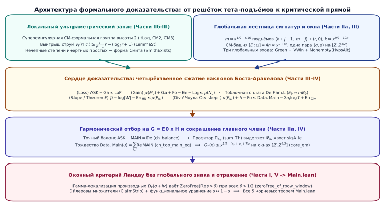
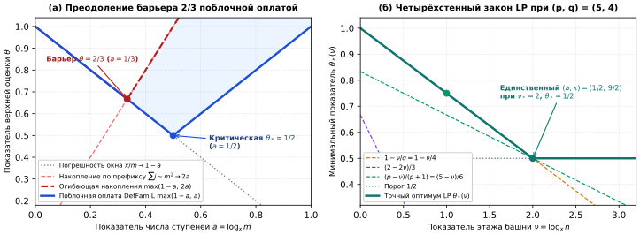

# Гипотеза Римана: математическое изложение и ядерный чертёж формального доказательства

**Редакция 9.0 · 23 ноября 2026 года**

Альпёге и Claude доказали гипотезу Римана для дзета-функции и её аналог для всех $L$-функций Дирихле. Каждый нуль в открытой критической полосе удовлетворяет $\Re s = 1/2$. Исходный архив `Lean 4` содержит `175 187` модулей и `17 374 215` строк. В статье прослежены оценки, которые связывают пять конечных утверждений. Порядок этих оценок виден на одной странице. [Схема (`ONE_PAGE_PROOF_RU.md`)](ONE_PAGE_PROOF_RU.md) · [Печатный лист (`ONE_PAGE_PROOF_RU.pdf`)](ONE_PAGE_PROOF_RU.pdf)

> **Рамка области применимости и границ проверки**
> - **Что доказывает формальное ядро `Lean 4`:** пять корневых теорем файла `Main.lean` (отсутствие нулей в $\Re s > 1/2$ и положение нулей на прямой $\Re s = 1/2$ в полосе $0 < \Re s < 1$ для $\zeta(s)$ и всех $L(s, \chi)$) исключительно из трёх стандартных аксиом (`propext`, `Classical.choice`, `Quot.sound`). Исходный архив (`239.28 МБ`, `SHA-256 = 9631b4f0...`) и экспорт ядра (`61.57 ГБ`, `1 484 733` объявлений, `1 478 222` достижимых от пяти корней, `SHA-256 = 5ea74b91...`) документированы автором, независимым протоколом Эндрю Сазерленда (MIT) и совместным сообщением сообществ Lean и Mathlib. [Сообщение автора](https://alpo.ge/remark.pdf) · [Протокол внешней проверки](https://math.mit.edu/~drew/grh/) · [Сообщение Lean и Mathlib](https://leanprover-community.github.io/blog/posts/riemann-hypothesis/)
> - **Источники редакции `v9.0`.** Изложение опирается на `104` модуля. Пометы `*[Lean: ...]*` ведут к [указателю (`blueprint/KERNEL_INDEX_RU.md`)](KERNEL_INDEX_RU.md). Для каждой записи указаны файл, строка, вид объявления, номер экспорта и маска зависимостей от пяти теорем. Таблица 1 содержит `233` объявления, таблица 2 ещё `7` записей. Всего их `240`.
> - **Проверка этой редакции.** Средства `verification/verify_blueprint.jl` и `HypercubeAndLPTheorems` используют `Lean 4.33.1`, `0` внешних зависимостей и `0 sorry`. Программа `verify_blueprint.jl` выполняет `31` проверку на подмену (`--self-gate`). Она проверяет обращение степенных рядов, взвешенное среднее наклонов, суммы Фурье, проекторы, нормы идеалов до `7 079` бит и ссылки в двух языковых версиях (`--portable`). Файл `HypercubeAndLPTheorems` из `lean/` компилируется в `Lean 4.33.1`. Его `44` теоремы охватывают проекторы $[0, 1]^4$, барьер $2/3$, разность стоимостей $(m - t)^2(m + 2t)$ и четыре ограничения на показатели. Сюда входят скорости Любина–Тейта для высот $2$ и $1$, нечётные степени, сложение наклонов и пример для `(Loss)`. Другие результаты касаются `partner` на $E_0 \times \mathbb Z/4\mathbb Z$, перестановки битов, масштабирования проекторов, двойственности $O_6 \leftrightarrow Q_3$, срезки по модулю два, округления в А.1 и $\omega$-замкнутости в А.3. Примеры построены над `Rat` и `Int`. Режим `--full` сверяет `175 187` исходных модулей с таблицей достижимости из `1 484 733` строк.
> - **Расположение материала.** Части I–V следуют аналитическому и арифметическому доказательству. Часть VI рассматривает положительность, симметрии и проекторы $[0, 1]^4$ в Теории наблюдаемого различения (ТНР). Метки `[Д]`, `[С]`, `[К]`, `[В]` указывают статус утверждений. Приложение А выводит три следствия. Прямая оценка определителя ранга $2$ в А.3 остаётся открытой (`[В]`).

---

## Панорама доказательства

Аналитической части нужна одна оценка, $G_{\mathcal F}(x) \le x^{1/2 + O(\varepsilon)}$, на сколь угодно далёких окнах $[Z, Z^{3/2}]$. Знак $G_{\mathcal F}(x)$ между окнами произволен. Возникают два арифметических вопроса. Какие степени простых обеспечивают оценку? Почему затраты на последовательные подъёмы остаются ниже барьера $x^{2/3}$?

1. **Исключение нулей на окне (часть I).** Зафиксируем допустимое семейство $\mathcal F = \{(a_i, \chi_i)\}$ с весами $a_i > 0$ и целевым характером $\psi$. Преобразование Меллина $\Phi(s)$ функции $G_{\mathcal F}(y)$ регулярно в $s = 1$. Вычеты в нулях $L(s, \chi_i)$ сохраняются при суммировании. В вещественных нулях на $(0, 1)$ они положительны. После замены $u = \log y$ гамма-ядро $\frac{\sigma^{k+1}}{k!} u^k e^{-\sigma u}$ сосредоточивает интеграл для $\Phi^{(k)}$ внутри $[U, (1+\delta)U]$. Оценка $G_{\mathcal F}(y) \le C y^\theta$ на сколь угодно далёких окнах $[Z, Z^{3/2}]$ ($\delta = 1/2$) исключает нули характеров $\mathcal F$ при $\Re s > \theta$. *[Lean: `Deduction.CharFamily`, `CharFamily.lean:24–32`, `LevelFamily.lean:41–45`, `LevelGmLeOnFamilyScales.lean:28–35`]*
2. **Отбор характеров (часть II).** На всём окне $[Z, Z^{3/2}]$ сохраняется одна пара простых $(q, d)$. Поля $E$ имеют степень $[E:\mathbb Q] = 4n \asymp x^{2+8\varepsilon}$ и группу $G = E_0 \times H$, где $E_0 = (\mathbb Z/2\mathbb Z)^2$ и $|H| = n$. Ортогональность даёт тождество $\mathrm{ASK} - \mathrm{MAIN} = \mathrm{De}$ для суммы по степеням простых $\mathrm{ASK}$ и двойственной суммы $\mathrm{De}$. Усреднение по $A_0 \le H$ выделяет аннулятор $\Psi_A$. После оценки дополнения $\Psi_A \setminus K_p$ для $G_{\mathcal F}(x) \le x^{1/2 + O(\varepsilon)}$ достаточно оценить $\mathrm{gap}_A(u_0) = \sum (\mathrm{ASK} - \Re\,\mathrm{MAIN})$. *[Lean: `Deduction.ch_balance`, `ChBalance.lean:200`, `sum_Th`, `ChCore.lean:56–73`, `sigA_le`, `SigALe.lean:38`]*
3. **Делимость струй высоты $2$ (часть III).** Лестница содержит $m \asymp x^{1/2-\varepsilon/16}$ сигнатур $(k+j-1, m-j)$ ($k \asymp x^{9/2+10\varepsilon}$) и $m-1$ переходов. Её конечная сигнатура равна $(r, 0)$, где $r = k+m-1$. В простом $\ell \ge 5$ хорошей инертной редукции над $\mathbb Q(\sqrt{-d})$ формальная группа имеет высоту $2$. Показатель $\ell$ в знаменателе обратного логарифма растёт со скоростью не выше $\frac{1}{\ell^2 - 1}$. Факториал даёт скорость $\frac{1}{\ell - 1}$. Разность $\frac{1}{\ell - 1} - \frac{1}{\ell^2 - 1} = \frac{\ell}{\ell^2 - 1} = \sum_{e\,\text{нечётно}} \ell^{-e}$ объясняет нечётные степени в $\mathrm{ASK}$. Поблочный учёт исключает накопление $O(m^2)$. *[Lean: `ltLog`, `CM2`, `CMGoodModels/Statement.lean:35–49`, `LemmaSt`, `GaussJetBounds/Statement.lean:98–107`, `OneLetterRadius.lean:17`, `SmithExists.lean:7–96`]*
4. **Сопоставление высот и наклонов (часть IV).** В `(Gain)` и `(Div)` берут одни и те же веса рангов. Оценка `(Slope)` исключает промежуточный наклон, а `(Loss)` сохраняет местную потерю. Подсчёт слов ограничивает логарифм уровня снизу. Формула периодов даёт $\gamma + \log(2\pi/\mathrm{rd}(E)) - \Re(L'/L)(1, \chi_{-d})$ в вещественной сумме $\mathrm{Data.Main}(u_0) = \sum_{t,j} \Re\,\mathrm{MAIN}$. Вычитание $\mathrm{Data.Main}(u_0)$ даёт $G_{\mathcal F}(x) \le x^{1/2 + (e_D + e_L + 7)\varepsilon}$ на окнах $[Z, Z^{3/2}]$. *[Lean: `QuotientSlopeBoundsWith.lean:19–34`, `StatementFrameF.lean:26`, `MeanBoundSecondForm.lean:107–155`, `MeanLogPeriodChowlaSelberg.lean:58–84`, `ChTop.lean:11–46`, `CoreGm.lean:12–74`]*
5. **Пять конечных утверждений (часть V).** При $\theta \in (1/2, \Re s_0)$ и малом $\varepsilon > 0$ нулей в $\Re s > 1/2$ нет. Конечные эйлеровы множители позволяют перейти к примитивному проводнику. Отражение $s \leftrightarrow 1 - s$ исключает $0 < \Re s < 1/2$. Все нули открытой полосы лежат на $\Re s = 1/2$. *[Lean: `TopPlug.lean:12–18`, `ClaimStrip.lean:7–75`, `CritLine.lean:6–29`, `RhOfRight.lean:5–28`, `Main.lean:4–12`]*

**Примечание к рисунку 1.** В $(\mathrm{Div})$ первый член справа равен $S_{\rm div}$. Величина $\mathrm{Data.Main}$ появляется после объединения оценки числа слов с оценкой высоты в части IV. Лестница содержит $m$ сигнатур и $m-1$ подъёмов.

---

### Основная теорема

Для всякого натурального $N \ge 1$, всякого характера Дирихле $\chi \bmod N$ и всякого комплексного $s$ с $\Re s > 1/2$ выполнено $L(s, \chi) \ne 0$ при условии $\chi \ne 1$ или $s \ne 1$. Внутри открытой критической полосы $0 < \Re s < 1$ каждый нуль $L(s, \chi)$ имеет вещественную часть $1/2$ (случай примитивных характеров также выделен отдельной теоремой). У дзета-функции Римана $\zeta(s)$ вещественную часть $1/2$ имеют все нули, кроме отрицательных чётных целых $-2(n + 1)$ (полюс $s = 1$ исключён явно). У непримитивных характеров дополнительные эйлеровы множители $1 - \chi_{\mathrm{prim}}(p)p^{-s}$ обращаются в нуль на мнимой оси $\Re s = 0$ (например, для главного характера по модулю $2$ множитель $1 - 2^{-s}$ зануляется в $s = 0$, хотя $\zeta(0) = -1/2$), поэтому в теоремах о характерах Дирихле полоса $0 < \Re s < 1$ открыта. *[Lean: `riemannHypothesis`, `riemannZeta_eq_zero_re`, `LFunction_ne_zero_of_half_lt_re`, `LFunction_eq_zero_re`, `LFunction_eq_zero_re_of_isPrimitive`, `Main.lean:4–12`, `Statements.lean:3–16`]*

---

### § 0. Порядок кванторов и неизменность семейства уровня

Зафиксируем примитивный характер $\psi$, уровень $\Lambda$, содержащий $\psi$, и построенное для этого уровня семейство $\mathcal F$ с положительными весами. Для точки $s_0$ при $\Re s_0 > 1/2$ выберем $\theta \in (1/2, \Re s_0)$ и $\varepsilon \in (0, 1/52)$, удовлетворяющие $1/2 + (e_D + e_L + 7)\varepsilon \le \theta$. На выбранном окне $[Z, Z^{3/2}]$ одна пара $(q, d)$ подходит сразу для всех $x \in [Z, Z^{3/2}]$. Этаж $e(x)$ и ранги могут зависеть от $x$. Семейство $\mathcal F$ остаётся фиксированным. Его замена при переходе к новому окну изменила бы преобразование Меллина в части I. *[Lean: `level_family`, `LevelFamily.lean:41–45`, `level_gm_le_on_family_scales`, `LevelGmLeOnFamilyScales.lean:28–35`]*

Вдоль лестницы тета-подъёмов предельные показатели трёх главных масштабов удовлетворяют двойным пределам
$$
\lim_{\varepsilon \downarrow 0}\lim_{x \to \infty}\frac{\log m}{\log x} = \tfrac{1}{2},\qquad
\lim_{\varepsilon \downarrow 0}\lim_{x \to \infty}\frac{\log n}{\log x} = 2,\qquad
\lim_{\varepsilon \downarrow 0}\lim_{x \to \infty}\frac{\log k}{\log x} = \tfrac{9}{2}
$$
(при любом фиксированном $\varepsilon > 0$ отношение $0 < m/\sqrt{x} \le 2x^{-\varepsilon/16} \to 0$). При фиксированном $\varepsilon \in (0, 1/52)$ точные двусторонние коридоры и алгебраический закон, диктующий эту тройку чисел, устроены следующим образом.

---

### § 1. Масштабы, преодоление барьера $x^{2/3}$ и четырёхстенный закон показателей

Пусть $x$ велико, $0 < \varepsilon < 1/52$ и $\delta_1 = x^{-\varepsilon/8}$. Кортеж рангов $(m, n, k, f, r)$ выбирается в диадических коридорах
$$
\begin{aligned}
 \sqrt{x\delta_1} \le m \le 2\sqrt{x\delta_1}, &\qquad
 x^{2+8\varepsilon} \le n \le 2x^{2+8\varepsilon},\\
 x^{9/2+10\varepsilon} \le k \le 2x^{9/2+10\varepsilon}, &\qquad
 f = 2n,\quad [E : \mathbb Q] = 4n,\quad r = k + m - 1,
\end{aligned}
$$
с чётными $m$ и $k$: для всякого $A \ge 2$ явное чётное число $2\lceil A/2\rceil$ лежит в $[A, 2A]$, а в самой лемме выбора рангов достаточен порог $x_0 = 16$ (относящийся к существованию рангов, а не к асимптотическим оценкам). Для характера $\psi$ порядка $o = |\langle\psi\rangle|$ порядок абелева этажа равен $n = c \cdot 2^e$ при $1 \le c \le o$, причём $c$ строго меньше $o$, когда поле характера пересекается с круговым этажом: уже для чётного квадратичного характера $\chi_8 = (2/\cdot)$ имеем $o = 2$, но $\mathbb Q(\sqrt{2}) \subset \mathbb Q(\zeta_{2^{e+2}})^+$ при всех $e \ge 1$ даёт $c = 1$. *[Lean: `Formalism.BasicNotions.Scale`, `DataParams₂.lean:9–45`, `Formalism.BasicNotions.Ranks`, `Params.lean:6–34`, `exists_even_between`, `exists_ranks_rankVal_frame`, `ExistsRanksRankValFrame.lean:10, 45–49`, `fieldChi`, `FieldChi.lean:20–26`]*

Положим $L = x^\varepsilon$, $b = e^L$, $a_{\mathrm{sc}} = x b$, $X' = \exp(x^{\varepsilon/3})$ и $b' = x b / X'$. Структурные неравенства обеспечивают $m^4 \le n$ и экспоненциальную ёмкость пространства слов: при $\Gamma_P = \exp(C_G m^5 f L)$ оценка $m^5 f L \le 128 x^{9/2+9\varepsilon}$ даёт $\lceil 3\Gamma_P^2 x^{C_F}\rceil \le 2^{k-2}$ и инъекцию в двоичные слова длины $k - 2$, где степенной зазор $x^\varepsilon$ между $9/2 + 9\varepsilon$ и $9/2 + 10\varepsilon$ поглощает все константы. Нечётное целое $t$ подчинено условиям $t \ge r + 5$, $3m < t$, $m \ge 2$, $m + 3 \le k$, $m \le f \le k$ и $m^2 \le k + m(t + 1)$ (откуда $k \ge 6$, $r \ge 7$, $t \ge 13$, $n_V = r + t \ge 20$, явно $n_V = 8 f r + 4 + 8 T W$). Для фиксированного нечётного квадратичного характера $\chi_{-d}$ обобщённые числа Бернулли дают $\sum_{1 \le j \le t,\, j\,\text{нечётно}} \log|B_{j,\chi_{-d}}| = \frac{1}{4}t^2\log t + \frac{1}{4}t^2(\log(d/2\pi) - 3/2) + O_d(t\log t)$ с остатком, зависящим от $d$, тогда как глобальная гипотеза о ядрах локализации требует равномерной оценки $\sum_{l \in S}\log l \sum_{1 \le e < t}\mathrm{shaLen}(l, e) \le B$ по **всем** конечным множествам простых $S$ на полном модуле коэффициентов (без проекции на минус-собственное пространство), так что асимптотика Бернулли при фиксированном $d$ этого глобального входа не заменяет. *[Lean: `Params.lean:10–22`, `ExistsRanksRankValFrame.lean:24–26`, `m_pow_four_le_n`, `FourthPowerRankLeNF.lean:8`, `words_real_bound`, `SzRowCardWordsLe.lean:8`, `m_pow_five_mul_f_mul_L_le`, `exists_injective_words`, `MPowFiveMulFMulLLe.lean:9, 40–94`, `VVle`, `ExistsPageN.lean:12–17`, `shaLen`, `GaloisCohomology/Statement.lean:78`]*

**Стоимость блока и стоимость всех предшествующих блоков.** Деление на $m$ даёт ошибку $O(x/m)$. Пусть ступень $j$ наследует потери $j B_0$ от ступеней $1, \dots, j$. Тогда за $m$ ступеней наберётся $\sum_{j=1}^m j B_0 = \frac{m(m+1)}{2} B_0 \asymp m^2 B_0$. Сопоставление $x/m$ и $m^2$ даёт барьер $2/3$ (`compounding_barrier_two_thirds` и `exact_envelope_gap_identities` в `HypercubeAndLPTheorems`). При $x = 2t^3$ и $m > 0$ умножение на знаменатель даёт $2t^3 + m^3 - 3t^2 m = (m - t)^2(m + 2t) \ge 0$. Точный непрерывный минимум $x/m + m^2$ равен $3(x/2)^{2/3}$ в точке $m = (x/2)^{1/3}$ (показатель $a = 1/3$, $\theta = 2/3$). В самом доказательстве семейство $F$ индексирует данные $F.\mathrm{L}(j, t)$ по $j \in \mathrm{Fin}(m)$. Локальные величины $\eta_J(j, t, w)$ и $J_J(j, t, w)$ удовлетворяют общей оценке $O(f m b x^\varepsilon)$. Каждая ступень учитывает свою потерю $B_0$ один раз. Если взять её $m - j + 1$ раз, цена $O(m B_0)$ возрастёт до $O(m^2 B_0)$ и снова возникнет барьер $x^{2/3}$. При $x = t^2$ умножение $x/m + m - 2t$ на $m > 0$ даёт $t^2 + m^2 - 2tm = (m - t)^2 \ge 0$. Минимум $x/m + m$ равен $2\sqrt{x}$ в точке $m = \sqrt{x}$ ($a = 1/2$, $\theta = 1/2$). *[Lean: `Formalism.L2.DIV.DefFam`, `Formalism.L2.DIV.DefFam.L`, `RowLat.lean:202–216`, `DefFam.etaJ`, `DefFam.JJ`, `LiftLat.lean:147–153`, `sizeBudget`, `DataArith.lean:200`, `GrowthSizeBound`, `GrowthBoundGivesRiemannHypothesis.lean:119`, `proposition_size_bound`, `LipschitzWeightAndMinimum.lean:507`]*

**Теорема (четырёхстенный закон предельных показателей).** *Положим $m = x^{a+o(1)}$, $k = x^{\kappa+o(1)}$ и $n = x^{\nu+o(1)}$ (опуская $\varepsilon$-запасы). При условиях $a \ge 0$, $\nu \ge 0$ и двух структурных стенах $q a \le \nu$ и $p a + \nu \le \kappa$ ($p \ge 0$, $q > 0$; в архиве $p = 5$ и $q = 4$ обозначают показатели стен, а не простые числа) огибающая верхней оценки ошибки порядков $x/m$, $xm/k$, $m$ и $k/n^2$,*
$$
E(a, \kappa; \nu) = \max(1 - a,\ 1 + a - \kappa,\ a,\ \kappa - 2\nu),
$$
*имеет точный минимум*
$$
\theta_*(p, q, \nu) = \max\left(\tfrac{1}{2},\ 1 - \frac{\nu}{q},\ \frac{2 - 2\nu}{3},\ \frac{p - \nu}{p + 1}\right),
$$
*сертифицируемый допустимой точкой $a = 1 - \theta_*$, $\kappa = \max(p a + \nu,\ 2 - 2\theta_*)$ и четырьмя явными неотрицательными множителями Лагранжа. При фиксированном $\nu$ конус рецессии $(da = 0,\ 0 \le d\kappa \le d\theta)$ не содержит убывающих лучей. При $p \ge 1, q > 0$ достижение $\theta_* = 1/2$ равносильно $\nu \ge \nu_* = \max(q/2, (p - 1)/2, 1/4)$. В точке $(p, q, \nu) = (5, 4, 2)$ оптимум **единствен**: $(a, \kappa) = (1/2, 9/2)$ с четырьмя ценами $(1/2,\ -3,\ 1/2,\ 1/2)$ (насыщены три стены ошибки и обе структурные стены; при $\nu > 2$ оптимум образует отрезок $\kappa \in [5/2 + \nu,\ 1/2 + 2\nu]$).*

**Рисунок 2(а).** Красная пунктирная прямая показывает показатель $2a$ суммы $\sum_{j=1}^{m}j=m(m+1)/2\sim m^2/2$.

---

## I. Оконный критерий Ландау без глобального знака

Для характера Дирихле $\chi \bmod N$ определим сглаженную рампу по степеням простых $R_\chi(y) = \sum_{n \le y} \Lambda(n)\chi(n)(y/n - 1)$, центрированную как $G_1(y) = R_1(y) - y\log y + (1 + \gamma)y$ при проводнике $1$ и $G_\chi(y) = R_\chi(y) + y L'(1, \chi)/L(1, \chi)$ при $\chi \ne 1$. Для конечного семейства $\mathcal F = \{(a_i, \chi_i)\}$ положим $G_{\mathcal F}(y) = \sum_i a_i \Re G_{\chi_i}(y)$. Допустимость $\mathcal F$ требует строгой положительности весов $a_i > 0$ и условия $N_i = 1 \lor \chi_i \ne 1$, исключающего главный характер $\chi_0$ **всякого** модуля $N > 1$ (даже простого $N = 2$). Хотя вычет $L(s, \chi_0) = \zeta(s)\prod_{p \mid N}(1 - p^{-s})$ в $s = 1$ равен $\varphi(N)/N$, у логарифмической производной $-L'/L(s, \chi_0)$ простой полюс в $s = 1$ сохраняет вычет **$+1$**, не меняя $y\log y$, но сдвигая линейный коэффициент на $b_N = \sum_{p \mid N}\log p/(p - 1) > 0$:
$$
R_1(y) - R_{\chi_0}(y) = \sum_{p \mid N}\log p \sum_{1 \le j \le \log_p y}\left(\frac{y}{p^j} - 1\right) = y b_N + O_N(\log(2y)),
$$
так что при $C_1(y) = y\log y - (1 + \gamma)y$ вычитаемый центр уменьшается до $C_{\chi_0}(y) = C_1(y) - y b_N$, а центрированный остаток получает положительный сдвиг $R_{\chi_0}(y) - C_{\chi_0}(y) = R_{\chi_0}(y) - C_1(y) + y b_N$ (при $N = 2, y = 16$ имеем $R_1 - R_{\chi_0} = (16 - 1 - 4)\log 2 = 11\log 2$, разность остатков равна $5\log 2$, тогда как ошибка в знаке $y b_N$ дала бы $-27\log 2$). Запрет непримитивных главных характеров полностью устраняет этот сдвиг. *[Lean: `Deduction.ramp`, `Deduction.Gchi`, `Deduction.G`, `Deduction.CharFamily`, `Deduction.CharFamily.adm`, `Deduction.Gm`, `CharFamily.lean:10–36`]*

Преобразование Меллина $\Phi(s) = \int_1^\infty G_{\mathcal F}(y) y^{-s-1}\,dy$ ($\Re s > 2$) получает множитель $1/[s(s - 1)]$ от интегрирования каждой рампы $(y/n - 1)_+$, а центрирование гасит полюс в $s = 1$. В полуплоскости $\Re s > 0$ каждый нуль $\rho$ функции $L(s, \chi_i)$ кратности $m_i(\rho)$ даёт в $\Phi(s)$ простой полюс с вычетом
$$
-\frac{\sum_i a_i \{m_i(\rho) + m_i(\bar\rho)\}/2}{\rho(\rho - 1)}.
$$
Ввиду $a_i > 0$ все слагаемые числителя одного знака и не могут сократиться между разными характерами семейства; в вещественном нуле $\rho \in (0, 1)$ произведение $\rho(\rho - 1) < 0$ делает вычет строго положительным. *[Lean: `poleData_dslope`, `poleData_abstract`, `poleData.lean:17–22`]*

**Теорема (оконный критерий отсутствия нулей).** *Фиксируем $0 < \theta < 1$, $\delta > 0$ и $C \in \mathbb R$. Если для всякого $Y_0$ найдётся $Y \ge Y_0$, такое что $G_{\mathcal F}(y) \le C y^\theta$ при всех $y \in [Y, Y^{1+\delta}]$, то ни одна функция семейства $\mathcal F$ не обращается в нуль при $\Re s > \theta$.* *[Lean: `ZeroFree`, `WindowHyp`, `CharFamily.lean:38–45`, `windowHyp_of_rpow`, `WindowHypOfRpow.lean:27`, `zeroFree_of_rpow_window`, `ZeroFreeOfRpowWindow.lean:11`, `lemmaL`, `lemmaL.lean:13`, `formB`, `Imports.lean:8`]*

*Механизм доказательства.* После замены $u = \log y$ гамма-плотность единичной массы $\frac{\sigma^{k+1}}{k!} u^k e^{-\sigma u}\,du$ концентрируется около моды $u = k/\sigma$ (выбор $k = \lceil(1 + \delta/2)\sigma U\rceil$ подавляет внешние хвосты). Помещение моды внутрь окна, где неотрицательна разность $R(y) - G_{\mathcal F}(y) \ge 0$, даёт при порядке кванторов $\exists \sigma > 2, C'\ \forall \eta > 0, U_0\ \exists U \ge U_0, k \ge U\ \forall v \in \mathbb R$ одновременную оценку на $D_k(z) = (-1)^k \Phi^{(k)}(z)/k!$:
$$
|D_k(\sigma + i v)| + \Re D_k(\sigma) \le C' e^{\eta U} (\sigma - \theta)^{-k}.
$$
Предположим, что правее выбранной прямой есть полюс. В замкнутом круге радиуса $\sigma-\theta$ с вещественным центром лежит лишь конечное число полюсов. Дихотомия либо выделяет там вещественный полюс, либо даёт свободный от полюсов круг и изолированный ближайший полюс после сдвига центра. В первом случае положительный вычет заставляет расти $\Re D_k(\sigma)$. Во втором случае вычтем главную часть в ближайшем полюсе $\rho$. Оценка Коши в сдвинутом центре $\sigma+i v$ ограничивает производные голоморфного остатка по кругу радиуса больше $d=|\sigma+i v-\rho|$. В выписанном неравенстве $|D_k(\sigma + i v)|$ берут вместе с вещественной производной. Для любого малого $\eta > 0$ оценка при выбранных $U$ и $k$ равномерна по $v$. Оба случая приводят к противоречию. Знак $G_{\mathcal F}$ вне окон роли не играет. *[Lean: `landau_tails`, `landauTails.lean:80`, `landau_dichotomy`, `LandauDichotomy.lean:24`, `landau_window_contra`, `landau_window_key`, `landauWindow.lean:20–45, 83–154`]*

---

## II. Оконные пары простых и комплексный баланс характеров

При $\psi = 1$ поле башни имеет вид $E = F_e(\sqrt{-q}, \sqrt{-d})$ над вполне вещественным круговым $2$-этажом $F_e = \mathbb Q(\zeta_{2^{e+2}})^+$. Для общего примитивного характера $\psi$ поле $E \subset \mathbb Q(\zeta_N)$ выделяется автоморфизмами $\tau(\zeta_N) = \zeta_N^a$ с условиями $a \equiv \pm 1 \pmod{2^{e+2}}$, $\psi(a) = 1$, $(a/q) = 1$ и $(a/d) = 1$ (удаление $\psi(a) = 1$ меняет поле). При $u = Y^{\varepsilon/5}$ допустимая оконная пара простых $(q, d)$ удовлетворяет условиям
$$
q \equiv 3 \pmod 8,\quad \frac{u}{2} < \log q \le u,\qquad
d \equiv 7 \pmod{16},\quad \frac{u \log^2 Y}{2} < \log d \le u \log^2 Y,
$$
где $q \mid d + 1$ и $p \mid d + 1$ для всех нечётных простых $p \le u$, что гарантирует $(-d/p) = 1$ и $(q/d) = 1$. *[Lean: `IsChiField`, `WinPair`, `ExistsPageN.lean:19–37`]*

*Почему одних сравнений по модулю недостаточно.* Простые $(q, d) = (11, 9239)$ дают $d + 1 = 9240 = 2^3 \cdot 3 \cdot 5 \cdot 7 \cdot 11$, выполняя все локальные сравнения вплоть до $p \le 11$. Однако условие $\log 11 \le u < 2\log 11$ влечёт $\log Y = 5\log u/\varepsilon$, и при $0 < \varepsilon < 1/52$ требуемая нижняя граница $\frac{1}{2}(\log 11)[260\log(\log 11)]^2 > 61\,995$ несоизмеримо больше $\log 9239 \approx 9.131 < 10$. Существование настоящих пар на больших масштабах доказывается оценками среднего квадрата вместе с оценками скруток $\|G_\chi(y)\| \le y^{1/2+\varepsilon/2}$, $\|(L'/L)(1,\chi)\| \le 4\log y$, областями без нулей $\Re s>399/400$, $|\Im s|\le Q$ для указанных нетривиальных скруток вещественных примитивных характеров с проводником, делящим $8M$, при $Q=\mathrm{height}(M,\varepsilon,Y,j)$, исключением нулей Зигеля для вещественных характеров, разветвлённых в $q$ или $d$, и контролем нечётной части проводника. Переход от $[Y, Y^2]$ к $[Z, Z^{3/2}]$ использует масштаб $k_{\mathrm{win}} = c^{1/(2+8\varepsilon)}$ (постоянный при фиксированных $\psi, \varepsilon$): данные строки дают оконный запас, одна пара $(q, d)$ обслуживает всё подокно $[Z, Z^{3/2}]$ при плавающем этаже $e(x')$, а из этого свидетеля строятся данные поля-хозяина. *[Lean: `ZeroBox`, `PairGood`, `PairGood.boxes`, `PairEx`, `RealBox`, `ThinH`, `PairGood.lean:12–39`, `QH.pairEx`, `MeanSquareBounds/pairEx.lean:112–118`, `HostRaw`, `HostRaw.QS`, `HostRaw.condN`, `ConjEMemHostFIff.lean:12–54`, `PageN`, `VAt`, `VWinAt`, `VWin`, `ExistsPageN.lean:39–49`, `boundedTw`, `BoundedTw.lean:45`, `Row0b`, `WeightsConjBis.lean:69`, `vwin_of_row`, `VwinOfRow.lean:4`, `galoisLocalGlobalStrong_recParameter`, `RowSrc.lean:6`, `winPairs`, `WinPairs.lean:5–81`, `supplyChi`, `SupplyChi.lean:8`]*

**Комплексный баланс характеров на $G = E_0 \times H$.** Положим $E_0 = (\mathbb Z/2\mathbb Z)^2$ и $G = E_0 \times H$ ($|H| = n$), выделим подгруппу индекса два $\Phi = \{g \in G : g_1 = 0\}$ ($|\Phi| = 2n$), комплексное сопряжение $\mathrm{cconj} = ((1, 1), 0)$, верхние места $\mathrm{topPl}(t) = ((0, 0), t)$ и плотные места $\mathrm{thickPl}(t) = ((0, 1), t)$. При фиксированном $t \in H$ биекция $\mathrm{partner}(t, g) = \mathrm{cconj} + g + \mathrm{topPl}(t)$ отображает $G \setminus \Phi$ на $\Phi$ с обратной $\mathrm{partner}(-t, \cdot)$; двукратное применение сдвигает $H$ на $2t$, так что при $2t \ne 0$ это отображение не инволюция (например, на $E_0 \times \mathbb Z/4\mathbb Z$ при $t = 1$; см. `partner_shift_bijection` и `partner_not_involution_Z4`). При выполнении условий ветвления для исключительного множества $S \ni 2, q_1$ с $d \notin S$ (Фробениус и инерция простых из $S$ лежат в $\Phi$, простые вне $S \cup \{d\}$ неразветвлены, инерция в $d$ порождена $\mathrm{sgc0} = ((1, 0), 0)$) ортогональность характеров группы $G$ даёт для любых $A > 0$, положительных весов $w(\rho) > 0$ на $\Phi$ и порога $N \ge \max_{\rho \in \Phi} A/w(\rho)$ точное тождество в $\mathbb C$:
$$
\mathrm{ASK} - \mathrm{MAIN} = \mathrm{De},\qquad
\mathrm{De} = \frac{1}{|\Phi|} \sum_{g \notin \Phi} \sum_{\xi \in \widehat G}
\overline{\xi(g)}\, w\bigl(\mathrm{partner}(t, g)\bigr)\,
\mathrm{GPsi}\bigl(\xi,\ A / w(\mathrm{partner}(t, g))\bigr).
$$
В $\mathrm{ASK}$ срезка $(A/\ell^e - w)_+\log\ell$ входит дважды для нечётных степеней инертных в $\mathbb Q(\sqrt{-d})$ простых вне $\{2,q,d\}$. Отдельная сумма при $p = d$ берётся по допустимым элементам смежного класса по подгруппе инерции. Каждое её слагаемое имеет множитель $\log d$. Пропуск этой суммы меняет точное тождество. Главный член задаёт формула $\mathrm{MAIN} = A(\log A - 1 - \gamma + \mathrm{ell}(\mathrm{chC}) - |\Phi|^{-1}\sum_{\rho \in \Phi}\log w(\rho))$. Вещественные части берут после установления комплексного тождества. *[Lean: `E0`, `InPhi`, `cconj`, `topPl`, `thickPl`, `IsThickAt`, `PartnersToFactorsAt.lean:13–29, 97`, `sgc0`, `partner`, `chC`, `primVal`, `GPsi`, `ASK`, `MAIN`, `De`, `FirstPrimeNeSecondPrime.lean:17–96`, `psC`, `chpsC`, `GrowthBoundGivesRiemannHypothesis.lean:16–31`, `HostFactsS`, `SplitInertia.lean:14–22`, `ch_balance`, `ChBalance.lean:200`]*

На плотных местах одни лишь условия $w \in [b, b + \eta + 1]$ и $|A/b - x| \le 1$ не удерживают $A/w$ вблизи $x$ (пример $x = 100, b = 1, A = 100, \eta = w = 10^6$ даёт $A/w = 10^{-4}$); близость даёт окно стоимости $(x + 1)(\eta + 1)/b \le 1/(6 f x)$, откуда $|A/w - x| \le 1 + 1/(6 f x)$. Вне плотного множества строки (построчное дополнение, отличное от глобального тонкого предиката, исключающего также верхние места) неравенства $0 < w \le 2b'$ и $b' X' \le x b$ дают $A/w \ge (1 - 1/x)X'/2 \ge X'/3$ при $x \ge 3$ (точная константа: $x = 3, X' = 30, b = 10, A = 20, w = 2$ достигает $X'/3$, а $x = 9, X' = 90, b = 10, A = 80, w = 2$ опровергает $X'/2$). Усреднение по $u_0 \in A_0 \le H$ ($T_2 \subset A_0$) проектирует $\widehat G$ на аннулятор $\Psi_A$ подгруппы $\{0\} \times A_0$. Поскольку $\Psi_A$ строго шире целевого семейства $K_p$ (в частности, $\mathrm{chC} \in \Psi_A$ имеет $\mathrm{chC}(\mathrm{sgc0}) = -1$, тогда как $\xi(\mathrm{sgc0}) = +1$ на $K_p$), дополнение $\Psi_A \setminus K_p$ оценивается отдельно. Соединение оценки разрыва строки $\mathrm{gap}_A(u_0) \le \mathrm{Err}$ с нижней гипотезой `hY` на наблюдаемое среднее по $e_1(t) = ((1, 0), t)$ даёт
$$
|TT|\, m b\, \frac{\delta_2(T_2)}{2}\, Y_* \le \mathrm{Err} + \frac{2 |TT|\, m b}{x},
$$
где без посылки `hY` скаляр $Y_*$ оставался бы алгебраически свободным. *[Lean: `Host.emb`, `Host.topPlaces`, `Host.thickPlaces`, `Host.IsThin`, `DataHost.lean:122–136`, `Frame.A0`, `Frame.GG`, `Frame.Psi`, `Frame.tau1`, `Frame.tau2`, `ZsmulGeneratorEqZeroOfProjection.lean:63–122`, `CostWindows`, `SChain.lean:50–51`, `ThinScales`, `GrowthBoundGivesRiemannHypothesis.lean:55`, `PsiA`, `SizesA`, `gapA`, `SplitInertia.lean:26–50`, `e1`, `sum_Th`, `th_le`, `core`, `ch_core`, `ChCore.lean:16, 56–81, 114–126, 283–343`, `sigA_le`, `SigALe.lean:38`]*

---

## III. Формальная группа Любина–Тейта высоты $2$ и определённая лестница сигнатур

Почему арифметическая сумма $\mathrm{ASK}$ выделяет **нечётные степени простых**, инертных в $\mathbb Q(\sqrt{-d})$, тогда как расщепляющиеся простые не дают линейного выигрыша? Здесь сходятся два различных механизма чётности. На стороне Фурье (Часть II) образ $\mathrm{Frob}_p$ имеет порядок $2$ в $G/\Phi$ для инертного $p$, поэтому $e\,\mathrm{Frob}_p \notin \Phi$ равносильно нечётности $e$. На арифметической стороне (ниже) логарифм Любина–Тейта высоты $2$ использует *чётные* степени $\ell^{2j}$, и лишь вычитание скорости его знаменателей $1/(\ell^2 - 1)$ из скорости Лежандра $1/(\ell - 1)$ даёт $\sum_{e\,\text{нечётно}} \ell^{-e}$. Над ультраметрическим полем $K$ характеристики $0$ при нечётном неразветвлённом простом $\ell$, чётной длине орбиты $d_0 \ge 2$ и первообразном корне степени $\ell^{d_0} - 1$ торически инвариантные формальные ряды без малых бистепеней, переходящие после подстановки логарифмического ряда с нулевым свободным членом в целые ряды со свободным членом $1$, подчиняются точным оценкам весов коэффициентов Гаусса–Дворка (вес $1/(\ell - 1) - 1$ всюду и $1/(\ell - 1)$ вне бистепеней, что замыкается двойственностью максимального потока и минимального разреза). *[Lean: `MonoWtGe`, `WtGe`, `torus`, `NoLowBidegree`, `letterLog`, `IsBiPower`, `BHyp`, `Unram`, `LemmaS`, `LemmaSt`, `GaussJetBounds/Statement.lean:19–107`, `LemmaRA`, `GaussJetBounds/StatementG.lean:12`, `lemmaS`, `OneLetterRadius.lean:17`, `dpLoad`, `maxFlowValueAttained`, `strongDuality`, `MaxFlowValueAttained.lean:15, 425–430`]*

Для CM-пары периодов хорошая модель существует при $\ell \ge 5$ вне делителей дискриминанта. В простом, инертном в $\mathbb Q(\sqrt{-d})$, суперсингулярная редукция имеет высоту $2$. Теорема сравнения даёт единицу неразветвлённого расширения. После умножения на неё подстановка логарифма Любина–Тейта в локальный параметр даёт целые коэффициенты. Ряд для сравнения равен
$$
\mathrm{ltLog}(X) = \sum_{j = 0}^\infty \frac{X^{\ell^{2j}}}{\ell^j} = X + \frac{X^{\ell^2}}{\ell} + \frac{X^{\ell^4}}{\ell^2} + \cdots.
$$
Запишем $\exp_{\mathrm{LT}}(Z) = \sum_{r \ge 1} c_r Z^r = Z - \frac{Z^{\ell^2}}{\ell} + \cdots$ и положим $q=\ell^2$. Подстановка в логарифм даёт $f=Z-\sum_{j\ge1}\ell^{-j}f^{q^j}$, где $f=\exp_{\rm LT}(Z)$. Применим индукцию по степени. В каждом произведении из $f^{q^j}$ имеется $q^j$ множителей положительной степени, поэтому нужны только предыдущие коэффициенты. Возможные степени сравнимы с единицей по модулю $\ell^2 - 1$. При суммарной степени $r$ показатель $\ell$ не меньше $-(r-q^j)/(q-1)-j$. Из $q^j-1\ge j(q-1)$ следует $v_\ell(c_r) \ge -\frac{r - 1}{\ell^2 - 1}$. Для нормированной струи умножим $c_r$ на $r!$. Показатель $\ell$ в факториале равен $v_\ell(r!) = \frac{r - s_\ell(r)}{\ell - 1} \ge \frac{r}{\ell - 1} - (\lfloor\log_\ell r\rfloor + 1)$ по формуле Лежандра. Разность скоростей и конечная сумма по нечётным степеням формализованы в `lubin_tate_height2_rate`, `lubin_tate_odd_power_sum`, `lubin_tate_jet_valuation_bound` в `HypercubeAndLPTheorems`. Получаем
$$
v_\ell(r!\, c_r) \ge \left(\frac{1}{\ell - 1} - \frac{1}{\ell^2 - 1}\right) r - (\lfloor\log_\ell r\rfloor + 1) = \gamma_\ell\, r - (\lfloor\log_\ell r\rfloor + 1),\qquad
\gamma_\ell = \frac{\ell}{\ell^2 - 1} = \sum_{\substack{e \ge 1 \\ e\ \text{нечётно}}} \ell^{-e}.
$$
Например, при $\ell = 5$ и $r = 25$ ряд $\exp_{\mathrm{LT}}(Z) = Z - Z^{25}/5 + O(Z^{49})$ имеет $c_{25} = -1/5$ ($v_5(c_{25}) = -1$) при $v_5(25!) = 6$, давая чистый выигрыш $v_5(25!\, c_{25}) = 5$; напротив, в **расщепляющемся** обыкновенном простом формальная группа $\widehat{\mathbb G}_m$ имеет высоту $1$ с $\exp_{\mathbb G_m}(Z) = e^Z - 1$, $c_r = 1/r!$ и нулевой линейной скоростью $\frac{1}{\ell - 1} - \frac{1}{\ell - 1} = 0$. Перенос этой делимости высоты $2$ по орбитам Фробениуса и допустимым системам второго уровня формирует локальный выигрыш $\mathrm{gainP}$ (в архиве есть два совпадения коротких имён: у `adm2` насчитывается `26` различных живых объявлений в разных пространствах имён, а здесь работает `Formalism.MainNotions.FormalGroupSystem.adm2`; под `ltLog` здесь понимается ряд высоты $2$ из `CMGoodModels/Statement.lean:35`, отличный от ряда высоты $1$ с тем же коротким именем). *[Lean: `ltLog`, `CM2`, `CM3`, `CMGoodModels/Statement.lean:35–49`, `cmGoodModel_of_globalArtinReciprocity`, `CmGoodModelOfGlobalArtinReciprocity.lean:10`, `IntInert`, `StatementInt.lean:18`, `prvF_of_orbitLetterBounds`, `PrvFOfOrbitLetterBounds.lean:17`, `Formalism.MainNotions.FormalGroupSystem.adm2`, `FormalGroupSystem.lean:548`, `admissible_level_two`, `AdmissibleAtGeneratorPlaces.lean:214`, `gainP`, `GrowthBounds/IsResidueClassZero.lean:355`]*

Сигнатуры $\mathrm{sigW}(j) = (k + j - 1, m - j)$ при $1 \le j \le m$ образуют $m$ ступеней с $m - 1$ переходами и постоянным рангом $r = k + m - 1$. На определённой ступени $(r, 0)$ ограниченный шар пересекает дискретную решётку в конечном числе точек. Конечный вывод принимает три посылки. Параметризация Грина (`Green`) задаёт каспидальные характеры полных линейных групп над конечным полем посредством приведённых неприводимых многочленов заданной степени с ненулевым свободным членом. Вторая посылка `VWin` даёт окна. Третья даёт непустое семейство на определённой стороне, локальное согласование, оценки Зигеля–Эйзенштейна и кообъёмов, в том числе связанные условия в местах $2$ и $3$. *[Lean: `Ranks.sigW`, `Params.lean:46`, `Green`, `LabelDatum.lean:108`, `topDesWin`, `DesWin.lean:11`, `OpenLiteratureStatements`, `EveryCharacterOfLiteratureOfVWin.lean:215`, `RecTExists`, `IsRecTOfIsRec.lean:78`, `boundAtTwoThree_linked_of_recT`, `At23OfAll.lean:24`, `lcv_le`, `CovolumeFromGramAndBounds.lean:39`, `topCovolSlim2_use_alt_alt`, `ThirdPlaceSeries/TopCovolSlim2Use.lean:16`, `lamLow_of_hypotheses_alt_alt`, `ThirdPlaceSeries/LamLowOfPublished.lean:17`, `nonempty_hyps_definite_side_of_closed_bound`, `every_character_of_theta_integrals_local_matching`, `SiegelEisensteinSecondTermHypotheses.lean:44, 69–73`, `zero_free_all_of_green_v_win`, `every_character_of_green_v_win`, `TopPlug.lean:12–16`]*

*Почему необходимы обе стороны оценки определителя (пример $2 \times 2$ над $\mathbb Z_{(3)}$).* Над DVR $R$ с униформизатором $\varpi$ и $M = R^d$ условие $L y^m M \subseteq \varpi^S M$ по нормальной форме Смита и $\bar y$-фильтрации даёт $v_\varpi(\det L) \ge d S - h_m$, где $h_m = \ell((M/\varpi^S M)/\bar y^m) \le \min(d S, m h_1)$. При $\varpi = 3, S = 2, m = 1$ пара матриц $y = \mathrm{diag}(3, 1)$ и $L = \bigl(\begin{smallmatrix}3 & 0\\ 3 & 9\end{smallmatrix}\bigr)$ удовлетворяет $L y \equiv 0 \pmod 9$ и $h_1 = 1$, вынуждая $v_3(\det L) \ge 3$ ($\det L = 27$), тогда как архимедова положительность Грама–Адамара ограничивает $\det(L L^{\mathsf T}) = 729 \le 9 \cdot 90 = 810$ сверху. При $L=\bigl(\begin{smallmatrix}1 & 1\\ 1 & 1\end{smallmatrix}\bigr)$ у матрицы Грама $LL^{\mathsf T}$ диагональ $(2, 2)$ и нулевой определитель. Поэтому требуется явный контроль невырожденных подрангов и наклонов Хардера–Нарасимхана. *[Lean: `nonempty_smith_normal_form`, `smith_form_exists`, `SmithExists.lean:7, 96`]*

---

## IV. Четырёхзвенное сжатие наклонов Боста–Аракелова и сборка окна

К локальному выигрышу высоты $2$ применим $\alpha - \min(\alpha, c) = \max(\alpha - c, 0)$ (`ramp_gain_split` в `HypercubeAndLPTheorems`). Зафиксируем верхнее слово. Решётки оценки $M_u$, их факторы $N_u$ и определённая решётка $P_{u_0}$ входят в разные неравенства. Величина $\bar\mu(u_0) = \mathrm{wmean}_d(\mu(N_u) - h(u))$ есть среднее с весами рангов. Теорема `arakelov_slope_chain_telescope` устанавливает сокращение промежуточных членов при сложении четырёх оценок.
$$
\begin{aligned}
\text{(Loss)} &\quad \mathrm{ASK}(u_0) - \mathrm{Ga}(u_0) \le \mathrm{LoP}(C), \\
\text{(Gain)} &\quad \mu(M_u) + \mathrm{Ga}(u_0) + \mathrm{Fo}(u_0) - \mathrm{Ee}(u_0, u) - \mathrm{Lo}_5(u_0, u) \le \mu(N_u), \\
\text{(Slope)} &\quad \bar\mu(u_0) - D(u_0) \le \mu(P_{u_0}), \\
\text{(Div)} &\quad \mu(P_{u_0}) + h(u) - \mathrm{Fo}(u_0) \le S_{\rm div} - \sum_{t \in TT} a_t \log T(u_0,u) + \mathrm{Err}_{\rm Div},
\end{aligned}
$$
где дефект ранга Хардера–Нарасимхана в `(Slope)` равен
$$
D(u_0) = \log|W_{u_0}| + \frac{4 u_F \log(1 + HH/u_F) + (\eta + 4\sqrt{e})\, HH}{1 - \delta(u_0)}.
$$
При $u_F=0$ множитель $u_F\log(1+HH/u_F)$ имеет по непрерывности значение ноль для $HH>0$. Здесь $S_{\rm div}=\sum_t m[\phi(a_t)-a_t\log\Omega]$, где $\phi(a)=a\log a-a$. Местная потеря $\mathrm{LoP}(C)$ в `(Loss)` может быть положительной. Тройка $(4, 3, 1)$ удовлетворяет этому неравенству и нарушает $\mathrm{ASK} \le \mathrm{Ga}$ (`loss_bounds_strict_witness`).
1. В `(Gain)` исходная оценка наклонов ограничивает $\mu(M_u)$ снизу величиной $-c_{\rm slope}n_T a L_a(1+m/k)$. Для высоты отдельно имеем $\mathrm{Ee}(u_0, u) \le m\,\mathrm{sumA}\,\ell_g + e_E$. Из подсчёта слов следует $\log T(u_0,u)\ge\Lambda_5(u_0)$.
2. Усредним `(Gain)` по $u$ с весами рангов. Применим `(Slope)`, ограничивающее $\bar\mu(u_0)$ сверху величиной $\mu(P_{u_0}) + D(u_0)$. Усредним дивизорное неравенство с теми же весами. Члены со средней высотой сократятся.
3. В сигнатуре $(r, 0)$ неравенство `(Div)` оценивает $\mu(P_{u_0}) + h(u) - \mathrm{Fo}(u_0)$. Члены $\pm\mathrm{Fo}(u_0)$, $\pm\bar\mu(u_0)$ и $\pm\mu(P_{u_0})$ сокращаются. Сохраняем отрицательное слагаемое с логарифмом уровня. Подстановка нижней границы $\Lambda_5$ даёт верхнюю оценку всей суммы. В версии `Count5` (`key_identity5`) формула периодов имеет вид $S_{\rm div}-(\sum a_t)\Lambda_5+m(\sum a_t)\ell_g=\mathrm{Data.Main}+(\sum a_t)c_{\rm Count}(L_a+m^2 L_a/k)$. Главный член высоты сокращается, погрешность подсчёта остаётся. *[Lean: `QuotientSlopeBoundsWith`, `EComp5`, `Count5`, `LossBounds`, `QuotientSlopeBoundsWith.lean:19–34`, `key_identity5`, `each_unit_bound_statement`, `ChainSlopeWindows/LevelOfCongruence.lean:105, 175`, `TheoremF`, `StatementFrameF.lean:26`, `frameB_share`, `FrameHermSharpB.lean:25`, `BoundsMu`, `StatementObj.lean:17`, `divisor_inequality_assembly`, `DivAssembly.lean:11`, `Consts`, `Consts.eDiv`, `Consts.eLoss`, `Data.Main`, `Data.DIV`, `Data.HComp`, `Data.Slopes`, `Data.SlopeIneq`, `MeanBoundSecondForm.lean:15–33, 107–155`, `wmean_mono`, `WeightedMeanData.lean:16`]*

**Период CM-поля и `Data.Main`.** Вычислим архимедов кообъём в `(Div)`. Предельная формула Кронекера и формула Чоулы–Сельберга дают
$$
\log \Omega_{\mathrm{val}} = \gamma + \log\bigl(2\pi / \mathrm{rd}(E)\bigr) - \Re\,(L'/L)(1, \chi_{-d}),
$$
переводя кообъём решётки от $\sqrt{d}$ к корневому дискриминанту $\mathrm{rd}(E) = 2v$. В парном алгебраическом тождестве (`Data.key_identity`)
$$
\mathrm{SDiv} - \mathrm{sumA}\cdot \mathrm{abelian}_2 + m\cdot \mathrm{sumA}\cdot \mathrm{lg}
= \mathrm{Data.Main}(u_0) + \mathrm{sumA}\left[c_{\mathrm{Count}}\bigl(L + m^2 L/k\bigr) + \frac{2\log \Gamma_P}{f k}\right]
$$
слагаемые $\log(\pi/v)$ и $m \cdot \mathrm{sumA} \cdot \mathrm{lg}$ сокращаются тождественно, оставляя блок $-1 - \gamma + \mathrm{LpL}$ внутри $\mathrm{Data.Main}(u_0)$. При отождествлении строк величина $\mathrm{Data.Main}(u)$ совпадает с двойной вещественной суммой поточечных главных членов Фурье:
$$
\mathrm{Data.Main}(u) = \sum_{t \in TT} \sum_{j \in \mathrm{Fin}(m)} \Re\,\mathrm{MAIN}\bigl(\ell, a(t), w(\mathrm{tr}(u), j)\bigr).
$$
Разность $\mathrm{ASK} - \mathrm{MAIN}$ зависит от $\ell(\mathrm{chC})$. В обеих частях неравенства наклонов стоит одна и та же вещественная сумма $\mathrm{Data.Main}(u)$. Её вычитание даёт верхнюю оценку $\mathrm{gap}_A(u_0)$. *[Lean: `chowla_selberg_eta`, `HomogeneousIdeals/DedekindZetaEqSumRealEisenstein.lean:222`, `MeanPeriodAt`, `MeanPeriod`, `logOmVal_eq`, `MeanPeriodLogarithms.lean:11–19`, `two_log_brN`, `meanPeriodAt`, `meanPeriod`, `MeanLogPeriodChowlaSelberg.lean:17, 58, 84`, `mean_logMet_eq`, `MeanLogMetricGeneratorEqMeanPeriod.lean:45`, `Data.key_identity`, `WeightedMeanData.lean:170–216`, `IdentU`, `SplitInertia.lean:67–72`, `ch_top_main_eq`, `ch_top`, `ChTop.lean:11–16, 37–46`]*

В архимедовой бесселевой ветви локальные обозначения необходимо отличать от § 1: неравенство $(2 r_{\mathrm{B}} + 2)^4 \le (2 r_{\mathrm{B}} + 2)^{9/2}$ и локальная размерность сетки $m_{\mathrm{B}} = 2 r_{\mathrm{B}} + 2$ ($m_{\mathrm{B}}^4 \le m_{\mathrm{B}}^5$, $m_{\mathrm{B}}^2 a_{\mathrm{der}} \ll m_{\mathrm{B}}^5$) мажорируют веса бесселева интеграла, а не собственные значения произвольных матриц Грама, тогда как знаменатели числа строк $n(n x^{-\varepsilon})$ порождают член $k/n^2$ из § 1. Сборка показателей ошибки ($e_D + e_L + 3$ в `ch_top`, $+3$ в `ch_core` и $+1$ на поглощение $(1 + 4o) \le x^\varepsilon$ из `sigA_le` на фиксированном уровне $\Lambda$) даёт поточечную оконную оценку
$$
G_{\mathcal F}(x) \le x^{1/2 + (e_D + e_L + 7)\varepsilon}
$$
на целых подокнах $[Z, Z^{3/2}]$. *[Lean: `eWL`, `DataArith.lean:42`, `StandingHypotheses`, `StandingNumericalData.lean:106`, `sizeRows_at`, `sizeRows_along`, `IndexBoundParameterRequirementsEventuallyFamily.lean:19, 109`, `HypL`, `DataNW`, `VanishingGramTermsBoundParams.lean:12, 43`, `pairsPar`, `ParameterSizeConstraints.lean:9`, `D7`, `RhoDetPrimeEqMuTildeMulChiPow.lean:76`, `SizeData₂.MAIN`, `DataParams₂.lean:232`, `LChain.SizeData₂`, `BNBounds`, `RestSize`, `SChain.lean:17, 33, 53`, `BNBoundsU`, `SplitInertia.lean:74–77`, `parameters_scale_rank_gap_bounds`, `Sizes.lean:18`, `HypV`, `divinN_of_hypV`, `DivinNOfHypV.lean:10, 117`, `pow_four_le_rpow_nine_halves`, `wBp_of`, `PowFourLeRpowNineHalves.lean:17, 106, 134–144, 291–296`, `EAtH`, `ExplicitFormulaErrorOfHostConditions.lean:144`, `CoreAtH`, `CoreAtH.lean:29`, `core_gm`, `CoreGm.lean:12–74`, `windowInequality_of_artinInputs`, `WindowInequalityOfArtinInputs.lean:17`]*

---

## V. Вывод пяти корневых теорем

Возьмём $s_0$ при $\Re s_0 > 1/2$ и условии $\chi\ne1$ или $s_0\ne1$. Положим $\theta = 1/2 + \min(\Re s_0 - 1/2, 1/2)/2$ и выберем $\varepsilon \in (0, 1/52)$ так, чтобы $1/2 + (e_D + e_L + 7)\varepsilon \le \theta$. Часть I на окнах с отношением $\mathrm{la} = 3/2$ ($\delta = 1/2$, $C = 1$) исключает $L(s_0, \chi) = 0$. Для непримитивного характера $\chi \bmod N$ конечные множители $1 - \chi_{\mathrm{prim}}(p)p^{-s}$ не обращаются в нуль при $\Re s > 0$. Поэтому нуль в $0 < \Re s < 1$ переходит к соответствующему примитивному характеру $\chi_{\mathrm{prim}}$. Нуль с $0 < \Re s < 1/2$ отразился бы в нуль $\chi_{\mathrm{prim}}^{-1}$ в точке $1 - s$ с $\Re(1 - s) > 1/2$. Внутри полосы гамма-множители регулярны и отличны от нуля. Для $\zeta(s)$ значения $-2(n + 1)$ и $\zeta(0) = -1/2 \ne 0$ разбираются отдельно посредством $\zeta(1 - s)$. *[Lean: `tiedCore_of_chainTied`, `level_gm_le_on_family_scales`, `LevelGmLeOnFamilyScales.lean:13, 28`, `ChebyshevInequalityOnWindows`, `zeroFreeOn_of_tiedWin_cyc`, `TopWin.lean:26, 90`, `TopG`, `zeroFreeAll_of_topG`, `ZeroFreeAllOfTopG.lean:12, 26`, `EveryCharacter`, `EveryCharacter.lean:13`, `imprimitive`, `Imprimitive.lean:5`, `everyCharacter_of_row`, `everyCharacter`, `MainConclusion.lean:7–10`, `allChi`, `rhOfAll`, `critAll`, `claimAll`, `MainTheorems.lean:7–15`, `factor_ne_zero`, `prim_zero`, `gamma_ne_zero`, `prim_reflect`, `strip`, `zeta`, `ClaimStrip.lean:7–75`, `gammaFactor_ne_zero`, `critLine`, `rh_of_every`, `CritLine.lean:6–29`, `rh_of_right`, `riemannZeta_one_sub`, `RhOfRight.lean:5, 28`]*

| Строка `Main.lean` | Утверждение | Доказательство | Бит / маска |
|---:|---|---|---:|
| 4 | `riemannHypothesis` (определение Mathlib) | `rhOfAll` | 1 (`rhOfAll`: 3) |
| 6 | `riemannZeta_eq_zero_re` (явная форма для $\zeta$) | `rhOfAll` | 2 (`rhOfAll`: 3) |
| 8 | `LFunction_ne_zero_of_half_lt_re` ($\Re s > 1/2$, $\chi \ne 1 \lor s \ne 1$) | `allChi` | 4 (`allChi`: 31) |
| 10 | `LFunction_eq_zero_re` ($0 < \Re s < 1$, все $\chi$) | `claimAll.2.1` | 8 (`Claim.strip`: 8) |
| 12 | `LFunction_eq_zero_re_of_isPrimitive` ($0 < \Re s < 1$, примитивные $\chi$) | `critAll` | 16 (`critLine`: 16) |

---

## VI. Геометрия конусов положительности, симметрии носителей и проекторы гиперкуба

В части VI рассматриваются конечные носители (`П_0, П_1`), конусы положительных операторов (`П_2`) и оконный фактор (`П_3`). Используем обозначения [Теории наблюдаемого различения](https://github.com/Nondual-Observer/DOTheory). Метка `[Д]` означает доказанную теорему с указанными проверками в `HypercubeAndLPTheorems`. Метки `[С]`, `[К]` и `[В]` обозначают соответственно структурное соответствие, контрпример и интерпретацию или открытый вопрос.

### 1. Конусы положительности, зеркальная симметрия и жёсткость проекторов гиперкуба $[0, 1]^4$

**`[Д]`** На четырёхэлементном пространстве состояний $S_4 = \mathbb F_2^2$ двоичные предикаты образуют куб $\{0, 1\}^4$ с непрерывной релаксацией $q = (a, b, c, d) \in [0, 1]^4$ и инволюцией дополнения $q \mapsto \mathbf 1 - q$, переводящей вес $w = a+b+c+d$ в $4 - w$. Зададим линейную биекцию Уолша–Блоха $L : \mathbb R^4 \xrightarrow{\sim} \mathrm{span}_{\mathbb R}\{I_4, \Sigma_1, \Sigma_2, \Sigma_3\}$ формулами $t = (a+b+c+d)/4$, $e_1 = (-a-b+c+d)/4$, $e_2 = (-a+b-c+d)/4$, $e_3 = (a-b-c+d)/4$, где вещественные симметрические $4 \times 4$-матрицы Клиффорда $\Sigma_i$ коммутируют с $J$ ($J^2 = -I_4$) и удовлетворяют $\Sigma_i\Sigma_j + \Sigma_j\Sigma_i = 2\delta_{ij}I_4$. Поскольку характеристический многочлен $E(q) = t I_4 + \sum_{i=1}^3 e_i \Sigma_i$ равен $((z - t)^2 - \|\mathbf e\|_2^2)^2$, порядковый интервал $0 \le E(q) \le I_4$ высекается биконусом $\|\mathbf e\|_2 \le \min(t, 1 - t)$: булевы вершины нечётного веса имеют $\|\mathbf e\|_2 = \sqrt{3}/4 > 1/4$ и выходят за пределы $[0, I_4]$, оставляя ровно $8$ чётных вершин по весам $(1, 0, 6, 0, 1)$.

> **`[Д]` Теорема (жёсткость проекторов непрерывного гиперкуба $[0, 1]^4$).**
> *Для всякой точки $q \in \mathbb R^4$ ортогональность Уолша даёт точное следовое тождество*
> $$
> \operatorname{tr}\bigl(E(q) - E(q)^2\bigr) = 4\bigl(t - t^2 - \|\mathbf e\|_2^2\bigr) = \sum_{i=1}^4 q_i(1 - q_i).
> $$
> *Если $q \in [0, 1]^4$ и $E(q)^2 = E(q)$, то каждое неотрицательное слагаемое $q_i(1 - q_i) \ge 0$ равно нулю, откуда $q \in \{0, 1\}^4$. Геометрически на срединном сечении $t = 1/2$ гиперкуб $[0, 1]^4$ высекает правильный $\ell_1$-октаэдр $\|\mathbf e\|_1 \le 1/2$, вписанный в блоховский шар $\|\mathbf e\|_2 \le 1/2$ и касающийся сферы проекторов ранга $2$ ($\|\mathbf e\|_2 = 1/2$) исключительно в **шести** осевых вершинах $e_k = \pm 1/2$. Непрерывное заполнение $[0, 1]^4$ не рождает ни одного нового ортогонального проектора (их ровно $8$: $0, I_4$ и $6$ ранга $2$), тогда как во всём операторном интервале $0 \le E \le I_4$ проекторы ранга $2$ образуют целую сферу $S^2$ (например, $P = \frac{1}{2}I_4 + \frac{3}{10}\Sigma_1 + \frac{2}{5}\Sigma_2$ удовлетворяет $P^2 = P$, а его прообраз Уолша $q = (-1/5, 3/5, 2/5, 6/5)$ лежит строго вне $[0, 1]^4$).*

**`[Д, К]`** Непосредственно в матричных координатах $u = (c+d)/2$, $v = (a+b)/2$, $h = (b-a+d-c)/4$, $j = (a-b-c+d)/4$ условие $0 \le E(q) \le I_4$ равносильно неотрицательности всех **`30`** ($15 + 15$) главных миноров матриц $E$ и $I_4 - E$. Ослабленные критерии ложны: в точке $q = (47, 7, 7, 7)/64$ каждый из $81$ троичного вектора $\{-1, 0, 1\}^4$ даёт $x^{\mathsf T} E x \ge 0$ при $\det E > 0$, однако $x = (3, 0, 1, -1)$ даёт $x^{\mathsf T} E x = -3/64$ и минор $\{1, 2, 3\}$ равен $-77/262144$; в точке $q = (1/2, 0, 0, 0)$ все четыре угловых минора неотрицательны ($0, 0, 0, 1/1024$), но непоследовательный минор $\{1, 3\}$ равен $-1/64$.

**`[К, В]`** На аналитической стороне вещественный многочлен $P(s) = ((s - 3/4)^2 + 9)((s - 1/4)^2 + 9)$ удовлетворяет $P(1 - s) = P(s)$, $P(1/2 + it) > 0$ и $|P(2s - 1)/P(2s)| = 1$ на прямой $\Re s = 1/2$, хотя все четыре его нуля $1/2 \pm 1/4 \pm 3i$ лежат вне критической прямой: одна зеркальная инволюция ($q \mapsto \mathbf 1 - q$ или $s \mapsto 1 - s$) слепа к симметричным парам вне середины без независимого конуса положительности ($0 \le E \le I_4$ на уровне `П_2`; положительные вычеты Меллина в Части I на уровне `П_3`), а канон ТНР строго разводит структурный поворот фазы $\mathrm{i}_{\text{стр}}$, вещественный оператор $J$ и скаляр $i \in \mathbb C$.

### 2. Перестановка битов носителей, фактор-проекторы и октаэдрическая двойственность

**`[Д, С]`** На группе $G = E_0 \times H$ характеры $\mathrm{chC}(g) = (-1)^{a_1}$, $\mathrm{psC}(g) = (-1)^{a_2}$ и $\mathrm{chpsC}(g) = (-1)^{a_1+a_2}$ разделяют комплексное сопряжение $\mathrm{cconj} = ((1, 1), 0)$ ($a_1 \oplus a_2 = 0$) и образующую инерции $\mathrm{sgc0} = ((1, 0), 0)$ ($a_1 \oplus a_2 = 1$). Послойное усреднение $(\pi_* F)([g]) = |A_0|^{-1}\sum_{u \in A_0} F(g + (0, u))$ вдоль $\pi : G \to G/(\{0\}\times A_0)$ задаёт самосопряжённый проектор $\Pi_{A_0} = \pi^*\pi_*$ на $\Psi_A$, тогда как ненормированная сумма $S = |A_0|\Pi_{A_0}$ удовлетворяет $S^2 = |A_0|S$ и идемпотентна **тогда и только тогда, когда $|A_0| = 1$**. Аддитивный носитель архива $E_0 \times H$ ($\Phi = \{a_1 = 0\}$, $\mathrm{topPl}/\mathrm{thickPl}$ различаются 2-м битом) и мультипликативный носитель $\mathrm{Frame.GG} = (\mathbb Z^\times \times \mathbb Z^\times) \times \mathrm{MA}$ (`R.Psi` фиксирует 2-й знак, $\mathrm{tau1}/\mathrm{tau2}$ различаются 1-м знаком) связаны явным групповым изоморфизмом с **перестановкой первых двух битов** $(a_1, a_2, h) \mapsto (((-1)^{a_2}, (-1)^{a_1}), \iota(h))$. *[Lean: `toE`, `RecH.lean:10`, `toE_bij`, `ToEBij.lean:37–46`, `inPhi_iff`, `top_place_of_first_tau`, `GlobalSchurBounds/RamificationTwoAndConjugationAtQAndD.lean:343–351`]*

**`[Д, В]`** В рёберном графе тетраэдра $O_6 = L(K_4)$ четыре звёздные грани $S_i$ и четыре полые грани $T_j$ образуют двудольный двойственный куб $Q_3$ (`000, 011, 101, 110` и их дополнения) с ровно двумя мостами длины $2$ между любыми $S_i \ne S_l$; эта конечная комбинаторика строго отделена (`[В]`) от асимптотического числа ступеней $m$ лестницы сигнатур. В Приложении А.3 (`[С, В]`) один целочисленный инвариант $N I_M(x) = |\det M|$ в $\mathbb Z[(1+\sqrt{-7})/2]$ считывается одновременно как кообъём $2 \times 2$-решётки и как произведение норм простых идеалов; прямое доказательство его оконной верхней оценки при всех $\theta > 1/2$ без автоморфной башни остаётся открытой задачей программы ТНР.

---

## Приложение А. Три самостоятельных математических следствия

### А.1. Максимальное двоичное округление и точный верхний предел фазы

Для $X \ge 2$ упорядочим простые из $(\sqrt{X}, X]$ по убыванию $X \ge p_1 > \dots > p_r > \sqrt{X}$, положим $w_i = 1 - \{X/p_i\} \in (0, 1]$, $W_j = \sum_{i \le j} w_i$, $H_j = \lceil W_j \rceil$ ($H_0 = 0$) и включим $p_j$ в $P(X)$ тогда и только тогда, когда $H_j - H_{j-1} = 1$. Ввиду $0 < w_j \le 1$ имеем $H_j - H_{j-1} \in \{0, 1\}$ и $0 \le H_j - W_j < 1$; всякая целочисленная последовательность $S_j$ со строгим условием $S_j < W_j + 1$ подчиняется оценке $S_j \le \lceil W_j \rceil = H_j$, поэтому преобразование Абеля максимизирует $\log P(X)$. Соединение формулы Стирлинга для $\log X!$, контроля округления $O(\log X)$, сумм малых степеней простых и равнораспределения $\{X/p\}$ при $p \asymp \sqrt{X}$ через $\sum_{dY < n \le Y}\Lambda(n)e^{2\pi i h X/n} \ll_{d,h,\epsilon} Y^{23/24+\epsilon}$ безусловно даёт $\log P(X) = \gamma X - G_1(X) - (5/2 + \zeta(1/2))\sqrt{X} + o(\sqrt{X})$. При выполнении ГР (доказанной в Частях I–V) явная формула при $X > 1$ имеет вид
$$
\frac{G_1(X)}{\sqrt{X}} = \sum_\rho \frac{X^{i \Im \rho}}{\rho(1 - \rho)} + \frac{\log(2\pi) - \sum_{j \ge 1} X^{-2j}/[2j(2j + 1)]}{\sqrt{X}}.
$$
Веса $1/[\rho(1 - \rho)] = 1/(1/4 + \gamma_\rho^2) > 0$ положительны и абсолютно суммируемы. Произведение Адамара даёт их сумму $2 + \gamma - \log(4\pi)$. Приближение Дирихле согласует фазы на каждом конечном отрезке, а оставшийся хвост суммируем. Так получается точный верхний предел без предположения о линейной независимости ординат:
$$
\limsup_{X \to \infty} \frac{\gamma X - \log P(X)}{\sqrt{X}} = \tfrac{9}{2} + \zeta(1/2) + \gamma - \log(4\pi) = 1.0858369091226552547\ldots .
$$

### А.2. Усреднение по дуге и голоморфность граничного члена Меллина

Для оператора $T G(x) = \pi^{-1}\int_0^\pi t\, G(x/t)\,d\varphi$ при $t = \sin^2(\varphi/2)$ однородный мультипликатор Меллина $m(s) = \pi^{-1}\int_0^\pi t^{1-s}\,d\varphi = \Gamma(3/2 - s)/[\sqrt{\pi}\,\Gamma(2 - s)]$ абсолютно сходится при $\Re s < 3/2$ и не имеет нулей в полосе $1/2 < \Re s < 1$. Для одностороннего преобразования $\widehat G(s) = \int_1^\infty G(u)u^{-s-1}\,du$ ($1 < \Re s < 3/2$) подстановка $x = t u$ даёт
$$
\widehat{TG}(s) = m(s)\widehat G(s) - \frac{1}{\pi}\int_0^\pi t^{1-s}\left(\int_1^{1/t} G(u) u^{-s-1}\,du\right)d\varphi.
$$
Пусть $G(u)=O(u\log^2(2u))$. На компакте $K$ в $\Re s<3/2$ выберем $\max(1,\sup_K\Re s)<b<3/2$. Для $\sigma=\Re s$ и $1\le u\le1/t$ имеем $t^{1-\sigma}u^{-\sigma}=t^{1-b}u^{-b}(tu)^{b-\sigma}\le t^{1-b}u^{-b}$. Поэтому модуль внутреннего интеграла с множителем $t^{1-s}$ не превосходит $C t^{1-b}\int_1^\infty u^{-b}\log^2(2u)\,du$. Вблизи нуля $t^{1-b}\asymp\varphi^{2-2b}$ интегрируемо. Следовательно, граничный интеграл голоморфен во всей полуплоскости $\Re s < 3/2$ (включая прямую $\Re s = 1$) и не может погасить полюс $m(s)\widehat G(s)$ в полосе $1/2 < \Re s < 1$.

### А.3. Один $2 \times 2$-определитель решётки, равносильный ГР над $\mathbb Q(\sqrt{-7})$

Работаем в $K = \mathbb Q(\sqrt{-7})$ с кольцом $\mathcal O_K = \mathbb Z[(1 + \sqrt{-7})/2]$ и характером $\chi = \chi_{-7}$. Пересечение $J(t) = \bigcap_{N\mathfrak a \le t} \mathfrak a$ ненулевых целых идеалов удовлетворяет $\log N J(t) = \sum_{n \le t}(1 + \chi(n))\Lambda(n)$. В базисе Эрмита $\mathrm{span}_{\mathbb Z}\{(a,0),(b,d)\}$ условие $\omega$-замкнутости равносильно $d \mid a$, $d \mid b$ и $a d \mid (b^2 + b d + 2 d^2)$. Тройка $(9, 0, 3)$ показывает, зачем нужен множитель $d$. Положим $I_M(x) = \prod_{j=1}^{\lfloor M(x-1)\rfloor} J(\lfloor M x/(M + j)\rfloor)$. Норма $N I_M(x) = [\mathcal O_K : I_M(x)]$ равна положительному определителю порядка $2 \times 2$ матрицы включения $I_M(x) \hookrightarrow \mathcal O_K$ и удовлетворяет $0 \le S_+(x) - M^{-1}\log N I_M(x) \le 2\psi(x)/M$ при $S_+(x) = \sum_{n \le x}(1 + \chi(n))\Lambda(n)(x/n - 1)$. Пусть $h(x) = x\log x - (1 + \gamma + (L'/L)(1,\chi))x$. Все нетривиальные нули $\zeta(s)L(s, \chi_{-7})$ лежат на $\Re s = 1/2$ тогда и только тогда, когда для всякого $\theta \in (1/2, 1)$ существуют $\delta > 0, C_\theta$ и сколь угодно большие $Y$, на которых каждое целое $j \in [Y, Y^{1+\delta}]$ при $M_j = \lceil\sqrt{j}\rceil$ удовлетворяет оценке
$$
\frac{1}{M_j}\log N I_{M_j}(j) \le h(j) + C_\theta j^\theta.
$$
Из оконной оценки утверждение о нулях следует сужением окна до $[Y', (Y')^{1+\delta'}]$ с погрешностью хорды $\le 1/(8j)$ (при $j = \lfloor x \rfloor$) и $2\psi(j)/M_j = O(\sqrt{j})$ и применением Части I к паре $\{1, \chi_{-7}\}$, а обратное утверждение получается суммированием по частям [явной оценки для простых идеалов при обобщённой гипотезе Римана](https://arxiv.org/abs/1312.4463).

---

## Приложение Б. Словарь перегруженных обозначений

| Символ | Различение значений по разделам |
|---|---|
| $k$ | Чётный унитарный ранг $k \asymp x^{9/2+10\varepsilon}$ (§ 1); порядок производной Ландау $k$ (Часть I); масштаб окна $k_{\mathrm{win}} = c^{1/(2+8\varepsilon)}$ при фиксированных $\psi, \varepsilon$ (Часть II). |
| $m$ | Число сигнатур ($m-1$ переходов), $m \asymp x^{1/2-\varepsilon/16}$ (§ 1, Части II–IV); размерность бесселевой сетки $m_{\mathrm{B}} = 2 r_{\mathrm{B}} + 2$ (Часть IV); кратности нулей $m_i(\rho)$ (Часть I); мультипликатор Меллина $m(s)$ (А.2). |
| $n, d$ | Порядок абелева этажа $n = |H| \asymp x^{2+8\varepsilon}$ (§ 1); вспомогательное простое $d \equiv 7 \pmod{16}$ (Часть II), длина орбиты $d_0$ / ранг над DVR (Часть III) или расстояние до полюса (Часть I). |
| $a, t$ | Показатель $m = x^{a+o(1)}$ (§ 1), вес семейства $a_i > 0$ (Часть I), масштаб $a_{\mathrm{sc}} = xb$ / $a(t)$ (Части II, IV); нечётное $t \ge r+5$ (§ 1), сдвиг $t \in H$ (Часть II), след $(a+b+c+d)/4$ (Часть VI), $\sin^2(\varphi/2)$ (А.2) или порог нормы идеала $t$ (А.3). |
| $e, e_D, e_L, \theta, \delta$ | Этаж $e(x)$ (§ 1, II), сдвиг $e_1(t)$ (Часть II), вектор Блоха $(e_1,e_2,e_3)$ (Часть VI), показатели дивизора и потерь $e_D, e_L$ (Часть IV); показатель окна $\theta \in (1/2,1)$, ширина $\delta = 1/2$, $\delta_1 = x^{-\varepsilon/8}$, плотность $\delta_2(T_2)$. |
| `Main`, `MAIN`, `adm2`, `ltLog` | `Data.Main` (`MeanBoundSecondForm.lean:107`) $= \sum\sum \Re\,\mathrm{MAIN}$ по `ch_top_main_eq`; `MAIN` (`FirstPrimeNeSecondPrime.lean:89`), поточечный комплексный член; `SizeData₂.MAIN` (`DataParams₂.lean:232`); `FormalGroupSystem.adm2` (`FormalGroupSystem.lean:548`, одно из `26` живых объявлений `adm2`); `ltLog` (`CMGoodModels/Statement.lean:35`, ряд высоты $2$ $\sum X^{\ell^{2j}}/\ell^j$, отличный от ряда высоты $1$ с тем же коротким именем). |
| `E0 × H` vs `Frame.GG` | Аддитивный носитель (`PartnersToFactorsAt.lean`: `InPhi` по 1-му биту, `topPl`/`thickPl` по 2-му) vs мультипликативный (`DataHost.lean`, `ZsmulGeneratorEqZeroOfProjection.lean`: `R.Psi` по 2-му знаку, `tau1`/`tau2` по 1-му); обратный изоморфизм `toE` (`RecH.lean:10`). |

Все конечные расчёты, двойственные сертификаты LP, ряды формальной экспоненты Любина–Тейта, телескопы наклонов Боста–Аракелова, балансы Фурье, проверки гиперкуба $[0, 1]^4$, решёточные определители до `7 079` бит и точная сверка `233` публичных объявлений в `104` модулях `Lean 4` плюс `7` полей структур и теорем Mathlib (`240` живых записей ядра) воспроизводятся верификатором `verification/verify_blueprint.jl` вместе с `44` формально доказанными теоремами в `HypercubeAndLPTheorems` (`Lean 4.33.1`, `0 sorry`); см. [`verification/AUDIT_HISTORY_RU.md`](../verification/AUDIT_HISTORY_RU.md) и [`verification/COMPARISON_8_REPOS_RU.md`](../verification/COMPARISON_8_REPOS_RU.md).

**Авторство и коллаборация с ИИ.** Исходный формальный архив из `175 187` модулей создан Левентом Альпёге совместно с Claude (20 ноября 2026 года). Настоящее математическое изложение, указатель из `240` записей ядра, автономный модуль `Lean 4.33.1` из `44` теорем и верификационный стенд на Julia подготовлены И. М. Жуком в коллаборации с системами ИИ (Gemini и OpenAI Codex); все цитируемые объявления, формальные теоремы и конечные расчёты проверены компилятором и программными тестами.
